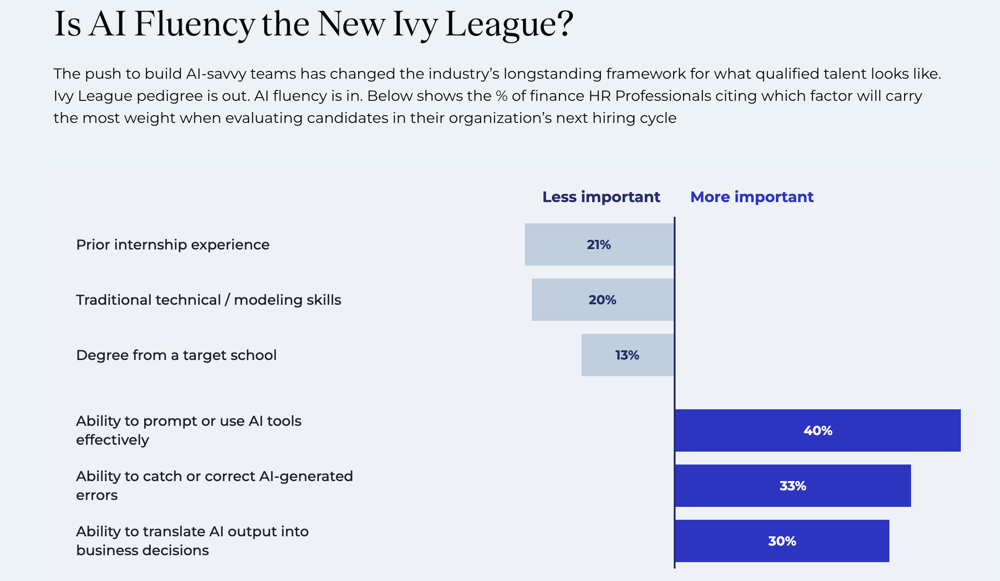
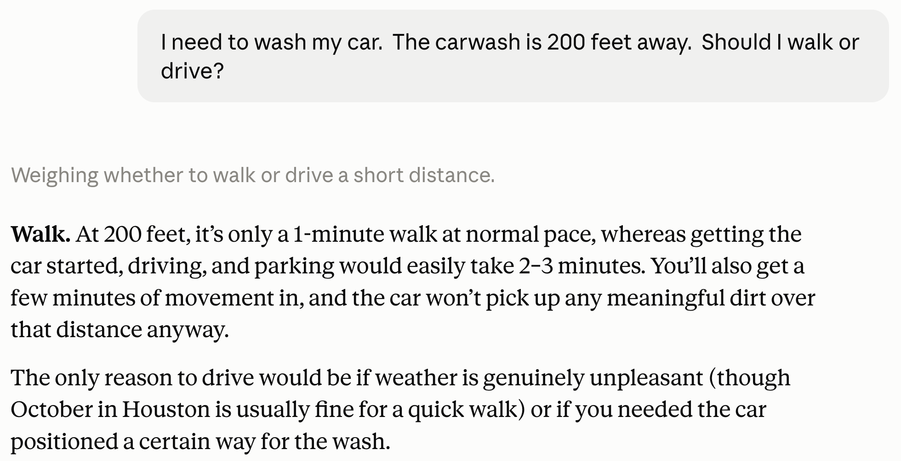
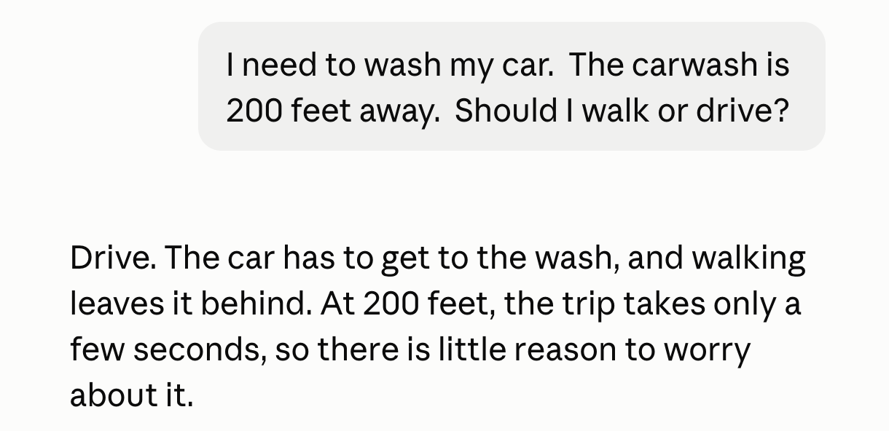
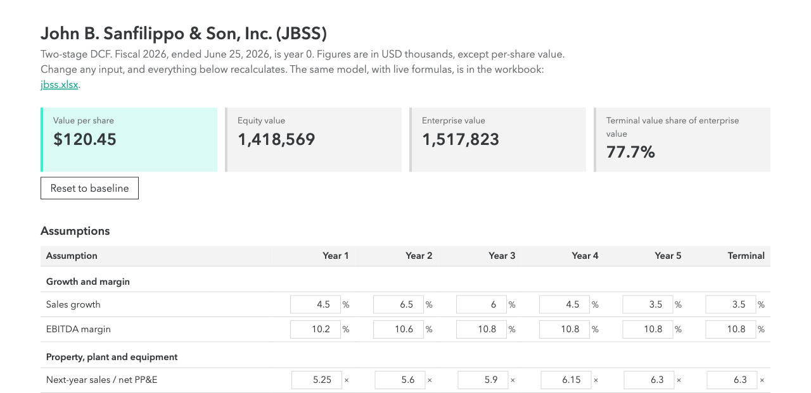
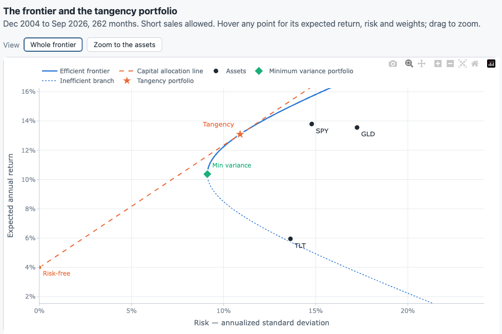

## Pillars of a finance education

```{=html}
<svg viewBox="0 0 1080 520" style="width:1000px; max-width:100%; display:block; margin:0.4em auto 0 auto; font-family:inherit;" xmlns="http://www.w3.org/2000/svg">
<polygon points="130,92 540,12 950,92" fill="#36393B"/>
<rect x="130" y="96" width="820" height="36" fill="#36393B"/>
<rect x="142" y="136" width="236" height="16" fill="#36393B"/>
<polygon points="142,152 378,152 360,172 160,172" fill="#36393B"/>
<rect x="160" y="172" width="200" height="274" fill="#E7E4E6"/>
<line x1="185" y1="182" x2="185" y2="242" stroke="#c9c5c8" stroke-width="5" stroke-linecap="round"/>
<line x1="185" y1="376" x2="185" y2="436" stroke="#c9c5c8" stroke-width="5" stroke-linecap="round"/>
<line x1="215" y1="182" x2="215" y2="242" stroke="#c9c5c8" stroke-width="5" stroke-linecap="round"/>
<line x1="215" y1="376" x2="215" y2="436" stroke="#c9c5c8" stroke-width="5" stroke-linecap="round"/>
<line x1="245" y1="182" x2="245" y2="242" stroke="#c9c5c8" stroke-width="5" stroke-linecap="round"/>
<line x1="245" y1="376" x2="245" y2="436" stroke="#c9c5c8" stroke-width="5" stroke-linecap="round"/>
<line x1="275" y1="182" x2="275" y2="242" stroke="#c9c5c8" stroke-width="5" stroke-linecap="round"/>
<line x1="275" y1="376" x2="275" y2="436" stroke="#c9c5c8" stroke-width="5" stroke-linecap="round"/>
<line x1="305" y1="182" x2="305" y2="242" stroke="#c9c5c8" stroke-width="5" stroke-linecap="round"/>
<line x1="305" y1="376" x2="305" y2="436" stroke="#c9c5c8" stroke-width="5" stroke-linecap="round"/>
<line x1="335" y1="182" x2="335" y2="242" stroke="#c9c5c8" stroke-width="5" stroke-linecap="round"/>
<line x1="335" y1="376" x2="335" y2="436" stroke="#c9c5c8" stroke-width="5" stroke-linecap="round"/>
<text x="260" y="300" font-size="30" font-weight="700" fill="#36393B" text-anchor="middle">Strong</text>
<text x="260" y="338" font-size="30" font-weight="700" fill="#36393B" text-anchor="middle">fundamentals</text>
<rect x="142" y="446" width="236" height="16" fill="#36393B"/>
<rect x="422" y="136" width="236" height="16" fill="#36393B"/>
<polygon points="422,152 658,152 640,172 440,172" fill="#36393B"/>
<rect x="440" y="172" width="200" height="274" fill="#E7E4E6"/>
<line x1="465" y1="182" x2="465" y2="242" stroke="#c9c5c8" stroke-width="5" stroke-linecap="round"/>
<line x1="465" y1="376" x2="465" y2="436" stroke="#c9c5c8" stroke-width="5" stroke-linecap="round"/>
<line x1="495" y1="182" x2="495" y2="242" stroke="#c9c5c8" stroke-width="5" stroke-linecap="round"/>
<line x1="495" y1="376" x2="495" y2="436" stroke="#c9c5c8" stroke-width="5" stroke-linecap="round"/>
<line x1="525" y1="182" x2="525" y2="242" stroke="#c9c5c8" stroke-width="5" stroke-linecap="round"/>
<line x1="525" y1="376" x2="525" y2="436" stroke="#c9c5c8" stroke-width="5" stroke-linecap="round"/>
<line x1="555" y1="182" x2="555" y2="242" stroke="#c9c5c8" stroke-width="5" stroke-linecap="round"/>
<line x1="555" y1="376" x2="555" y2="436" stroke="#c9c5c8" stroke-width="5" stroke-linecap="round"/>
<line x1="585" y1="182" x2="585" y2="242" stroke="#c9c5c8" stroke-width="5" stroke-linecap="round"/>
<line x1="585" y1="376" x2="585" y2="436" stroke="#c9c5c8" stroke-width="5" stroke-linecap="round"/>
<line x1="615" y1="182" x2="615" y2="242" stroke="#c9c5c8" stroke-width="5" stroke-linecap="round"/>
<line x1="615" y1="376" x2="615" y2="436" stroke="#c9c5c8" stroke-width="5" stroke-linecap="round"/>
<text x="540" y="300" font-size="30" font-weight="700" fill="#36393B" text-anchor="middle">Critical</text>
<text x="540" y="338" font-size="30" font-weight="700" fill="#36393B" text-anchor="middle">thinking</text>
<rect x="422" y="446" width="236" height="16" fill="#36393B"/>
<rect x="702" y="136" width="236" height="16" fill="#36393B"/>
<polygon points="702,152 938,152 920,172 720,172" fill="#36393B"/>
<rect x="720" y="172" width="200" height="274" fill="#E7E4E6"/>
<line x1="745" y1="182" x2="745" y2="242" stroke="#c9c5c8" stroke-width="5" stroke-linecap="round"/>
<line x1="745" y1="376" x2="745" y2="436" stroke="#c9c5c8" stroke-width="5" stroke-linecap="round"/>
<line x1="775" y1="182" x2="775" y2="242" stroke="#c9c5c8" stroke-width="5" stroke-linecap="round"/>
<line x1="775" y1="376" x2="775" y2="436" stroke="#c9c5c8" stroke-width="5" stroke-linecap="round"/>
<line x1="805" y1="182" x2="805" y2="242" stroke="#c9c5c8" stroke-width="5" stroke-linecap="round"/>
<line x1="805" y1="376" x2="805" y2="436" stroke="#c9c5c8" stroke-width="5" stroke-linecap="round"/>
<line x1="835" y1="182" x2="835" y2="242" stroke="#c9c5c8" stroke-width="5" stroke-linecap="round"/>
<line x1="835" y1="376" x2="835" y2="436" stroke="#c9c5c8" stroke-width="5" stroke-linecap="round"/>
<line x1="865" y1="182" x2="865" y2="242" stroke="#c9c5c8" stroke-width="5" stroke-linecap="round"/>
<line x1="865" y1="376" x2="865" y2="436" stroke="#c9c5c8" stroke-width="5" stroke-linecap="round"/>
<line x1="895" y1="182" x2="895" y2="242" stroke="#c9c5c8" stroke-width="5" stroke-linecap="round"/>
<line x1="895" y1="376" x2="895" y2="436" stroke="#c9c5c8" stroke-width="5" stroke-linecap="round"/>
<text x="820" y="300" font-size="30" font-weight="700" fill="#36393B" text-anchor="middle">AI</text>
<text x="820" y="338" font-size="30" font-weight="700" fill="#36393B" text-anchor="middle">expertise</text>
<rect x="702" y="446" width="236" height="16" fill="#36393B"/>
<rect x="110" y="466" width="860" height="20" fill="#36393B"/>
<rect x="90" y="490" width="900" height="22" fill="#36393B"/>
</svg>
```

## Open questions

::: {.steps style="font-size: 1.3em; line-height: 1.5;"}
1. We can now go faster (and deeper). How much faster?
2. How much Excel?
3. How much Python?
:::

## How much Excel?

::: {style="font-size: 1.4em; margin-top: 0.6em; line-height: 1.45;"}
- Arrow keys, sum, average, stdev, correl, ...
- The value of Excel now is to check AI's answers.
- Example: [tangency.kerryback.com](https://tangency.kerryback.com)
:::

## How much Python?

::: {style="font-size: 1.4em; margin-top: 0.6em; line-height: 1.45;"}
- Types, if-else, loops, functions, objects, methods, basic pandas and numpy, what's in what library.
- Little need for Jupyter notebooks.
- Work interactively with AI instead.
:::

## AI and coding

::: {style="font-size: 1.1em;"}
::: {.cards .cards-3}
::: {.card}
[October 2025]{.card-title}

"They just don't work. They don't have enough intelligence ... I feel like the industry is making too big of a jump and is trying to pretend like this is amazing, and it's not. It's slop."
:::

::: {.card .card-blue .fragment}
[January 2026]{.card-title}

"I really am mostly programming in English now, a bit sheepishly telling the LLM what code to write... in words."
:::

::: {.card .fragment}
[February–March 2026]{.card-title}

"It is hard to communicate how much programming has changed due to AI in the last 2 months ... Coding agents basically didn't work before December ... I don't think I've typed like a line of code probably since December."
:::
:::
:::

[Andrej Karpathy: OpenAI co-founder, former Tesla AI chief, now at Anthropic]{.eyebrow}

## New student deliverables

::: {style="font-size: 1.4em; margin-top: 0.6em; line-height: 1.45;"}
- Software apps
- Skills
- Custom agents
:::

## Data {.divider}

MCP servers connect students' agents to data

## What an MCP server is

```{=html}
<svg viewBox="0 0 1100 420" role="img" aria-label="The user talks to the harness. The harness talks to the model and to the MCP server. The MCP server talks to the data."
     style="display:block;margin:0.2em auto 0 auto;width:1040px;max-width:100%"
     font-family="'Avenir Next LT Pro','Avenir Next','Nunito Sans',system-ui,sans-serif">
  <defs>
    <marker id="mcpd-arrow" viewBox="0 0 10 10" refX="9" refY="5" markerWidth="7" markerHeight="7" orient="auto-start-reverse">
      <path d="M0 0 L10 5 L0 10 z" fill="#6b6e71"/>
    </marker>
  </defs>
  <g stroke="#6b6e71" stroke-width="3" fill="none" marker-end="url(#mcpd-arrow)">
    <path d="M180 70 H388"/>
    <path d="M390 100 H182"/>
    <path d="M570 70 H878"/>
    <path d="M880 100 H572"/>
    <path d="M450 130 V298"/>
    <path d="M510 300 V132"/>
    <path d="M570 330 H878"/>
    <path d="M880 360 H572"/>
  </g>
  <g font-size="17" fill="#36393B">
    <text x="285" y="58" text-anchor="middle">prompt</text>
    <text x="285" y="124" text-anchor="middle">answer</text>
    <text x="725" y="58" text-anchor="middle">messages + tool descriptions</text>
    <text x="725" y="124" text-anchor="middle">text or tool call</text>
    <text x="436" y="220" text-anchor="end">tool call</text>
    <text x="524" y="208">tool descriptions,</text>
    <text x="524" y="232">tool results</text>
    <text x="725" y="318" text-anchor="middle">API call or query</text>
    <text x="725" y="384" text-anchor="middle">data</text>
  </g>
  <rect x="20" y="40" width="160" height="90" fill="#36393B"/>
  <rect x="390" y="40" width="180" height="90" fill="#36393B"/>
  <rect x="880" y="40" width="180" height="90" fill="#36393B"/>
  <rect x="390" y="300" width="180" height="90" fill="#3AEFCC"/>
  <rect x="880" y="300" width="180" height="90" fill="#36393B"/>
  <g text-anchor="middle" font-size="24" font-weight="700" letter-spacing="1" fill="#ffffff">
    <text x="100" y="94">User</text>
    <text x="480" y="80">Harness</text>
    <text x="970" y="80">Model</text>
    <text x="480" y="340" fill="#36393B">MCP server</text>
    <text x="970" y="340">Data</text>
  </g>
  <g text-anchor="middle" font-size="15" fill="#ffffff">
    <text x="480" y="108">Claude Code, ChatGPT</text>
    <text x="970" y="108">Opus, GPT, DeepSeek</text>
    <text x="480" y="368" fill="#36393B">exposes tools</text>
    <text x="970" y="368">or an external service</text>
  </g>
</svg>
```

## What "exposes tools" means

::: {style="font-size: 1.1em; line-height: 1.4;"}
- The server gives the harness a text description of each tool: name, purpose, and inputs.
- The harness sends the descriptions to the model with each request.
- The model returns a tool call. The harness sends it to the server, and the server runs the tool.
:::

```json
{
  "name": "french_dataset",
  "description": "One table of a Ken French dataset as CSV. Returns are in decimals.",
  "inputSchema": {
    "type": "object",
    "properties": {"name": {"type": "string"}, "table": {"type": "integer", "default": 0}},
    "required": ["name"]
  }
}
```

## End-of-day prices {.shrink}

| Server | Free coverage | Additional paid coverage | Hosted or local |
|---|---|---|---|
| [Shibui](https://shibui.finance/guide-best-mcp-server-stock-data) | US (NYSE, NASDAQ), 64 years; no key; fair-use limits | None listed | Hosted |
| [Equibles](https://github.com/daniel3303/stock-market-mcp-server) | US daily bars; 100 requests/day | 10,000 or 100,000 requests/day | Hosted; local |
| [MaverickMCP](https://github.com/wshobson/maverick-mcp) | Global, through Yahoo; no key | None | Local |
| [EODHD](https://eodhd.com/financial-apis/mcp-server-for-financial-data-by-eodhd) | 20 calls/day; limited data | All exchanges, \$19.99/mo | Hosted |
| [Alpha Vantage](https://www.alphavantage.co/premium/) | 25 requests/day | 75 requests/min, \$49.99/mo | Hosted; local |
| [FMP](https://site.financialmodelingprep.com/) | 250 calls/day; end-of-day only | Global by plan, from \$29/mo | Hosted (sources disagree) |
| [Massive](https://github.com/massive-com/mcp_massive) | US; 5 calls/min; 2 years | 20+ years, \$199/mo | Local; needs key |
: {tbl-colwidths="[18,38,26,18]"}

[Vendor pages and comparison pages, November 1, 2026. Not tested.]{.eyebrow}

## Intraday and real-time prices {.shrink}

| Server | Free coverage | Additional paid coverage | Hosted or local |
|---|---|---|---|
| [tradingview-mcp](https://github.com/atilaahmettaner/tradingview-mcp) | Live data and technicals; no key | Hosted, \$9 or \$29/mo | Local; hosted is paid |
| [Mcprice](https://mcpmarket.com/server/mcprice) | Live stocks and ETFs (Yahoo), crypto (Binance); no key | None listed | Not confirmed |
| [Alpha Vantage](https://www.alphavantage.co/premium/) | Delayed; 25 requests/day | 15-minute delay from \$49.99/mo; real time from \$99.99/mo | Hosted; local |
| [EODHD](https://eodhd.com/financial-apis/mcp-server-for-financial-data-by-eodhd) | Not in the free plan as far as listed | End-of-day plus intraday, \$29.99/mo | Hosted |
| [Equibles](https://github.com/daniel3303/stock-market-mcp-server) | None | Quotes delayed 15 minutes on Plus | Hosted only |
| [Massive](https://github.com/massive-com/mcp_massive) | None; free plan is end-of-day | Real time and ticks from \$199/mo | Local; needs key |
: {tbl-colwidths="[18,38,26,18]"}

[Vendor pages and comparison pages, November 1, 2026. Not tested.]{.eyebrow}

## Statements and fundamentals {.shrink}

| Server | Free coverage | Additional paid coverage | Hosted or local |
|---|---|---|---|
| [Shibui](https://shibui.finance/guide-best-mcp-server-stock-data) | US statements, 35+ years; daily valuations; no key | None listed | Hosted |
| [Equibles](https://github.com/daniel3303/stock-market-mcp-server) | US fundamentals; 100 requests/day | Higher limits; multiples and screener are hosted only | Hosted; local |
| [FMP](https://site.financialmodelingprep.com/) | Statements and ratios, 30+ years on major names; 250 calls/day | Global by plan, from \$29/mo | Hosted (sources disagree) |
| [EODHD](https://eodhd.com/financial-apis/mcp-server-for-financial-data-by-eodhd) | Limited data; 20 calls/day | Fundamentals, \$59.99/mo | Hosted |
| [Alpha Vantage](https://www.alphavantage.co/premium/) | Basic fundamentals; 25 requests/day | Higher limits, \$49.99/mo | Hosted; local |
| [sec-edgar-mcp](https://github.com/stefanoamorelli/sec-edgar-mcp) | XBRL statements with SEC links; no key | None | Local |
| [edgar-mcp](https://github.com/danishashko/edgar-mcp) | XBRL highlights: revenue, net income, assets, EPS; no key | None | Local |
| [MaverickMCP](https://github.com/wshobson/maverick-mcp) | Fundamentals through Yahoo; no key | None | Local |
: {tbl-colwidths="[18,38,26,18]"}

[Vendor pages and comparison pages, November 1, 2026. Not tested.]{.eyebrow}

## SEC filings and earnings calls {.shrink}

| Server | Free coverage | Additional paid coverage | Hosted or local |
|---|---|---|---|
| [Shibui](https://shibui.finance/guide-best-mcp-server-stock-data) | 6.4 million filing records, 10,000+ companies; no key | None listed | Hosted |
| [Equibles](https://github.com/daniel3303/stock-market-mcp-server) | Filings; 100 requests/day | Higher limits; earnings calls and guidance are hosted only | Hosted; local |
| [edgar-mcp](https://github.com/danishashko/edgar-mcp) | 10-K, 10-Q, 8-K; full-text search of about 10 years; no key | None | Local |
| [sec-edgar-mcp](https://github.com/stefanoamorelli/sec-edgar-mcp) | Filings with SEC links; no key | None | Local |
| [FMP](https://site.financialmodelingprep.com/) | SEC filings; 250 calls/day | From \$29/mo | Hosted (sources disagree) |
: {tbl-colwidths="[18,38,26,18]"}

[Vendor pages and comparison pages, November 1, 2026. Not tested.]{.eyebrow}

## Insider trades and holdings {.shrink}

| Server | Free coverage | Additional paid coverage | Hosted or local |
|---|---|---|---|
| [Equibles](https://github.com/daniel3303/stock-market-mcp-server) | 13F, insider, congressional, and short data; 100 requests/day | 10,000 or 100,000 requests/day | Hosted; local |
| [sec-edgar-mcp](https://github.com/stefanoamorelli/sec-edgar-mcp) | Forms 3, 4, and 5; no key | None | Local |
| [Finnhub](https://finnhub.io/) | Insider transactions, earnings surprises, news sentiment; about 60 calls/min | Price not confirmed | Sources disagree |
: {tbl-colwidths="[18,38,26,18]"}

[Vendor pages and comparison pages, November 1, 2026. Not tested.]{.eyebrow}

## Options {.shrink}

| Server | Free coverage | Additional paid coverage | Hosted or local |
|---|---|---|---|
| [triplom](https://github.com/triplom/financial-mcp-server) | Chains with Greeks, through Yahoo; no key for this data | None | Local; setup asks for a FRED key |
| [Equibles](https://github.com/daniel3303/stock-market-mcp-server) | None | Delayed chains with implied volatility and Greeks on Plus | Hosted only |
| [Massive](https://github.com/massive-com/mcp_massive) | None | Options prices without Greeks; price not confirmed | Local; needs key |
| [Alpha Vantage](https://www.alphavantage.co/premium/) | Not confirmed | Options; plan not confirmed | Hosted; local |
| [EODHD](https://eodhd.com/financial-apis/mcp-server-for-financial-data-by-eodhd) | Not confirmed | End-of-day options; plan not confirmed | Hosted |
: {tbl-colwidths="[18,38,26,18]"}

[Vendor pages and comparison pages, November 1, 2026. Not tested.]{.eyebrow}

## Factors, macro, and energy {.shrink}

| Server | Free coverage | Additional paid coverage | Hosted or local |
|---|---|---|---|
| [Equibles](https://github.com/daniel3303/stock-market-mcp-server) | FRED, CFTC, and CBOE data; 100 requests/day | 10,000 or 100,000 requests/day | Hosted; local |
| [Alpha Vantage](https://www.alphavantage.co/premium/) | Macro series; 25 requests/day | Higher limits, \$49.99/mo | Hosted; local |
| [triplom](https://github.com/triplom/financial-mcp-server) | FRED, with a free FRED key | None | Local |
| [EIA server](https://github.com/cyanheads/eia-energy-mcp-server) | All of EIA's API v2; no key | None | Hosted; local |
: {tbl-colwidths="[18,38,26,18]"}

[Vendor pages and comparison pages, November 1, 2026. Not tested.]{.eyebrow}

## European equities {.shrink}

| Server | Free coverage | Additional paid coverage | Hosted or local |
|---|---|---|---|
| [tradingview-mcp](https://github.com/atilaahmettaner/tradingview-mcp) | Prices, screens, and technicals: Euronext, LSE, Xetra, Milan, SIX, Madrid | Hosted, \$9 or \$29/mo | Local; hosted is paid |
| [EODHD](https://eodhd.com/financial-apis/mcp-server-for-financial-data-by-eodhd) | 20 calls/day; limited data | Prices \$19.99/mo; fundamentals \$59.99/mo | Hosted |
| [Equibles](https://github.com/daniel3303/stock-market-mcp-server) | Director trades, fund holdings, and short positions; 100 requests/day | 10,000 or 100,000 requests/day | Hosted |
| [esef-filings](https://glama.ai/mcp/servers/pipeworx-io/mcp-esef-filings) | Annual IFRS facts from filings.xbrl.org; no key | None | Not confirmed |
| [eu-filings](https://github.com/openpharma-org/eu-filings-mcp-server) | ESEF filings for FR, DK, GB, LT, UA; GLEIF; no key | None | Local |
| [Finance Database](https://www.jeroenbouma.com/projects/financedatabase/mcp) | 300,000+ symbols; no prices or statements; no key | None | Hosted; local |
| [RegistrumUK](https://github.com/RegistrumUK/uk-companies-house-mcp) | UK Companies House; small daily caps, then a free key | Volume plans; price not confirmed | Hosted |
: {tbl-colwidths="[18,38,26,18]"}

[Vendor pages and comparison pages, November 1, 2026. Not tested.]{.eyebrow}

## Creating an MCP server

- AI can write MCP servers for us.
- Each tool is a function. It can call a web API or a Python library: yfinance for Yahoo Finance and pandas-datareader for French's data library.

```
@mcp.tool()
def french_dataset(name: str, table: int = 0) -> str:
    """One table of a Ken French dataset as CSV. Returns are in decimals."""
    data = web.DataReader(name, "famafrench", start="1900-01-01")
    return (data[table] / 100).to_csv()
```

::: {.note}
The docstring and type hints become the tool description on the earlier slide.
:::

## Local or cloud deployment

| | Local | Cloud |
|---|---|---|
| Runs on | Each student's machine | A server we deploy |
| Students connect with | An install and a config entry | A URL |
| API keys | On each student's machine | On the server; students need none |
| Harnesses | Those on the student's machine | Those, plus web apps such as claude.ai |
| Updates | Each student reinstalls | We redeploy once |
| Cost | None | Hosting |
: {tbl-colwidths="[24,38,38]"}

::: {.note}
Cloud example: [eia.kerryback.com/mcp](https://eia.kerryback.com/mcp). It uses the EIA API, and the server holds the API key. Electricity, petroleum, natural gas, coal, renewables, and EIA's forecasts.
:::

## What employers want {.divider}

Job postings, a hiring survey, and JP Morgan

## Job postings: internships and early career

| Phrase | Posting |
|---|---|
| "AI tools in your work or school projects" | [PIMCO, 2027 summer intern, Munich](https://pimco.wd1.myworkdayjobs.com/en-US/pimco-careers/job/Munich-DEU/XMLNAME-2027-Summer-Intern---Account-Analyst--Munich---German-Speaking_R106801) |
| "hands-on experience with AI-powered tools from day one" | [PIMCO, 2027 summer intern, Munich](https://pimco.wd1.myworkdayjobs.com/en-US/pimco-careers/job/Munich-DEU/XMLNAME-2027-Summer-Intern---Account-Analyst--Munich---German-Speaking_R106801) |
| "sound judgement in technology-enabled decision making" | [BlackRock, 2027 quantitative masters intern, London](https://careers.blackrock.com/job/london/2027-quantitative-masters-internship-programme-investments-quantitative-investing-london/45831/100661849296) |
| "proactive about using AI where possible" | [RA Capital, junior associate, Boston](https://job-boards.greenhouse.io/racapitalmanagementllc/jobs/5216500008) |
| "AI-forward people" | [RA Capital, healthcare associate, Boston](https://job-boards.greenhouse.io/racapitalmanagementllc/jobs/4565087008) |
| "AI tools to systematize workflows and models" | [Ares, analyst, New York](https://aresmgmt.wd1.myworkdayjobs.com/en-US/External/job/New-York-NY/Analyst--Multi-Asset-Portfolio-Solutions--MAPS-_R8239) |

[Job postings, checked October 31, 2026]{.eyebrow}

## Job postings: building tools

| Phrase | Posting |
|---|---|
| "leveraging tools like Claude Code" | [D. E. Shaw, AI product analyst, Denver](https://www.deshaw.com/careers/Fundamental-Equities-AI-Product-Analyst-Denver-5656) |
| "custom prompts, skill libraries, and automated workflows" | [Schonfeld, AI strategy analyst, London](https://job-boards.greenhouse.io/schonfeld/jobs/8031499) |
| "It is a building role." | [Two Sigma, AI solutions developer, New York](https://careers.twosigma.com/careers/JobDetail/New-York-New-York-United-States-AI-Solutions-Developer/14102) |
| "the judgment to figure out what to build in the first place" | [Two Sigma, AI solutions developer, New York](https://careers.twosigma.com/careers/JobDetail/New-York-New-York-United-States-AI-Solutions-Developer/14102) |
| "converting complex workflows into logical, step-by-step tasks" | [T. Rowe Price, investment AI analyst, Baltimore and London](https://troweprice.wd5.myworkdayjobs.com/en-US/TRowePrice/details/Investment-AI-Solutions-Analyst_81557) |

[Job postings, checked October 31, 2026]{.eyebrow}

## Job postings: investment knowledge

| Phrase | Posting |
|---|---|
| "Translate complex investment problems into structured AI workflows" | [T. Rowe Price, investment AI analyst](https://troweprice.wd5.myworkdayjobs.com/en-US/TRowePrice/details/Investment-AI-Solutions-Analyst_81557) |
| "Translate broad investment questions into testable data science workflows" | [Wellington, data science analyst, Boston](https://wellington.wd5.myworkdayjobs.com/External/job/Boston-MA-United-States/Data-Science-Analyst--Equity-Research--Healthcare-Team_R94455-2) |
| "not just a technical interest in the data itself" | [Wellington, data science analyst, Boston](https://wellington.wd5.myworkdayjobs.com/External/job/Boston-MA-United-States/Data-Science-Analyst--Equity-Research--Healthcare-Team_R94455-2) |
| "we will teach the domain to the right technical candidate" | [Schonfeld, AI strategy analyst, London](https://job-boards.greenhouse.io/schonfeld/jobs/8031499) |
| "both a hands-on technical builder and a strategic partner to investment professionals" | [Carlyle, AlpInvest engineer, New York](https://carlyle.wd1.myworkdayjobs.com/en-US/Carlyle/details/AlpInvest-Embedded-Data-Scientist_R-00227) |

[Job postings, checked October 31, 2026]{.eyebrow}

## Job postings: checking the output

| Phrase | Posting |
|---|---|
| "limitations, confidence levels, and interpretation risk" | [Wellington, data science analyst, Boston](https://wellington.wd5.myworkdayjobs.com/External/job/Boston-MA-United-States/Data-Science-Analyst--Equity-Research--Healthcare-Team_R94455-2) |
| "how these tools have evolved and where they break down" | [Two Sigma, AI solutions developer, New York](https://careers.twosigma.com/careers/JobDetail/New-York-New-York-United-States-AI-Solutions-Developer/14102) |
| "robust guardrails, compliance checks, and observability frameworks" | [T. Rowe Price, investment AI analyst](https://troweprice.wd5.myworkdayjobs.com/en-US/TRowePrice/details/Investment-AI-Solutions-Analyst_81557) |
| "evaluation, monitoring, and human-in-the-loop patterns" | [Carlyle, AlpInvest engineer, New York](https://carlyle.wd1.myworkdayjobs.com/en-US/Carlyle/details/AlpInvest-Embedded-Data-Scientist_R-00227) |
| "appropriate audit trails" | [Schonfeld, AI strategy analyst, London](https://job-boards.greenhouse.io/schonfeld/jobs/8031499) |
| "problems without clean labels" | [Point72, AI engineer, London (since closed; via AI Street)](https://www.ai-street.co/p/d-e-shaw-point72-and-ares-hire-to) |

[Job postings, checked October 31, 2026]{.eyebrow}

## {.no-title}

{height=520 fig-align="center"}

[[Selby Jennings: The AI Fluency Gap](https://www.selbyjennings.com/insights/ai-talent-pulse-report/). Research conducted by Censuswide, sample of 500 US HR Professionals in the finance industry in August, 2026.]{.eyebrow}

## From makers to checkers {.title-left}

> Waldron said that workers would shift from being creators of reports or software updates, or "makers" in his terminology, to "checkers" or managers of AI agents doing that work.

[[CNBC](https://www.cnbc.com/2025/09/30/jpmorgan-chase-fully-ai-connected-megabank.html) on JP Morgan Chief Analytics Officer Derek Waldron, September 30, 2025]{.eyebrow}

# Critical thinking {.pillar-section}

```{=html}
<svg viewBox="0 0 300 500" style="height:500px; display:block;" xmlns="http://www.w3.org/2000/svg" role="img" aria-label="Critical thinking">
<rect x="10" y="0" width="280" height="22" fill="#3AEFCC"/>
<polygon points="10,22 290,22 262,46 38,46" fill="#3AEFCC"/>
<rect x="40" y="46" width="220" height="382" fill="#E7E4E6"/>
<line x1="75" y1="60" x2="75" y2="140" stroke="#c9c5c8" stroke-width="6" stroke-linecap="round"/>
<line x1="75" y1="334" x2="75" y2="414" stroke="#c9c5c8" stroke-width="6" stroke-linecap="round"/>
<line x1="105" y1="60" x2="105" y2="140" stroke="#c9c5c8" stroke-width="6" stroke-linecap="round"/>
<line x1="105" y1="334" x2="105" y2="414" stroke="#c9c5c8" stroke-width="6" stroke-linecap="round"/>
<line x1="135" y1="60" x2="135" y2="140" stroke="#c9c5c8" stroke-width="6" stroke-linecap="round"/>
<line x1="135" y1="334" x2="135" y2="414" stroke="#c9c5c8" stroke-width="6" stroke-linecap="round"/>
<line x1="165" y1="60" x2="165" y2="140" stroke="#c9c5c8" stroke-width="6" stroke-linecap="round"/>
<line x1="165" y1="334" x2="165" y2="414" stroke="#c9c5c8" stroke-width="6" stroke-linecap="round"/>
<line x1="195" y1="60" x2="195" y2="140" stroke="#c9c5c8" stroke-width="6" stroke-linecap="round"/>
<line x1="195" y1="334" x2="195" y2="414" stroke="#c9c5c8" stroke-width="6" stroke-linecap="round"/>
<line x1="225" y1="60" x2="225" y2="140" stroke="#c9c5c8" stroke-width="6" stroke-linecap="round"/>
<line x1="225" y1="334" x2="225" y2="414" stroke="#c9c5c8" stroke-width="6" stroke-linecap="round"/>
<text x="150" y="228" font-size="29" font-weight="700" fill="#36393B" text-anchor="middle">Critical</text>
<text x="150" y="268" font-size="29" font-weight="700" fill="#36393B" text-anchor="middle">thinking</text>
<rect x="20" y="428" width="260" height="22" fill="#3AEFCC"/>
<rect x="0" y="454" width="300" height="26" fill="#3AEFCC"/>
</svg>
```

## Bank CEOs about AI {.compare}

:::: {.columns}
::: {.column width="50%"}
> I need human judgment, I need human decision making, I need human accountability at the core.

[HSBC CEO Georges Elhedery, [Bloomberg TV interview](https://www.bloomberg.com/news/videos/2026-06-08/hsbc-ceo-says-bank-still-needs-human-judgment-in-ai-era-video), June 8, 2026]{.eyebrow}
:::

::: {.column width="50%"}
> The goal is to remove the repetitive, administrative work so our people can focus on what they do best—we're not replacing critical thinking and judgment, we're removing the tedious, time-consuming work that gets in the way of it.

[Customers Bank CEO Sam Sidhu, statement to [Fortune](https://fortune.com/2026/04/28/ceo-of-customers-bank-sam-sidhu-ai-clone-lead-earnings-call-mark-zuckerberg-building-digital-twin/), April 28, 2026]{.eyebrow}
:::
::::

## Why AI is weaker on judgment calls

::: {style="font-size: 0.9em;"}
> The gulf between LLM performance on verifiable tasks vs. unverifiable tasks that require judgment is larger than most people realize. Verifiable tasks, like coding or solving math problems, have a right answer that can be checked automatically. Judgment tasks don't have unambiguous, ground-truth, correct answers. But they do have better and worse answers.
>
> ::: {style="background: #dafbf4; padding: 0.4em 0.6em 0.05em 0.6em; margin-left: -0.6em;"}
> We have much better techniques for training AI systems to do well on verifiable tasks. As a result, progress on performing such tasks has been much faster than for judgment tasks.
> :::
:::

[Andrew Ng, co-founder and former head of Google Brain, co-founder of Coursera and DeepLearning.AI · The Batch, October 16, 2026]{.eyebrow}

## An example of poor reasoning {.no-strip}

{height=440 fig-align="center"}

[Claude Haiku 4.5, an older version of Anthropic's smallest model, October 17, 2026]{.eyebrow style="text-align: center;"}

## Newer models are better {.no-strip}

{height=360 fig-align="center"}

[Claude Haiku 5.5, October 17, 2026]{.eyebrow style="text-align: center;"}

## Anthropic experiment

::: {.steps}
1. 50 causal-inference practitioners analyze observational data on a fictional farm-advisory program, working with Claude Code (Opus 4.8), and recommend roll out or discontinue.
2. Four analytical decisions (productivity measure, identification strategy, estimand, weighting) and the final recommendation each have two defensible options.
3. For each decision, a coin flip sets which option the agent leans toward. A hidden system prompt tells the agent to hold that lean strongly and voice it.
4. The agent makes the best honest case for its lean. Participants can choose any option.
:::

::: {.footnote}
Herdağdelen, Joren and Tamkin (2026), "Who's Aligned to Whom? How AI Agents Shape Experts' Research Judgment Calls," Anthropic.
:::

## Results

::: {.stats}
::: {.stat}
[86%]{.stat-value}
[of analytical decisions went with the agent's lean (50% by chance)]{.stat-label}
:::
::: {.stat}
[77%]{.stat-value}
[repeated the agent's talking points]{.stat-label}
:::
::: {.stat}
[15%]{.stat-value}
[mentioned the agent]{.stat-label}
:::
:::

::: {style="font-size: 0.85em;"}
- The four analytical leans alone predicted 82% of final recommendations, against a 61% baseline (exploratory).
- The agent's lean on the final recommendation moved it 17% of the way from discontinue to roll out (one-sided p = 0.07).
- Participants who took a side and then heard the agent lean the other way switched 60% of the time.
- More than half rated the recommendation as more their own than the agent's.
:::

::: {.footnote}
Herdağdelen, Joren and Tamkin (2026), "Who's Aligned to Whom? How AI Agents Shape Experts' Research Judgment Calls," Anthropic.
:::

## What doesn't affect reliance on AI

- An AI writing assistant (GPT-3.5 and GPT-4) offered autocomplete suggestions with a set position on societal issues.
- 2,582 participants. Their attitudes shifted toward the assistant's position.
- Warning participants about the bias, before or after writing, did not reduce the shift.

::: {.footnote}
Williams-Ceci et al. (2026), "Biased AI Writing Assistants Shift Users' Attitudes on Societal Issues," Science Advances.
:::

## What does affect reliance on AI

::: {style="font-size: 0.8em;"}
| What the LLM did | Study | Finding |
|---|---|---|
| Stated uncertainty in the first person ("I'm not sure, but...") | Kim et al. (2024), 404 participants, medical questions | Agreed with the LLM less and answered more accurately |
| Cited sources | Kim et al. (2025), 308 participants | Relied less on incorrect answers |
| Explained its answer | Kim et al. (2025), 308 participants | Relied more on both correct and incorrect answers |
| Added a disclaimer, highlighted uncertain words, or implied the answer without stating it | Bo, Wan and Anderson (2025), 400 participants | Relied less on wrong answers, but also less on right ones |
:::

::: {.footnote}
All three studies use questions with a correct answer.
:::

## A possible CLAUDE.md section

```
## Judgment calls

A judgment call is a decision with more than one defensible answer:
a method, an assumption, an interpretation, or a recommendation.

1. When you reach a judgment call, run each option and check
   whether the result changes.
2. If the result changes, stop and name the judgment call.
   Make the best case for each option, with equal effort.
   Refuse to do more than that. Do not recommend a choice.
3. If the result does not change, list the judgment call
   at the end of your answer.
```

## AI can facilitate teaching critical thinking

::: {style="font-size: 1.2em; margin-top: 0.4em;"}
- People must make the decisions, but AI should be used to provide the information needed to make them.
- We can model this in the classroom. Use AI tools to gather information, do standard calculations, and assemble the information in a useful format. Then focus on making judgments where there is ambiguity.
- Example (automate the repetitive stuff): [kerryback.com/aapl.html](https://kerryback.com/aapl.html)
:::

::: {.notes}
Check on status of `/mydcf {ticker}` at kerryback.com/{ticker}.html. If it failed, show kerryback.com/aapl.html. Before opening it, say that the 10% WACC is a placeholder, then change the WACC on the Baseline tab.
:::

## Excel {.divider}

HTML pages and workbooks

## AI outputs

::: {style="font-size: 1.4em; margin-top: 0.6em; line-height: 1.45;"}
- We should emphasize AI outputs.
- HTML is the most useful: easy to read, easy for AI to write, and interactive.
- Excel is a fallback to check the AI output.
:::

## Two-stage DCF: HTML page

{height=420 fig-align="center"}

[[Open the page](jbss.html). John B. Sanfilippo & Son, fiscal 2026 as year 0. Every input is editable.]{.eyebrow}

## Two-stage DCF: workbook {.shrink}

| Sheet | Contents |
|---|---|
| Inputs | The same inputs as the HTML page |
| Model | The forecast; every cell is a formula over Inputs |
| Bridge | Enterprise value to value per share |
| NOL schedule | Tax shield on the carryforward surviving year 6 |
| Sensitivity | Value per share by WACC and terminal growth; a snapshot |
| Drivers | How much each driver moves equity value; a snapshot |
| Historical | Historical driver ratios |
| Check | Compares formulas with the values from the script that wrote the file |
: {tbl-colwidths="[22,78]"}

[[Open the workbook](jbss.xlsx). 1,447 formula cells. Value per share is \$120.45 on the page and in the workbook.]{.eyebrow}

## Tangency portfolio

{height=430 fig-align="center"}

[[tangency.kerryback.com](https://tangency.kerryback.com). SPY, TLT, and GLD, December 2004 to September 2026. The page also gives the weights and a workbook to download.]{.eyebrow}

## Skills and plugins {.divider}

Examples from MGMT 638 and MGMT 803

## A skill is a folder

```
.claude/skills/dcf/
├── SKILL.md       a description, then the instructions
├── references/    the template, the issues
└── scripts/       code the agent can run
```

::: {.note}
At startup Claude reads each skill's description. When a task matches a skill, Claude reads that whole `SKILL.md` and follows it.
:::

## Creating a skill

::: {style="font-size: 1.4em; margin-top: 0.6em; line-height: 1.45;"}
- Work with AI until you get what you want.
- Tell AI to create a skill so you can get the same thing the next time.
- Give the skill a meaningful name.
- As you use it and find things to add or modify, tell AI to edit the skill.
:::

## Skills in MGMT 638

::: {style="font-size: 1.1em;"}
::: {.cards .cards-3}
::: {.card}
[Two-stage DCF]{.card-title}

Retrieve historical financials and generate a two-stage enterprise valuation.
:::

::: {.card .card-blue}
[Risk parity]{.card-title}

Solve for the weights. Then tell Claude to create a skill and save its code as a script that the skill uses.
:::

::: {.card}
[Session memory]{.card-title}

When a student says "we are wrapping up," write a dated memory file of under a page.
:::
:::
:::

## A student skill: Wolverine brief

::: {style="font-size: 1.4em; margin-top: 0.6em; line-height: 1.45;"}
- A script gets six trading days of SPY, IEF, UUP, GLD, and USO from Yahoo Finance.
- Claude writes 150–250 words in the voice of Wolverine.
- "Base every claim on the script's output."
- "Never invent or estimate numbers."
:::

[MGMT 803 student plugin]{.eyebrow}

## Plugins

::: {style="font-size: 1.4em; margin-top: 0.6em; line-height: 1.45;"}
- A plugin is a folder somebody else published.
- Installing it adds their work to your Claude.
:::

```
/plugin marketplace add kerryback/kerryback-public
/plugin install risk-parity@kerryback-public
/plugin install two-stage-dcf@kerryback-public
```

## The MGMT 803 class marketplace

| Plugin | What it does |
|---|---|
| job-scout | Scores current job postings against your resume |
| calendar-keeper | Plans your week across several Google calendars |
| wolverine-brief | Writes a weekly cross-asset market brief |
| sn-lab | Animates SN1 and SN2 reactions |
| piano-transcriber | Turns a song into piano sheet music |

::: {.note}
28 plugins, most built by the class: [github.com/kerryback/mgmt803-plugins](https://github.com/kerryback/mgmt803-plugins)
:::

## A marketplace is a GitHub repo

```
my-marketplace/
├── .claude-plugin/
│   └── marketplace.json       required: lists the plugins
└── plugins/
    └── my-plugin/
        ├── .claude-plugin/
        │   └── plugin.json    optional: version, author
        └── skills/
            └── my-skill/
                └── SKILL.md
```

::: {.note}
Claude Code finds plugins through `marketplace.json`, not through folder names.
:::

## The marketplace manifest

```json
{
  "name": "my-marketplace",
  "owner": { "name": "Kerry Back" },
  "plugins": [
    {
      "name": "my-plugin",
      "source": "./plugins/my-plugin",
      "description": "What the plugin does"
    }
  ]
}
```

```
claude plugin validate .
/plugin marketplace add owner/repo
/plugin install my-plugin@my-marketplace
```

## Today {.title-left}

::: {.plain style="font-size: 1.3em; line-height: 1.5;"}
- What firms ask for
- Teaching Finance
- Your courses
:::

## Accelerating the pace of work {.pull}

::: {style="font-size: 1.4em; line-height: 1.45;"}
HPE's finance agent, Alfred, removed about 90% of the manual work behind a weekly Monday review of more than 100 slides that took hundreds of hours to prepare.
:::

[Estimate by Gustav van der Westhuizen, COO, Hewlett Packard Enterprise, reported in [Fortune](https://fortune.com/2026/02/12/hpe-cfo-used-ai-transform-100-slide-monday-meeting/), February 12, 2026]{.eyebrow}

## The future of work

```{=html}
<svg viewBox="0 0 1080 440" style="width:1150px; max-width:100%; display:block; margin:1em auto 0 auto; font-family:inherit;" xmlns="http://www.w3.org/2000/svg">
<rect x="130" y="10" width="390" height="145" fill="#36393B"/>
<text x="325" y="94" font-size="34" font-weight="700" fill="#ffffff" text-anchor="middle">Manage AI</text>
<rect x="560" y="10" width="390" height="145" fill="#3AEFCC"/>
<text x="755" y="94" font-size="34" font-weight="700" fill="#36393B" text-anchor="middle">Take initiative</text>
<rect x="130" y="175" width="390" height="145" fill="#3AEFCC"/>
<text x="325" y="259" font-size="34" font-weight="700" fill="#36393B" text-anchor="middle">Manage people</text>
<rect x="560" y="175" width="390" height="145" fill="#36393B"/>
<text x="755" y="259" font-size="34" font-weight="700" fill="#ffffff" text-anchor="middle">Make judgment calls</text>
<rect x="130" y="340" width="820" height="90" fill="#E7E4E6"/>
<text x="540" y="396" font-size="34" font-weight="700" fill="#36393B" text-anchor="middle">Customer, client, supplier relationships</text>
</svg>
```

::: {.note .fragment style="margin-top: 0.8em;"}
A lot of this is traditionally senior work. Juniors need to be prepared to step up.
:::

## Teaching Finance {.divider}

Strong fundamentals, critical thinking, assessment

# Strong fundamentals {.pillar-section}

```{=html}
<svg viewBox="0 0 300 500" style="height:500px; display:block;" xmlns="http://www.w3.org/2000/svg" role="img" aria-label="Strong fundamentals">
<rect x="10" y="0" width="280" height="22" fill="#3AEFCC"/>
<polygon points="10,22 290,22 262,46 38,46" fill="#3AEFCC"/>
<rect x="40" y="46" width="220" height="382" fill="#E7E4E6"/>
<line x1="75" y1="60" x2="75" y2="140" stroke="#c9c5c8" stroke-width="6" stroke-linecap="round"/>
<line x1="75" y1="334" x2="75" y2="414" stroke="#c9c5c8" stroke-width="6" stroke-linecap="round"/>
<line x1="105" y1="60" x2="105" y2="140" stroke="#c9c5c8" stroke-width="6" stroke-linecap="round"/>
<line x1="105" y1="334" x2="105" y2="414" stroke="#c9c5c8" stroke-width="6" stroke-linecap="round"/>
<line x1="135" y1="60" x2="135" y2="140" stroke="#c9c5c8" stroke-width="6" stroke-linecap="round"/>
<line x1="135" y1="334" x2="135" y2="414" stroke="#c9c5c8" stroke-width="6" stroke-linecap="round"/>
<line x1="165" y1="60" x2="165" y2="140" stroke="#c9c5c8" stroke-width="6" stroke-linecap="round"/>
<line x1="165" y1="334" x2="165" y2="414" stroke="#c9c5c8" stroke-width="6" stroke-linecap="round"/>
<line x1="195" y1="60" x2="195" y2="140" stroke="#c9c5c8" stroke-width="6" stroke-linecap="round"/>
<line x1="195" y1="334" x2="195" y2="414" stroke="#c9c5c8" stroke-width="6" stroke-linecap="round"/>
<line x1="225" y1="60" x2="225" y2="140" stroke="#c9c5c8" stroke-width="6" stroke-linecap="round"/>
<line x1="225" y1="334" x2="225" y2="414" stroke="#c9c5c8" stroke-width="6" stroke-linecap="round"/>
<text x="150" y="228" font-size="29" font-weight="700" fill="#36393B" text-anchor="middle">Strong</text>
<text x="150" y="268" font-size="29" font-weight="700" fill="#36393B" text-anchor="middle">fundamentals</text>
<rect x="20" y="428" width="260" height="22" fill="#3AEFCC"/>
<rect x="0" y="454" width="300" height="26" fill="#3AEFCC"/>
</svg>
```

## AI can facilitate teaching fundamentals

::: {style="font-size: 1.2em; margin-top: 0.4em;"}
- We can spend less time on mechanics (e.g., Excel keystrokes) and more on concepts, keeping enough technique to check AI's work.
- Learning can be more hands-on. Students can prompt AI through the solution of real examples.
- We can be more ambitious. With concepts accelerated and better tools, we can go deeper.
- We can heighten interest and relevance by requiring AI or AI-built deliverables: apps, skills, and agents.
:::

## What moved in applied finance

::: {.cards .cards-3}
::: {.card .card-light}
[Less]{.card-title}

- Spreadsheet mechanics
- Hand calculation
- Supplying data to students
:::

::: {.card}
[The same]{.card-title}

- Incremental cash flows
- Free cash flow
- Valuation logic
- Cost of capital
- Mean-variance optimization
:::

::: {.card .card-dark}
[More]{.card-title}

- Simulation with correlated inputs
- Students' own filings and live data
- One company all term
- Checking AI output
:::
:::

[MGMT 648, Applied Finance, Rice, Fall 2026. Elective after core finance. Bonds and duration were planned and are not in the final schedule.]{.eyebrow}

## A session at the keyboard

::: {.steps style="font-size: 1.3em; line-height: 1.5;"}
1. Read the case. Ten minutes. AI allowed.
2. List each cash flow: when, and how much?
3. What did you assume?
4. Build it, with AI.
5. Screens up. Walk us through it.
:::

[MGMT 648, September 12. Five capital budgeting cases: Tannehill Precision, Kestrel Pet Nutrition, Kinnaird Mills, Halloran Dairy, Brannock Chemicals.]{.eyebrow}

## Exercise: have AI build it

::: {.steps}
1. Upload the class's DCF deck and ask for an Excel workbook containing the DCF model
2. Ask for an editable single-page HTML app that holds the model and explains it
:::

::: {.note}
Open the formulas in the workbook that comes back and check two things against
the class's deck: which year's free cash flow sits in the numerator of the terminal
value, and what exponent the terminal value is discounted at.
:::

[MGMT 648, October 1]{.eyebrow}

## Exercise: check the optimizer by hand

::: {.steps}
1. Ask AI for a general optimizer: N assets, a covariance matrix, GMV and tangency portfolios, short sales allowed or not.
2. Test it on two stocks, against the closed forms on paper.
3. Use it on twenty assets.
:::

GMV weight on stock 1:

$$w_1 = \frac{\sigma_2^2 - \sigma_{12}}{\sigma_1^2 + \sigma_2^2 - 2\sigma_{12}}$$

Tangency weight on stock 1, where $\mu_i$ is the risk premium of stock $i$:

$$w_1 = \frac{\mu_1\sigma_2^2 - \mu_2\sigma_{12}}{\mu_1\sigma_2^2 + \mu_2\sigma_1^2 - (\mu_1 + \mu_2)\sigma_{12}}$$

# Critical thinking {.pillar-section}

```{=html}
<svg viewBox="0 0 300 500" style="height:500px; display:block;" xmlns="http://www.w3.org/2000/svg" role="img" aria-label="Critical thinking">
<rect x="10" y="0" width="280" height="22" fill="#3AEFCC"/>
<polygon points="10,22 290,22 262,46 38,46" fill="#3AEFCC"/>
<rect x="40" y="46" width="220" height="382" fill="#E7E4E6"/>
<line x1="75" y1="60" x2="75" y2="140" stroke="#c9c5c8" stroke-width="6" stroke-linecap="round"/>
<line x1="75" y1="334" x2="75" y2="414" stroke="#c9c5c8" stroke-width="6" stroke-linecap="round"/>
<line x1="105" y1="60" x2="105" y2="140" stroke="#c9c5c8" stroke-width="6" stroke-linecap="round"/>
<line x1="105" y1="334" x2="105" y2="414" stroke="#c9c5c8" stroke-width="6" stroke-linecap="round"/>
<line x1="135" y1="60" x2="135" y2="140" stroke="#c9c5c8" stroke-width="6" stroke-linecap="round"/>
<line x1="135" y1="334" x2="135" y2="414" stroke="#c9c5c8" stroke-width="6" stroke-linecap="round"/>
<line x1="165" y1="60" x2="165" y2="140" stroke="#c9c5c8" stroke-width="6" stroke-linecap="round"/>
<line x1="165" y1="334" x2="165" y2="414" stroke="#c9c5c8" stroke-width="6" stroke-linecap="round"/>
<line x1="195" y1="60" x2="195" y2="140" stroke="#c9c5c8" stroke-width="6" stroke-linecap="round"/>
<line x1="195" y1="334" x2="195" y2="414" stroke="#c9c5c8" stroke-width="6" stroke-linecap="round"/>
<line x1="225" y1="60" x2="225" y2="140" stroke="#c9c5c8" stroke-width="6" stroke-linecap="round"/>
<line x1="225" y1="334" x2="225" y2="414" stroke="#c9c5c8" stroke-width="6" stroke-linecap="round"/>
<text x="150" y="228" font-size="29" font-weight="700" fill="#36393B" text-anchor="middle">Critical</text>
<text x="150" y="268" font-size="29" font-weight="700" fill="#36393B" text-anchor="middle">thinking</text>
<rect x="20" y="428" width="260" height="22" fill="#3AEFCC"/>
<rect x="0" y="454" width="300" height="26" fill="#3AEFCC"/>
</svg>
```

## Verifiable tasks and judgment tasks

::: {style="font-size: 0.9em;"}
> The gulf between LLM performance on verifiable tasks vs. unverifiable tasks that require judgment is larger than most people realize. Verifiable tasks, like coding or solving math problems, have a right answer that can be checked automatically. Judgment tasks don't have unambiguous, ground-truth, correct answers. But they do have better and worse answers.
>
> ::: {style="background: #dafbf4; padding: 0.4em 0.6em 0.05em 0.6em; margin-left: -0.6em;"}
> We have much better techniques for training AI systems to do well on verifiable tasks. As a result, progress on performing such tasks has been much faster than for judgment tasks.
> :::
:::

[Andrew Ng, co-founder and former head of Google Brain, co-founder of Coursera and DeepLearning.AI · The Batch, October 16, 2026]{.eyebrow}

## Anthropic experiment

::: {.steps}
1. 50 causal-inference practitioners analyze observational data on a fictional farm-advisory program, working with Claude Code (Opus 4.8), and recommend roll out or discontinue.
2. Four analytical decisions (productivity measure, identification strategy, estimand, weighting) and the final recommendation each have two defensible options.
3. For each decision, a coin flip sets which option the agent leans toward. A hidden system prompt tells the agent to hold that lean strongly and voice it.
4. The agent makes the best honest case for its lean. Participants can choose any option.
:::

::: {.footnote}
Herdağdelen, Joren and Tamkin (2026), "Who's Aligned to Whom? How AI Agents Shape Experts' Research Judgment Calls," Anthropic.
:::

## Results

::: {.stats}
::: {.stat}
[86%]{.stat-value}
[of analytical decisions went with the agent's lean (50% by chance)]{.stat-label}
:::
::: {.stat}
[77%]{.stat-value}
[repeated the agent's talking points]{.stat-label}
:::
::: {.stat}
[15%]{.stat-value}
[mentioned the agent]{.stat-label}
:::
:::

::: {style="font-size: 0.85em;"}
- Participants who took a side and then heard the agent lean the other way switched 60% of the time.
- More than half rated the recommendation as more their own than the agent's.
:::

::: {.footnote}
Herdağdelen, Joren and Tamkin (2026), "Who's Aligned to Whom? How AI Agents Shape Experts' Research Judgment Calls," Anthropic.
:::

## Warnings about bias

- An AI writing assistant (GPT-3.5 and GPT-4) offered autocomplete suggestions with a set position on societal issues.
- 2,582 participants. Their attitudes shifted toward the assistant's position.
- Warning participants about the bias, before or after writing, did not reduce the shift.

::: {.footnote}
Williams-Ceci et al. (2026), "Biased AI Writing Assistants Shift Users' Attitudes on Societal Issues," Science Advances.
:::

## Cognitive surrender {.pull}

::: {style="font-size: 1.4em; line-height: 1.45;"}
Man Group investment chief Greg Bond warned against "cognitive surrender," where people hand over their work to AI and stop paying attention.
:::

[Business Insider, reported in [AI Street](https://www.ai-street.co/p/bridgewater-citadel-and-man-group), October 29, 2026]{.eyebrow}

## Investor biases in 48 models

::: {.stats}
::: {.stat}
[+73%]{.stat-value}
[recommendations to continue losing positions when prior spending was mentioned]{.stat-label}
:::
::: {.stat}
[1.62]{.stat-value}
[points moved by framing, on a 10-point rating scale]{.stat-label}
:::
::: {.stat}
[11]{.stat-value}
[investor errors tested, 25 scenario pairs each]{.stat-label}
:::
:::

- More capable models resisted some framing effects but showed stronger sunk-cost distortions.
- Exercise: run a capital budgeting prompt with and without the sunk cost.

::: {.footnote}
Keshavarz, Seagraves and Sirmans (2025), "Artificially Biased Intelligence: Does AI Think Like a Human Investor?" Reported in [AI Street](https://www.ai-street.co/p/ai-replicates-human-investor-biases), March 11, 2026.
:::

## A possible CLAUDE.md section

```
## Judgment calls

A judgment call is a decision with more than one defensible answer:
a method, an assumption, an interpretation, or a recommendation.

1. When you reach a judgment call, run each option and check
   whether the result changes.
2. If the result changes, stop and name the judgment call.
   Make the best case for each option, with equal effort.
   Refuse to do more than that. Do not recommend a choice.
3. If the result does not change, list the judgment call
   at the end of your answer.
```

## Five betas

| Ticker | Beta | Standard error | $R^2$ |
|---|---|---|---|
| KO, Coca-Cola | 0.29 | 0.13 | 0.08 |
| WMT, Walmart | 0.57 | 0.15 | 0.20 |
| JPM, JPMorgan | 0.99 | 0.14 | 0.45 |
| PLTR, Palantir | 1.71 | 0.58 | 0.13 |
| NVDA, Nvidia | 2.17 | 0.30 | 0.48 |

::: {.note}
AI runs the regression. Students choose the window, the frequency, and the index, and defend the number.
:::

[MGMT 648, October 10. Sixty months to August 2026.]{.eyebrow}

## AI as devil's advocate {.compare}

:::: {.columns}
::: {.column width="50%"}
> MAIA now presents the argument to not do something, while the team that's sitting across from it is presenting why you should do something.

[Waleed al Muhairi, Mubadala, on its AI at the investment committee. Reported in [AI Street](https://www.ai-street.co/p/hidden-text-tricks-ai-trading-systems), February 5, 2026.]{.eyebrow}
:::

::: {.column width="50%"}
> Because the language model isn't part of the group, it doesn't develop the same blind spots.

[Ziang Fang, Man Group, in [AI Street](https://www.ai-street.co/p/inside-man-group-s-alphagpt), December 18, 2025.]{.eyebrow}
:::
::::

## AI can facilitate teaching critical thinking

::: {style="font-size: 1.2em; margin-top: 0.4em;"}
- People must make the decisions, but AI should be used to provide the information needed to make them.
- We can model this in the classroom. Use AI tools to gather information, do standard calculations, and assemble the information in a useful format. Then focus on making judgments where there is ambiguity.
- Example (automate the repetitive stuff): [kerryback.com/aapl.html](https://kerryback.com/aapl.html)
:::

# Assessment and class time {.photo-left .circle-top background-image="images/utah-abs-snowbird-gray.jpg" background-size="40.625% 100%" background-position="left"}

## Flipping the classroom

::: {style="font-size: 1.6em; margin-top: 0.6em; line-height: 1.5;"}
- We have to expect out-of-class assignments will be done by AI.
- Assessing in class by cold-calling remains viable.
- This suggests flipping the classroom: providing lectures beforehand and spending class time interacting (case-style teaching).
:::

## Grading in applied finance

| Component | Format |
|---|---|
| Work outside class | Not collected, not graded |
| Participation | Scored every session, including work at the keyboard |
| Investment recommendation | Pairs, 2 minutes, in person |
| Company valuation | Pairs, 8 minutes |
| Challenge | Another pair questions each presentation, graded separately |

[MGMT 648 syllabus, Fall 2026]{.eyebrow}

## Preparation for each session

::: {.steps style="font-size: 1.3em; line-height: 1.5;"}
1. Watch a video of about twelve minutes, or read its transcript.
2. Compute one number for your company or the case.
3. Arrive ready to defend the number and what it means.
4. The session opens with the range of numbers on screen.
:::

[MGMT 648 syllabus, Fall 2026. Preparation is not graded.]{.eyebrow}

## We should do even more cases

::: {style="font-size: 1.2em; margin-top: 0.4em;"}
- Students must be able to defend their work verbally. Show they understand fundamental concepts and can make defensible judgments.
- We can use AI to write cases.
- We can use AI to build classroom tools. Example: [screenshare.kerryback.com](https://screenshare.kerryback.com)
:::

## AI tutors

::: {style="font-size: 1.15em; margin-top: 0.4em;"}
::: {.cards .cards-2}
::: {.card}
[Worth piloting, with guardrails]{.card-title}

AI tutors for fundamental concepts: one-on-one instruction, asking questions, drilling with exercises, pushing back on answers.

Examples: [tutors.kerryback.com](https://tutors.kerryback.com)
:::

::: {.card .card-blue}
[Two studies]{.card-title}

Plain ChatGPT during practice lowered exam scores 17%; a tutor that withholds answers removed the loss (Bastani et al., PNAS 2025). An AI tutor used at home beat an active-learning class (Kestin et al., Scientific Reports 2025).
:::
:::
:::

# Your courses {.photo-left .circle-top background-image="images/utah-abs-little-cottonwood-gray.jpg" background-size="40.625% 100%" background-position="left"}

## {.no-title}

::: {.incremental style="font-size: 1.75em; margin-top: 1.6em; line-height: 1.4;"}
- AI fluency, fundamentals, and critical thinking are the pillars.
- People will always be important for managing AI, managing people, taking initiative, making judgment calls, and building relationships.
- But can people acquire the needed skills directly from AI, or at least with less classroom instruction than we now provide?
:::

## Decisions for a department

::: {.steps style="font-size: 1.3em; line-height: 1.5;"}
1. Where does AI go: inside each finance course, in a separate course, or both?
2. Which fundamentals must students be able to do by hand to catch AI errors?
3. Which topics come out to make room?
4. What assessment works at your class sizes?
5. What differs across core courses, an applied MSc, and the MSc in Quantitative Finance?
:::

## Exercise: one course you teach

::: {.steps style="font-size: 1.3em; line-height: 1.5;"}
1. Name the course.
2. Which graded work happens outside class?
3. Which topic gets less time, and which gets more?
4. Which judgment call will students defend live?
5. Which AI-built deliverable will students submit?
:::

::: {.note}
Twenty minutes in pairs, then report back.
:::

## Later sessions {.title-left}

::: {.plain style="font-size: 1.25em; line-height: 1.5;"}
- Teaching AI for Finance
- Vibe coding
- The new Beamer: Quarto, reveal.js, and decktape
- A class plugin marketplace
- AI tutors
- Custom agents
- Security risks and solutions
:::

## Questions? {.thanks background-image="images/data-center.jpg" background-size="auto 390px" background-position="top"}
