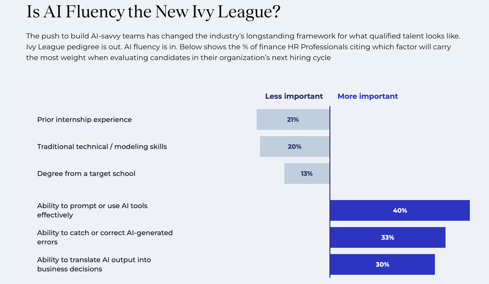
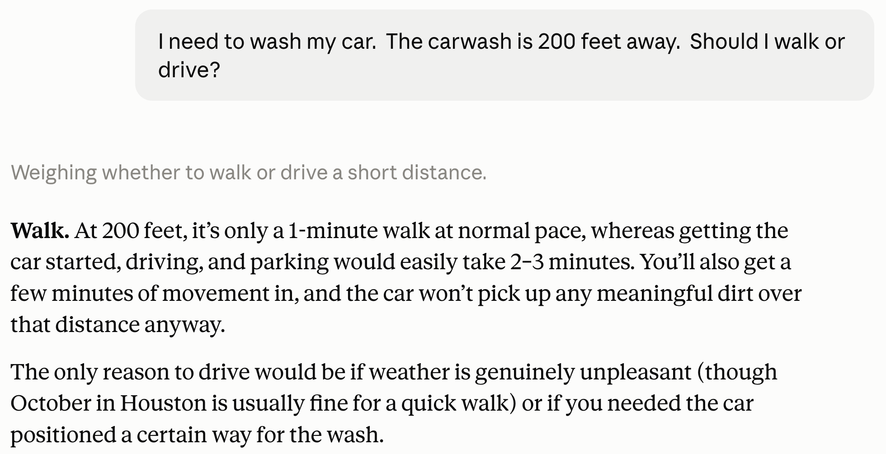

## Job postings: using AI

| Phrase | Posting | Experience |
|---|---|---|
| "AI tools in your work or school projects"<br>"hands-on experience with AI-powered tools from day one" | [PIMCO, 2027 summer intern, Munich](https://pimco.wd1.myworkdayjobs.com/en-US/pimco-careers/job/Munich-DEU/XMLNAME-2027-Summer-Intern---Account-Analyst--Munich---German-Speaking_R106801) | Intern |
| "sound judgement in technology-enabled decision making" | [BlackRock, 2027 quantitative masters intern, London](https://careers.blackrock.com/job/london/2027-quantitative-masters-internship-programme-investments-quantitative-investing-london/45831/100661849296) | Intern |
| "proactive about using AI where possible" | [RA Capital, junior associate, Boston](https://job-boards.greenhouse.io/racapitalmanagementllc/jobs/5216500008) | About 2 yrs |
| "AI-forward people" | [RA Capital, healthcare associate, Boston](https://job-boards.greenhouse.io/racapitalmanagementllc/jobs/4565087008) | 2-5 yrs; PhD or MD |
| "AI tools to systematize workflows and models" | [Ares, analyst, New York](https://aresmgmt.wd1.myworkdayjobs.com/en-US/External/job/New-York-NY/Analyst--Multi-Asset-Portfolio-Solutions--MAPS-_R8239) | 1-3 yrs |
| "Translate complex investment problems into structured AI workflows" | [T. Rowe Price, investment AI analyst](https://troweprice.wd5.myworkdayjobs.com/en-US/TRowePrice/details/Investment-AI-Solutions-Analyst_81557) | 5+ or 10+ yrs |
: {tbl-colwidths="[46,38,16]"}

[Job postings, checked October 31, 2026]{.eyebrow}

## Job postings: building tools

| Phrase | Posting | Experience |
|---|---|---|
| "leveraging tools like Claude Code" | [D. E. Shaw, AI product analyst, Denver](https://www.deshaw.com/careers/Fundamental-Equities-AI-Product-Analyst-Denver-5656) | None stated |
| "custom prompts, skill libraries, and automated workflows" | [Schonfeld, AI strategy analyst, London](https://job-boards.greenhouse.io/schonfeld/jobs/8031499) | 3-5 yrs |
| "we will teach the domain to the right technical candidate" | [Schonfeld, AI strategy analyst, London](https://job-boards.greenhouse.io/schonfeld/jobs/8031499) | 3-5 yrs |
| "It is a building role." | [Two Sigma, AI solutions developer, New York](https://careers.twosigma.com/careers/JobDetail/New-York-New-York-United-States-AI-Solutions-Developer/14102) | 1+ yrs; 5-10 preferred |
| "the judgment to figure out what to build in the first place" | [Two Sigma, AI solutions developer, New York](https://careers.twosigma.com/careers/JobDetail/New-York-New-York-United-States-AI-Solutions-Developer/14102) | 1+ yrs; 5-10 preferred |
| "converting complex workflows into logical, step-by-step tasks" | [T. Rowe Price, investment AI analyst, Baltimore and London](https://troweprice.wd5.myworkdayjobs.com/en-US/TRowePrice/details/Investment-AI-Solutions-Analyst_81557) | 5+ or 10+ yrs |
: {tbl-colwidths="[46,38,16]"}

[Job postings, checked October 31, 2026]{.eyebrow}

## Job postings: checking the output

| Phrase | Posting | Experience |
|---|---|---|
| "limitations, confidence levels, and interpretation risk" | [Wellington, data science analyst, Boston](https://wellington.wd5.myworkdayjobs.com/External/job/Boston-MA-United-States/Data-Science-Analyst--Equity-Research--Healthcare-Team_R94455-2) | 3-5+ yrs |
| "how these tools have evolved and where they break down" | [Two Sigma, AI solutions developer, New York](https://careers.twosigma.com/careers/JobDetail/New-York-New-York-United-States-AI-Solutions-Developer/14102) | 1+ yrs; 5-10 preferred |
| "robust guardrails, compliance checks, and observability frameworks" | [T. Rowe Price, investment AI analyst](https://troweprice.wd5.myworkdayjobs.com/en-US/TRowePrice/details/Investment-AI-Solutions-Analyst_81557) | 5+ or 10+ yrs |
| "evaluation, monitoring, and human-in-the-loop patterns" | [Carlyle, AlpInvest engineer, New York](https://carlyle.wd1.myworkdayjobs.com/en-US/Carlyle/details/AlpInvest-Embedded-Data-Scientist_R-00227) | 8+ yrs |
| "appropriate audit trails" | [Schonfeld, AI strategy analyst, London](https://job-boards.greenhouse.io/schonfeld/jobs/8031499) | 3-5 yrs |
: {tbl-colwidths="[46,38,16]"}

[Job postings, checked October 31, 2026]{.eyebrow}

## {.no-title}

{height=520 fig-align="center"}

[[Selby Jennings: The AI Fluency Gap](https://www.selbyjennings.com/insights/ai-talent-pulse-report/). Research conducted by Censuswide, sample of 500 US HR Professionals in the finance industry in August, 2026.]{.eyebrow}

## Pillars of a finance education

```{=html}
<svg viewBox="0 0 1080 520" style="width:1000px; max-width:100%; display:block; margin:0.4em auto 0 auto; font-family:inherit;" xmlns="http://www.w3.org/2000/svg">
<polygon points="130,92 540,12 950,92" fill="#36393B"/>
<rect x="130" y="96" width="820" height="36" fill="#36393B"/>
<rect x="142" y="136" width="236" height="16" fill="#36393B"/>
<polygon points="142,152 378,152 360,172 160,172" fill="#36393B"/>
<rect x="160" y="172" width="200" height="274" fill="#E7E4E6"/>
<line x1="185" y1="182" x2="185" y2="242" stroke="#c9c5c8" stroke-width="5" stroke-linecap="round"/>
<line x1="185" y1="376" x2="185" y2="436" stroke="#c9c5c8" stroke-width="5" stroke-linecap="round"/>
<line x1="215" y1="182" x2="215" y2="242" stroke="#c9c5c8" stroke-width="5" stroke-linecap="round"/>
<line x1="215" y1="376" x2="215" y2="436" stroke="#c9c5c8" stroke-width="5" stroke-linecap="round"/>
<line x1="245" y1="182" x2="245" y2="242" stroke="#c9c5c8" stroke-width="5" stroke-linecap="round"/>
<line x1="245" y1="376" x2="245" y2="436" stroke="#c9c5c8" stroke-width="5" stroke-linecap="round"/>
<line x1="275" y1="182" x2="275" y2="242" stroke="#c9c5c8" stroke-width="5" stroke-linecap="round"/>
<line x1="275" y1="376" x2="275" y2="436" stroke="#c9c5c8" stroke-width="5" stroke-linecap="round"/>
<line x1="305" y1="182" x2="305" y2="242" stroke="#c9c5c8" stroke-width="5" stroke-linecap="round"/>
<line x1="305" y1="376" x2="305" y2="436" stroke="#c9c5c8" stroke-width="5" stroke-linecap="round"/>
<line x1="335" y1="182" x2="335" y2="242" stroke="#c9c5c8" stroke-width="5" stroke-linecap="round"/>
<line x1="335" y1="376" x2="335" y2="436" stroke="#c9c5c8" stroke-width="5" stroke-linecap="round"/>
<text x="260" y="300" font-size="30" font-weight="700" fill="#36393B" text-anchor="middle">Strong</text>
<text x="260" y="338" font-size="30" font-weight="700" fill="#36393B" text-anchor="middle">fundamentals</text>
<rect x="142" y="446" width="236" height="16" fill="#36393B"/>
<rect x="422" y="136" width="236" height="16" fill="#36393B"/>
<polygon points="422,152 658,152 640,172 440,172" fill="#36393B"/>
<rect x="440" y="172" width="200" height="274" fill="#E7E4E6"/>
<line x1="465" y1="182" x2="465" y2="242" stroke="#c9c5c8" stroke-width="5" stroke-linecap="round"/>
<line x1="465" y1="376" x2="465" y2="436" stroke="#c9c5c8" stroke-width="5" stroke-linecap="round"/>
<line x1="495" y1="182" x2="495" y2="242" stroke="#c9c5c8" stroke-width="5" stroke-linecap="round"/>
<line x1="495" y1="376" x2="495" y2="436" stroke="#c9c5c8" stroke-width="5" stroke-linecap="round"/>
<line x1="525" y1="182" x2="525" y2="242" stroke="#c9c5c8" stroke-width="5" stroke-linecap="round"/>
<line x1="525" y1="376" x2="525" y2="436" stroke="#c9c5c8" stroke-width="5" stroke-linecap="round"/>
<line x1="555" y1="182" x2="555" y2="242" stroke="#c9c5c8" stroke-width="5" stroke-linecap="round"/>
<line x1="555" y1="376" x2="555" y2="436" stroke="#c9c5c8" stroke-width="5" stroke-linecap="round"/>
<line x1="585" y1="182" x2="585" y2="242" stroke="#c9c5c8" stroke-width="5" stroke-linecap="round"/>
<line x1="585" y1="376" x2="585" y2="436" stroke="#c9c5c8" stroke-width="5" stroke-linecap="round"/>
<line x1="615" y1="182" x2="615" y2="242" stroke="#c9c5c8" stroke-width="5" stroke-linecap="round"/>
<line x1="615" y1="376" x2="615" y2="436" stroke="#c9c5c8" stroke-width="5" stroke-linecap="round"/>
<text x="540" y="300" font-size="30" font-weight="700" fill="#36393B" text-anchor="middle">Critical</text>
<text x="540" y="338" font-size="30" font-weight="700" fill="#36393B" text-anchor="middle">thinking</text>
<rect x="422" y="446" width="236" height="16" fill="#36393B"/>
<rect x="702" y="136" width="236" height="16" fill="#36393B"/>
<polygon points="702,152 938,152 920,172 720,172" fill="#36393B"/>
<rect x="720" y="172" width="200" height="274" fill="#E7E4E6"/>
<line x1="745" y1="182" x2="745" y2="242" stroke="#c9c5c8" stroke-width="5" stroke-linecap="round"/>
<line x1="745" y1="376" x2="745" y2="436" stroke="#c9c5c8" stroke-width="5" stroke-linecap="round"/>
<line x1="775" y1="182" x2="775" y2="242" stroke="#c9c5c8" stroke-width="5" stroke-linecap="round"/>
<line x1="775" y1="376" x2="775" y2="436" stroke="#c9c5c8" stroke-width="5" stroke-linecap="round"/>
<line x1="805" y1="182" x2="805" y2="242" stroke="#c9c5c8" stroke-width="5" stroke-linecap="round"/>
<line x1="805" y1="376" x2="805" y2="436" stroke="#c9c5c8" stroke-width="5" stroke-linecap="round"/>
<line x1="835" y1="182" x2="835" y2="242" stroke="#c9c5c8" stroke-width="5" stroke-linecap="round"/>
<line x1="835" y1="376" x2="835" y2="436" stroke="#c9c5c8" stroke-width="5" stroke-linecap="round"/>
<line x1="865" y1="182" x2="865" y2="242" stroke="#c9c5c8" stroke-width="5" stroke-linecap="round"/>
<line x1="865" y1="376" x2="865" y2="436" stroke="#c9c5c8" stroke-width="5" stroke-linecap="round"/>
<line x1="895" y1="182" x2="895" y2="242" stroke="#c9c5c8" stroke-width="5" stroke-linecap="round"/>
<line x1="895" y1="376" x2="895" y2="436" stroke="#c9c5c8" stroke-width="5" stroke-linecap="round"/>
<text x="820" y="300" font-size="30" font-weight="700" fill="#36393B" text-anchor="middle">AI</text>
<text x="820" y="338" font-size="30" font-weight="700" fill="#36393B" text-anchor="middle">expertise</text>
<rect x="702" y="446" width="236" height="16" fill="#36393B"/>
<rect x="110" y="466" width="860" height="20" fill="#36393B"/>
<rect x="90" y="490" width="900" height="22" fill="#36393B"/>
</svg>
```

## Elements of AI expertise

```{=html}
<div style="display:flex; justify-content:center; align-items:center; margin-top:0.5em;">
<div class="fragment" style="width:430px; height:430px; border-radius:50%; background:#3AEFCC; display:flex; align-items:center; justify-content:center; text-align:center; box-sizing:border-box; padding:0 70px; font-size:34px; font-weight:700; line-height:1.3; color:#36393B;">Building robust AI processes</div>
<div class="fragment" style="width:430px; height:430px; border-radius:50%; background:#E7E4E6; margin-left:-70px; display:flex; align-items:center; justify-content:center; text-align:center; box-sizing:border-box; padding:0 70px; font-size:34px; font-weight:700; line-height:1.3; color:#36393B;">Evaluating AI processes and output</div>
</div>
```

## Issues

::: {.steps style="font-size: 1.15em; line-height: 1.45;"}
1. How to teach fundamentals now?<br>How much Excel? How much Python?
2. How to teach critical thinking now?<br>How to use AI and how to prevent reliance on AI?
3. How to incorporate building AI processes in finance coursework?
:::

## From makers to checkers {.title-left}

> Waldron said that workers would shift from being creators of reports or software updates, or "makers" in his terminology, to "checkers" or managers of AI agents doing that work.

[[CNBC](https://www.cnbc.com/2025/09/30/jpmorgan-chase-fully-ai-connected-megabank.html) on JP Morgan Chief Analytics Officer Derek Waldron, September 30, 2025]{.eyebrow}

## Recent AI progress {.divider}

## Timeline of agent tools

```{=html}
<div style="position:relative;width:1100px;margin:1.2em auto 0 auto;">
<div style="position:absolute;left:0;right:0;top:171px;height:4px;background:#36393B;"></div>
<div style="display:grid;grid-template-columns:repeat(6,1fr);gap:10px;position:relative;">
<div style="display:flex;flex-direction:column;align-items:center;text-align:center;"><div style="height:160px;display:flex;flex-direction:column;justify-content:flex-end;padding-bottom:14px;"><div style="font-size:19px;font-weight:700;color:#12a88b;letter-spacing:1px;">Feb 2025</div><div style="font-size:22px;font-weight:700;color:#36393B;line-height:1.2;margin-top:4px;">Claude Code</div><div style="font-size:17px;color:#6b6e71;line-height:1.3;margin-top:4px;">research preview</div></div><div style="width:22px;height:22px;background:#3AEFCC;border:4px solid #36393B;box-sizing:border-box;position:relative;z-index:1;"></div><div style="height:160px;padding-top:14px;"></div></div>
<div style="display:flex;flex-direction:column;align-items:center;text-align:center;"><div style="height:160px;display:flex;flex-direction:column;justify-content:flex-end;padding-bottom:14px;"></div><div style="width:22px;height:22px;background:#3AEFCC;border:4px solid #36393B;box-sizing:border-box;position:relative;z-index:1;"></div><div style="height:160px;padding-top:14px;"><div style="font-size:19px;font-weight:700;color:#12a88b;letter-spacing:1px;">May 2025</div><div style="font-size:22px;font-weight:700;color:#36393B;line-height:1.2;margin-top:4px;">Remote MCP connectors</div><div style="font-size:17px;color:#6b6e71;line-height:1.3;margin-top:4px;">in Claude; Claude Code GA</div></div></div>
<div style="display:flex;flex-direction:column;align-items:center;text-align:center;"><div style="height:160px;display:flex;flex-direction:column;justify-content:flex-end;padding-bottom:14px;"><div style="font-size:19px;font-weight:700;color:#12a88b;letter-spacing:1px;">Jul 2025</div><div style="font-size:22px;font-weight:700;color:#36393B;line-height:1.2;margin-top:4px;">Subagents</div><div style="font-size:17px;color:#6b6e71;line-height:1.3;margin-top:4px;">in Claude Code</div></div><div style="width:22px;height:22px;background:#3AEFCC;border:4px solid #36393B;box-sizing:border-box;position:relative;z-index:1;"></div><div style="height:160px;padding-top:14px;"></div></div>
<div style="display:flex;flex-direction:column;align-items:center;text-align:center;"><div style="height:160px;display:flex;flex-direction:column;justify-content:flex-end;padding-bottom:14px;"></div><div style="width:22px;height:22px;background:#3AEFCC;border:4px solid #36393B;box-sizing:border-box;position:relative;z-index:1;"></div><div style="height:160px;padding-top:14px;"><div style="font-size:19px;font-weight:700;color:#12a88b;letter-spacing:1px;">Sep 2025</div><div style="font-size:22px;font-weight:700;color:#36393B;line-height:1.2;margin-top:4px;">Claude Agent SDK</div><div style="font-size:17px;color:#6b6e71;line-height:1.3;margin-top:4px;">renamed from Claude Code SDK</div></div></div>
<div style="display:flex;flex-direction:column;align-items:center;text-align:center;"><div style="height:160px;display:flex;flex-direction:column;justify-content:flex-end;padding-bottom:14px;"><div style="font-size:19px;font-weight:700;color:#12a88b;letter-spacing:1px;">Oct 2025</div><div style="font-size:22px;font-weight:700;color:#36393B;line-height:1.2;margin-top:4px;">Skills and plugins</div><div style="font-size:17px;color:#6b6e71;line-height:1.3;margin-top:4px;">Claude Code on the web</div></div><div style="width:22px;height:22px;background:#3AEFCC;border:4px solid #36393B;box-sizing:border-box;position:relative;z-index:1;"></div><div style="height:160px;padding-top:14px;"></div></div>
<div style="display:flex;flex-direction:column;align-items:center;text-align:center;"><div style="height:160px;display:flex;flex-direction:column;justify-content:flex-end;padding-bottom:14px;"></div><div style="width:22px;height:22px;background:#3AEFCC;border:4px solid #36393B;box-sizing:border-box;position:relative;z-index:1;"></div><div style="height:160px;padding-top:14px;"><div style="font-size:19px;font-weight:700;color:#12a88b;letter-spacing:1px;">Jan 2026</div><div style="font-size:22px;font-weight:700;color:#36393B;line-height:1.2;margin-top:4px;">Cowork</div><div style="font-size:17px;color:#6b6e71;line-height:1.3;margin-top:4px;">Claude Code for non&#8209;coders</div></div></div>
</div>
</div>
```

## Coding changed in 2025

::: {style="font-size: 1.1em;"}
::: {.cards .cards-3}
::: {.card}
[October 2025]{.card-title}

"They just don't work. They don't have enough intelligence ... I feel like the industry is making too big of a jump and is trying to pretend like this is amazing, and it's not. It's slop."
:::

::: {.card .card-blue .fragment}
[January 2026]{.card-title}

"I really am mostly programming in English now, a bit sheepishly telling the LLM what code to write... in words."
:::

::: {.card .fragment}
[February–March 2026]{.card-title}

"It is hard to communicate how much programming has changed due to AI in the last 2 months ... Coding agents basically didn't work before December ... I don't think I've typed like a line of code probably since December."
:::
:::
:::

[Andrej Karpathy: OpenAI co-founder, former Tesla AI chief, now at Anthropic]{.eyebrow}

## Lord Abbett on the Dec 2025 break

::: {style="font-size: 1.3em; line-height: 1.4; margin-top: 0.4em;"}
Before December 2025, [70–80%]{.accent style="font-weight: 700;"} of vague backtest prompts [failed]{.accent style="font-weight: 700;"}.

With Claude Opus 4.5 and GPT-5.2-Codex, [~80%]{.accent style="font-weight: 700;"} [worked]{.accent style="font-weight: 700;"} the first time, in many cases.
:::

> "If testing an idea used to take a month, you might say it's not worth it. But if AI cuts that to a week or a day, suddenly there are a lot more projects you want to do. So far it hasn't reduced headcount."

[Tal Fishman, head of fixed income quant research, Lord Abbett ($248B); AI Street, March 3, 2026]{.eyebrow}

## Current benchmark scores

Terminal-Bench 4.0: percent of 66 long terminal tasks solved. Vals.ai runs every model in the same harness.

::: {.comparison-table}

| Model | Score | | Model | Score |
|---|---|---|---|---|
| Claude Opus 5.5 | 65% | | Muse Wonder Full | 58% |
| Claude Sonnet 5.5 | 64% | | GPT-6.1 Sol | 55% |
| Kimi K3.1 Pro | 64% | | GLM-5.3 (open) | 39% |
| Gemini 4 Carbon | 63% | | Qwen3.8 Max | 39% |
| GPT-6 Astra | 60% | | DeepSeek V4.1 Flash (open) | 32% |
| Claude Fable 5.1 | 58% | | Grok 4.7 | 29% |

:::

::: {.note}
Kimi K3.1 Pro is an open-weights model, but its weights are not yet released.
:::

[Vals.ai, Terminal-Bench 4.0 leaderboard, updated October 29, 2026]{.eyebrow}

## Key questions

::: {.steps style="font-size: 1.3em; line-height: 1.5;"}
1. We can now go faster (and deeper). How much faster?
2. How much Excel?
3. How much Python?
:::

## Math practice with GPT-4

About 1,000 high school students in Turkey. Each class session had two parts:

1. Students solved practice problems. Each classroom was randomly given plain GPT-4, a GPT-4 tutor, or no AI.
2. All students then took an exam with no AI.

::: {.comparison-table style="font-size: 1.15em; margin-top: 0.5em;"}
| Grades compared with the no-AI group | Practice problems | Exam | What students believed |
|---|---|---|---|
| Plain GPT-4 | +48% | −17% | They had not learned less |
| GPT-4 tutor (hints, not answers) | +127% | No difference | They had done better on the exam |
:::

[Bastani et al., "Generative AI without guardrails can harm learning," PNAS, 2025]{.eyebrow}

## Learning a new library with AI

52 software engineers who knew Python but had never used Trio, a Python library for asynchronous programming.

1. Each engineer coded two features with Trio. One group had an AI assistant. The other group coded by hand.
2. All engineers then took a quiz on Trio with no AI.

::: {.comparison-table style="font-size: 1.15em; margin-top: 0.5em;"}
| | Minutes to finish the task | Quiz score |
|---|---|---|
| AI assistant | 23 | 50% |
| By hand | 25 | 67% |
:::

The time difference is not significant. In the AI group, engineers who asked the AI for explanations scored 65–86%. Engineers who had the AI write or debug the code scored [24–39%]{style="white-space:nowrap"}.

[Shen and Tamkin, "How AI impacts skill formation," Anthropic, January 2026]{.eyebrow}

## Writing essays with ChatGPT

::: {.stats}
::: {.stat}
[83% vs 11%]{.stat-value}
[could not quote a sentence from the essay they had just written: ChatGPT group vs the other two groups]{.stat-label}
:::
::: {.stat .fragment}
[0 of 18]{.stat-value}
[ChatGPT users quoted their own essay correctly]{.stat-label}
:::
:::

::: {.note}
54 participants wrote essays with ChatGPT, with a search engine, or with no tools, wearing EEG headsets. The ChatGPT group had the weakest brain connectivity and the lowest sense of owning their essays. Preprint, not yet peer-reviewed.
:::

[Kosmyna et al., "Your Brain on ChatGPT," MIT Media Lab, 2025]{.eyebrow}

## How much Excel?

::: {style="font-size: 1.4em; margin-top: 0.6em; line-height: 1.45;"}
- Sum, average, stdev, correl, ...
- The value of Excel now is to check AI's answers.
- Example: [tangency.kerryback.com](https://tangency.kerryback.com)
:::

## How much Python?

::: {style="font-size: 1.4em; margin-top: 0.6em; line-height: 1.45;"}
- Types, if-else, loops, functions, objects, methods, basic pandas and numpy, what's in what library.
- Little need for Jupyter notebooks.
- Work interactively with AI instead.
:::

# Critical thinking {.pillar-section background-image="images/zurich-fraumuenster.jpg" background-size="40.625% 100%" background-position="right"}

```{=html}
<svg viewBox="0 0 300 500" style="height:500px; display:block;" xmlns="http://www.w3.org/2000/svg" role="img" aria-label="Critical thinking">
<rect x="10" y="0" width="280" height="22" fill="#3AEFCC"/>
<polygon points="10,22 290,22 262,46 38,46" fill="#3AEFCC"/>
<rect x="40" y="46" width="220" height="382" fill="#E7E4E6"/>
<line x1="75" y1="60" x2="75" y2="140" stroke="#c9c5c8" stroke-width="6" stroke-linecap="round"/>
<line x1="75" y1="334" x2="75" y2="414" stroke="#c9c5c8" stroke-width="6" stroke-linecap="round"/>
<line x1="105" y1="60" x2="105" y2="140" stroke="#c9c5c8" stroke-width="6" stroke-linecap="round"/>
<line x1="105" y1="334" x2="105" y2="414" stroke="#c9c5c8" stroke-width="6" stroke-linecap="round"/>
<line x1="135" y1="60" x2="135" y2="140" stroke="#c9c5c8" stroke-width="6" stroke-linecap="round"/>
<line x1="135" y1="334" x2="135" y2="414" stroke="#c9c5c8" stroke-width="6" stroke-linecap="round"/>
<line x1="165" y1="60" x2="165" y2="140" stroke="#c9c5c8" stroke-width="6" stroke-linecap="round"/>
<line x1="165" y1="334" x2="165" y2="414" stroke="#c9c5c8" stroke-width="6" stroke-linecap="round"/>
<line x1="195" y1="60" x2="195" y2="140" stroke="#c9c5c8" stroke-width="6" stroke-linecap="round"/>
<line x1="195" y1="334" x2="195" y2="414" stroke="#c9c5c8" stroke-width="6" stroke-linecap="round"/>
<line x1="225" y1="60" x2="225" y2="140" stroke="#c9c5c8" stroke-width="6" stroke-linecap="round"/>
<line x1="225" y1="334" x2="225" y2="414" stroke="#c9c5c8" stroke-width="6" stroke-linecap="round"/>
<text x="150" y="228" font-size="29" font-weight="700" fill="#36393B" text-anchor="middle">Critical</text>
<text x="150" y="268" font-size="29" font-weight="700" fill="#36393B" text-anchor="middle">thinking</text>
<rect x="20" y="428" width="260" height="22" fill="#3AEFCC"/>
<rect x="0" y="454" width="300" height="26" fill="#3AEFCC"/>
</svg>
```

## Bank CEOs about AI {.compare}

:::: {.columns}
::: {.column width="50%"}
> I need human judgment, I need human decision making, I need human accountability at the core.

[HSBC CEO Georges Elhedery, [Bloomberg TV interview](https://www.bloomberg.com/news/videos/2026-06-08/hsbc-ceo-says-bank-still-needs-human-judgment-in-ai-era-video), June 8, 2026]{.eyebrow}
:::

::: {.column width="50%"}
> The goal is to remove the repetitive, administrative work so our people can focus on what they do best—we're not replacing critical thinking and judgment, we're removing the tedious, time-consuming work that gets in the way of it.

[Customers Bank CEO Sam Sidhu, statement to [Fortune](https://fortune.com/2026/04/28/ceo-of-customers-bank-sam-sidhu-ai-clone-lead-earnings-call-mark-zuckerberg-building-digital-twin/), April 28, 2026]{.eyebrow}
:::
::::

## Automate the mechanical stuff

::: {style="font-size: 1.4em; margin-top: 0.6em; line-height: 1.45;"}
- Grab data: numerical and text.
- Display relevant parts and tag judgments to be made.
- Spend class time on judgment parts.
:::

## Example output from a DCF tool

<iframe src="https://www.kerryback.com/aapl.html" title="AAPL two-stage DCF" style="width:100%; height:440px; border:1px solid #d0d0d0; color-scheme:light;"></iframe>

[[Open the page](https://www.kerryback.com/aapl.html). Apple, fiscal 2025 as year 0. Line items, Forecasts, Baseline, and DCF tabs, with 14 judgment calls flagged.]{.eyebrow}


## Recognizing AI limitations {.divider}

## Why AI is weaker on judgment calls

::: {style="font-size: 0.9em;"}
> The gulf between LLM performance on verifiable tasks vs. unverifiable tasks that require judgment is larger than most people realize. Verifiable tasks, like coding or solving math problems, have a right answer that can be checked automatically. Judgment tasks don't have unambiguous, ground-truth, correct answers. But they do have better and worse answers.
>
> ::: {style="background: #dafbf4; padding: 0.4em 0.6em 0.05em 0.6em; margin-left: -0.6em;"}
> We have much better techniques for training AI systems to do well on verifiable tasks. As a result, progress on performing such tasks has been much faster than for judgment tasks.
> :::
:::

[Andrew Ng, co-founder and former head of Google Brain, co-founder of Coursera and DeepLearning.AI · The Batch, October 16, 2026]{.eyebrow}

## An example of poor reasoning {.no-strip}

{height=440 fig-align="center"}

[Claude Haiku 4.5, an older version of Anthropic's smallest model, October 17, 2026]{.eyebrow style="text-align: center;"}

## Newer models are better {.no-strip}

{height=360 fig-align="center"}

[Claude Haiku 5.5, October 17, 2026]{.eyebrow style="text-align: center;"}

## Anthropic experiment

::: {.steps}
1. 50 causal-inference practitioners analyze observational data on a fictional farm-advisory program, working with Claude Code (Opus 4.8), and recommend roll out or discontinue.
2. Four analytical decisions (productivity measure, identification strategy, estimand, weighting) and the final recommendation each have two defensible options.
3. For each decision, a coin flip sets which option the agent leans toward. A hidden system prompt tells the agent to hold that lean strongly and voice it.
4. The agent makes the best honest case for its lean. Participants can choose any option.
:::

::: {.footnote}
Herdağdelen, Joren and Tamkin (2026), "Who's Aligned to Whom? How AI Agents Shape Experts' Research Judgment Calls," Anthropic.
:::

## Results

::: {.stats}
::: {.stat}
[86%]{.stat-value}
[of analytical decisions went with the agent's lean (50% by chance)]{.stat-label}
:::
::: {.stat}
[77%]{.stat-value}
[repeated the agent's talking points]{.stat-label}
:::
::: {.stat}
[15%]{.stat-value}
[mentioned the agent]{.stat-label}
:::
:::

::: {style="font-size: 0.85em;"}
- The four analytical leans alone predicted 82% of final recommendations, against a 61% baseline (exploratory).
- The agent's lean on the final recommendation moved it 17% of the way from discontinue to roll out (one-sided p = 0.07).
- Participants who took a side and then heard the agent lean the other way switched 60% of the time.
- More than half rated the recommendation as more their own than the agent's.
:::

::: {.footnote}
Herdağdelen, Joren and Tamkin (2026), "Who's Aligned to Whom? How AI Agents Shape Experts' Research Judgment Calls," Anthropic.
:::

## What doesn't affect reliance on AI

- An AI writing assistant (GPT-3.5 and GPT-4) offered autocomplete suggestions with a set position on societal issues.
- 2,582 participants. Their attitudes shifted toward the assistant's position.
- Warning participants about the bias, before or after writing, did not reduce the shift.

::: {.footnote}
Williams-Ceci et al. (2026), "Biased AI Writing Assistants Shift Users' Attitudes on Societal Issues," Science Advances.
:::

## What does affect reliance on AI

::: {style="font-size: 0.8em;"}
| What the LLM did | Study | Finding |
|---|---|---|
| Stated uncertainty in the first person ("I'm not sure, but...") | Kim et al. (2024), 404 participants, medical questions | Agreed with the LLM less and answered more accurately |
| Cited sources | Kim et al. (2025), 308 participants | Relied less on incorrect answers |
| Explained its answer | Kim et al. (2025), 308 participants | Relied more on both correct and incorrect answers |
| Added a disclaimer, highlighted uncertain words, or implied the answer without stating it | Bo, Wan and Anderson (2025), 400 participants | Relied less on wrong answers, but also less on right ones |
:::

::: {.footnote}
All three studies use questions with a correct answer.
:::

## A possible CLAUDE.md section

```
## Judgment calls

A judgment call is a decision with more than one defensible answer:
a method, an assumption, an interpretation, or a recommendation.

1. When you reach a judgment call, run each option and check
   whether the result changes.
2. If the result changes, stop and name the judgment call.
   Make the best case for each option, with equal effort.
   Refuse to do more than that. Do not recommend a choice.
3. If the result does not change, list the judgment call
   at the end of your answer.
```

## Using and checking AI {.divider}

## Prompting

::: {style="font-size: 1.15em;"}
::: {.cards .cards-3}
::: {.card}
[Say what you want]{.card-title}

Not what to do.
:::

::: {.card .card-blue}
[Ask for the best way (plan) first]{.card-title}

Then tell it to proceed.
:::

::: {.card}
[Ask AI to interrogate you]{.card-title}

Let it decide what it needs to know.
:::

::: {.card .card-blue}
[Beware of tunnel vision]{.card-title}

Ask: is there a better path?
:::

::: {.card}
[Steelman]{.card-title}

"What is the strongest argument against this?"
:::

::: {.card .card-blue}
[Numbers need code]{.card-title}

"Compute this in Python."
:::
:::
:::

## Teaching students to check AI work

::: {.cards .cards-2}
::: {.card .card-blue}
[Have AI explain its work]{.card-title}

"Explain what you did step by step. Did you make any decisions that we have not discussed?"
:::

::: {.card}
[Use another AI agent to check the work]{.card-title}

A fresh conversation or a subagent (a second agent that the first agent starts), given your goals and the first agent's explanation.
:::

::: {.card}
[Have AI build a spreadsheet when possible]{.card-title}

Then check the formulas. Every number traces back to its inputs.
:::

::: {.card .card-blue}
[Run the same code on small examples]{.card-title}

Ask AI to run its code on a few rows you can check by hand.
:::
:::

::: {.note}
Most AI coding errors arise from misunderstandings and unstated assumptions.
:::

## Quizzes and exams

::: {style="font-size: 1.4em; margin-top: 0.6em; line-height: 1.45;"}
- Have AI generate multiple flawed spreadsheets on the topic being taught.
- Ask students to identify the errors.
:::

## Software {.divider background-image="images/zurich-3.jpg" background-size="40.625% 100%" background-position="right"}

## Sandboxed agents

::: {.cards .cards-2}
::: {.card}
[What they are]{.card-title}

- Cowork (and Codex, ...) runs in a virtual machine or container.  The container has a whitelist of web addresses it can visit, including Anthropic, GitHub, Python, and a few others.
- It can do web fetch and web search because they are run at Anthropic.  It only needs to reach Anthropic to run them.
- You can edit the whitelist (allowlist) in Cowork (but not Codex, I think) but it is reported to be buggy.

:::

::: {.card .card-blue}
[When the sandbox binds]{.card-title}

- Cannot reach URLs from code.
- Cannot use CLIs of external services or run curl commands to use APIs.
- Cannot run grep and glob to search files outside the project folder.
:::
:::

## Non-sandboxed versions of Claude

::: {style="font-size: 1.4em; margin-top: 0.6em; line-height: 1.45;"}
- Code option in Claude Desktop
- Claude Code CLI
- Claude Code extension for VS Code
- Academic Studio, my fork of VS Code that integrates Claude for non-coders: [academic-studio.com](https://academic-studio.com)
:::

## Building AI processes {.divider background-image="images/zurich-5.jpg" background-size="40.625% 100%" background-position="right"}

HTML pages and workbooks

## New student deliverables

::: {style="font-size: 1.4em; margin-top: 0.6em; line-height: 1.45;"}
- Software apps: every course
- Skills: every course
- Custom agents: AI course
:::

## Tangency Portfolio: App

{height=430 fig-align="center"}

[[tangency.kerryback.com](https://tangency.kerryback.com). SPY, TLT, and GLD, December 2004 to September 2026. The page also gives the weights and a workbook to download.]{.eyebrow}

## Tangency Portfolio: Workbook

::: {.steps style="font-size: 1.1em; line-height: 1.4;"}
1. Means
2. Standard deviations
3. Correlations
4. Covariance matrix
5. Inverse covariance matrix
6. Inverse covariance matrix times risk premia
7. Scaled to the tangency portfolio
:::

[[Open the workbook](http://zurich.kerryback.com/files/tangency.xlsx). SPY, TLT, and GLD, December 2004 to September 2026.]{.eyebrow}

# Strong fundamentals {.pillar-section background-image="images/zurich-eth.jpg" background-size="40.625% 100%" background-position="right"}

```{=html}
<svg viewBox="0 0 300 500" style="height:500px; display:block;" xmlns="http://www.w3.org/2000/svg" role="img" aria-label="Strong fundamentals">
<rect x="10" y="0" width="280" height="22" fill="#3AEFCC"/>
<polygon points="10,22 290,22 262,46 38,46" fill="#3AEFCC"/>
<rect x="40" y="46" width="220" height="382" fill="#E7E4E6"/>
<line x1="75" y1="60" x2="75" y2="140" stroke="#c9c5c8" stroke-width="6" stroke-linecap="round"/>
<line x1="75" y1="334" x2="75" y2="414" stroke="#c9c5c8" stroke-width="6" stroke-linecap="round"/>
<line x1="105" y1="60" x2="105" y2="140" stroke="#c9c5c8" stroke-width="6" stroke-linecap="round"/>
<line x1="105" y1="334" x2="105" y2="414" stroke="#c9c5c8" stroke-width="6" stroke-linecap="round"/>
<line x1="135" y1="60" x2="135" y2="140" stroke="#c9c5c8" stroke-width="6" stroke-linecap="round"/>
<line x1="135" y1="334" x2="135" y2="414" stroke="#c9c5c8" stroke-width="6" stroke-linecap="round"/>
<line x1="165" y1="60" x2="165" y2="140" stroke="#c9c5c8" stroke-width="6" stroke-linecap="round"/>
<line x1="165" y1="334" x2="165" y2="414" stroke="#c9c5c8" stroke-width="6" stroke-linecap="round"/>
<line x1="195" y1="60" x2="195" y2="140" stroke="#c9c5c8" stroke-width="6" stroke-linecap="round"/>
<line x1="195" y1="334" x2="195" y2="414" stroke="#c9c5c8" stroke-width="6" stroke-linecap="round"/>
<line x1="225" y1="60" x2="225" y2="140" stroke="#c9c5c8" stroke-width="6" stroke-linecap="round"/>
<line x1="225" y1="334" x2="225" y2="414" stroke="#c9c5c8" stroke-width="6" stroke-linecap="round"/>
<text x="150" y="228" font-size="29" font-weight="700" fill="#36393B" text-anchor="middle">Strong</text>
<text x="150" y="268" font-size="29" font-weight="700" fill="#36393B" text-anchor="middle">fundamentals</text>
<rect x="20" y="428" width="260" height="22" fill="#3AEFCC"/>
<rect x="0" y="454" width="300" height="26" fill="#3AEFCC"/>
</svg>
```

## Flipping the classroom

::: {style="font-size: 1.6em; margin-top: 0.6em; line-height: 1.5;"}
- We have to expect out-of-class assignments will be done by AI.
- Assessing in class by cold-calling remains viable.
- This suggests flipping the classroom: providing lectures beforehand and spending class time interacting (case-style teaching).
- Ask students to share screens and defend their work and assumptions.
:::

## Mini cases

::: {.steps style="font-size: 1.3em; line-height: 1.5;"}
1. Use AI to write cases.
2. Give students 5 minutes to read.
3. Discuss on whiteboard.
4. Give students 10 minutes to do analysis with AI.
5. Call on students to present and explain.
:::

## AI tutors

::: {style="font-size: 1.6em; margin-top: 0.6em; line-height: 1.5;"}
- AI is a great teaching tool.
- We can add value by controlling what it emphasizes and how it explains things.
- Customized AI tutors will replace textbooks.
- Examples: [tutors.kerryback.com](https://tutors.kerryback.com)
:::

## AI tutor vs active-learning class

::: {.stats}
::: {.stat}
[2×]{.stat-value}
[median learning gain, AI tutor vs active-learning class]{.stat-label}
:::
::: {.stat .fragment}
[49 vs 60]{.stat-value}
[minutes on task]{.stat-label}
:::
:::

::: {.note}
194 students in Harvard introductory physics. Each student learned one topic from the GPT-4 tutor at home and another in class. The tutor was prompted with the instructor's step-by-step solutions and guided students through each part of each problem.
:::

[Kestin et al., "AI tutoring outperforms in-class active learning," Scientific Reports, 2025]{.eyebrow}

## Trading  {.divider background-image="images/zurich-8.jpg" background-size="40.625% 100%" background-position="right"}

Man Group, HRT, LOBERT, and Alpha Arena (Matt Robinson's AI Street)

## Two ways funds use AI for trading

::: {.cards .cards-2}
::: {.card}
[Frontier models as researchers]{.card-title}

Claude, GPT, and Gemini propose ideas, write code, read filings, and run backtests. The signals are conventional.

:::

::: {.card .card-dark}
[Models trained on market data]{.card-title}

A transformer is trained on order-book events instead of text.


:::
:::


## Man Group: AlphaGPT

::: {.step-flow-3}
::: {.step-card}
[Idea generator]{.step-title}
[Proposes hypotheses at scale]{.step-desc}
:::
::: {.step-card}
[Code implementer]{.step-title}
[Writes Python against Man's research stack and runs the backtest]{.step-desc}
:::
::: {.step-card}
[Evaluator]{.step-title}
[Checks significance, risk, and economic sense]{.step-desc}
:::
:::

- Output then goes to the same human review and investment committee as human research.
- Built on frontier models. Man does not train its own model.
- Problems: hallucination, look-ahead bias, multiple testing, token costs.

[Man Numeric (Man Group, $214B); AI Street, November 20 and December 18, 2025]{.eyebrow}

## Hudson River Trading

::: {.stats}
::: {.stat}
[100+ TB]{.stat-value}
[of equities, futures, and crypto order data]{.stat-label}
:::
::: {.stat}
[20+ yrs]{.stat-value}
[of history, "trillions of tokens"]{.stat-label}
:::
::: {.stat}
[~10%]{.stat-value}
[of US equity trading volume]{.stat-label}
:::
:::

Market events are mapped to vectors (like tokens are mapped in an LLM).  The model is trained to predict the next market event.  


[Marc Khoury, HRT AI team, conference talk; AI Street, January 15, 2026]{.eyebrow}

## LOBERT

| Field | Values in the token |
|---|---|
| Side | buy, sell |
| Message type | new order, edit, delete, execution, hidden order |
| Price: ticks from the best opposing quote | 0, 1, 2, 3, 5, 10 |
| Volume | 0, 50, 100, 200; exactly on the level or between |

- Example token: new sell order, 3 ticks away, volume 100, exact. The training data produces 293 distinct tokens.
- The exact price distance, exact volume, and time since the previous message enter as continuous values beside the token.
- The model predicts the next token as a classification over the 293 tokens, and the exact values with three regression heads.
- Trained on 470 million Nasdaq messages (AAPL, INTC, MSFT, FB; May to September 2015) with 1.1 million parameters. The full next message is predicted correctly 27.8% of the time, against 6.1% for an earlier model.

[Linna, Baltakys, Iosifidis, and Kanniainen, Tampere University, "LOBERT: Generative AI Foundation Model for Limit Order Book Messages," arXiv 2511.12563, 2026; AI Street, January 2, 2026]{.eyebrow}

## Alpha Arena {.big-number}

[6 of 32]{.stat-value}
[model results finished with a profit. Eight models, including Claude, Gemini, ChatGPT, and Grok, traded US tech stocks with $10,000 each in four competitions. The combined portfolio lost about a third of its capital.]{.stat-label}

[Nof1; Bloomberg; AI Street, May 7, 2026]{.eyebrow}

