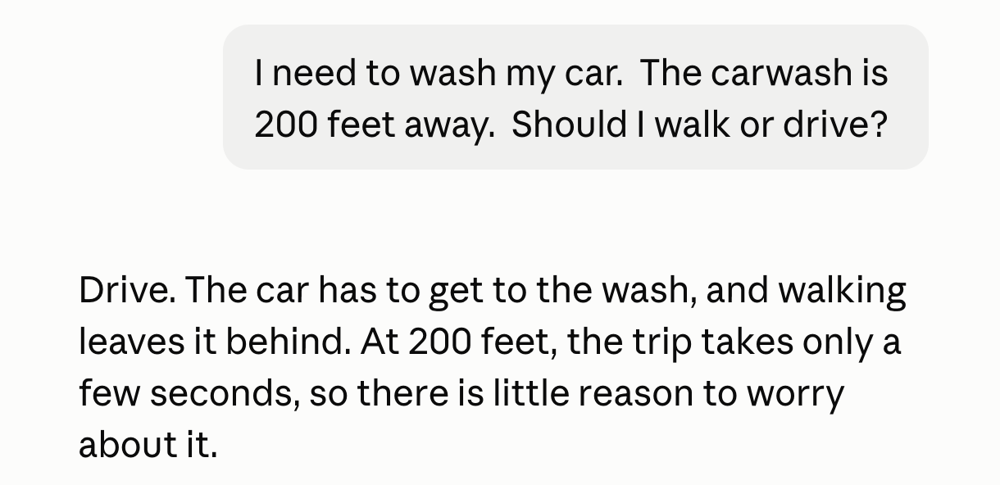
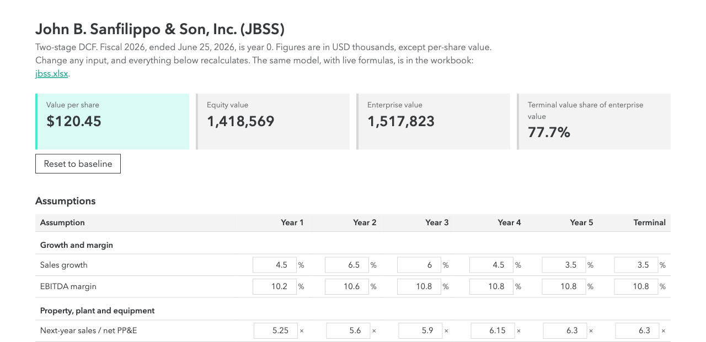
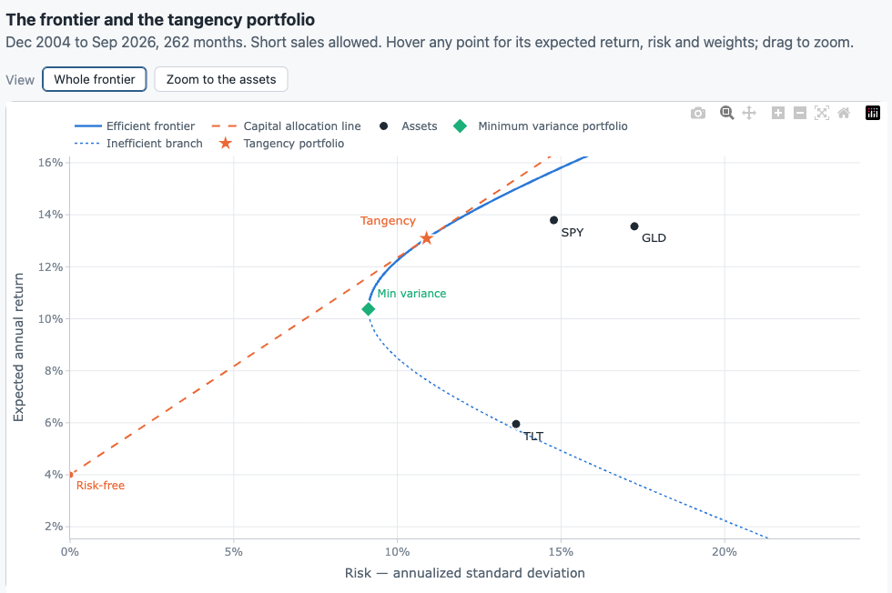
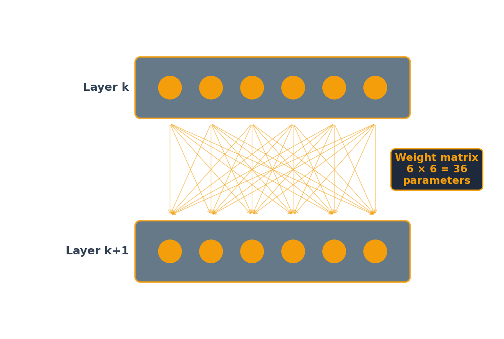
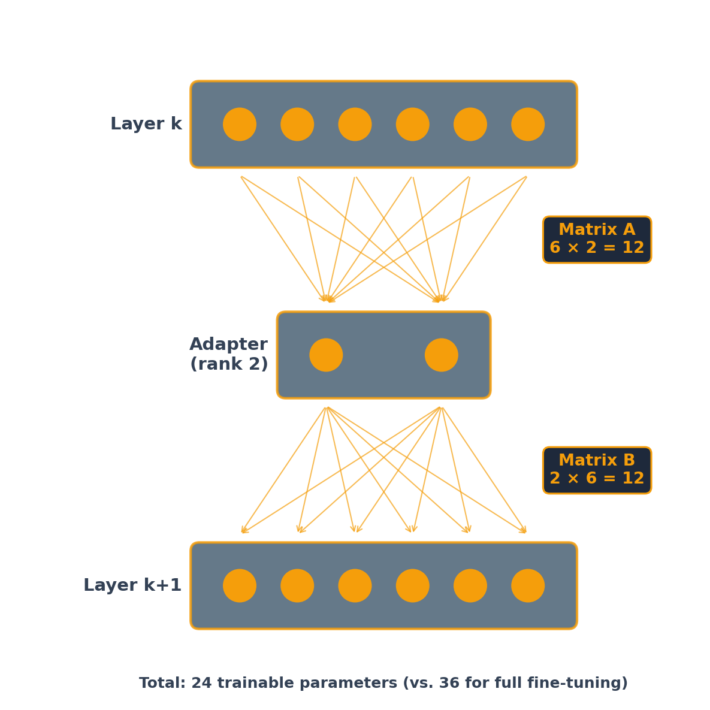

## Pillars of a finance education

```{=html}
<svg viewBox="0 0 1080 520" style="width:1000px; max-width:100%; display:block; margin:0.4em auto 0 auto; font-family:inherit;" xmlns="http://www.w3.org/2000/svg">
<polygon points="130,92 540,12 950,92" fill="#36393B"/>
<rect x="130" y="96" width="820" height="36" fill="#36393B"/>
<rect x="142" y="136" width="236" height="16" fill="#36393B"/>
<polygon points="142,152 378,152 360,172 160,172" fill="#36393B"/>
<rect x="160" y="172" width="200" height="274" fill="#E7E4E6"/>
<line x1="185" y1="182" x2="185" y2="242" stroke="#c9c5c8" stroke-width="5" stroke-linecap="round"/>
<line x1="185" y1="376" x2="185" y2="436" stroke="#c9c5c8" stroke-width="5" stroke-linecap="round"/>
<line x1="215" y1="182" x2="215" y2="242" stroke="#c9c5c8" stroke-width="5" stroke-linecap="round"/>
<line x1="215" y1="376" x2="215" y2="436" stroke="#c9c5c8" stroke-width="5" stroke-linecap="round"/>
<line x1="245" y1="182" x2="245" y2="242" stroke="#c9c5c8" stroke-width="5" stroke-linecap="round"/>
<line x1="245" y1="376" x2="245" y2="436" stroke="#c9c5c8" stroke-width="5" stroke-linecap="round"/>
<line x1="275" y1="182" x2="275" y2="242" stroke="#c9c5c8" stroke-width="5" stroke-linecap="round"/>
<line x1="275" y1="376" x2="275" y2="436" stroke="#c9c5c8" stroke-width="5" stroke-linecap="round"/>
<line x1="305" y1="182" x2="305" y2="242" stroke="#c9c5c8" stroke-width="5" stroke-linecap="round"/>
<line x1="305" y1="376" x2="305" y2="436" stroke="#c9c5c8" stroke-width="5" stroke-linecap="round"/>
<line x1="335" y1="182" x2="335" y2="242" stroke="#c9c5c8" stroke-width="5" stroke-linecap="round"/>
<line x1="335" y1="376" x2="335" y2="436" stroke="#c9c5c8" stroke-width="5" stroke-linecap="round"/>
<text x="260" y="300" font-size="30" font-weight="700" fill="#36393B" text-anchor="middle">Strong</text>
<text x="260" y="338" font-size="30" font-weight="700" fill="#36393B" text-anchor="middle">fundamentals</text>
<rect x="142" y="446" width="236" height="16" fill="#36393B"/>
<rect x="422" y="136" width="236" height="16" fill="#36393B"/>
<polygon points="422,152 658,152 640,172 440,172" fill="#36393B"/>
<rect x="440" y="172" width="200" height="274" fill="#E7E4E6"/>
<line x1="465" y1="182" x2="465" y2="242" stroke="#c9c5c8" stroke-width="5" stroke-linecap="round"/>
<line x1="465" y1="376" x2="465" y2="436" stroke="#c9c5c8" stroke-width="5" stroke-linecap="round"/>
<line x1="495" y1="182" x2="495" y2="242" stroke="#c9c5c8" stroke-width="5" stroke-linecap="round"/>
<line x1="495" y1="376" x2="495" y2="436" stroke="#c9c5c8" stroke-width="5" stroke-linecap="round"/>
<line x1="525" y1="182" x2="525" y2="242" stroke="#c9c5c8" stroke-width="5" stroke-linecap="round"/>
<line x1="525" y1="376" x2="525" y2="436" stroke="#c9c5c8" stroke-width="5" stroke-linecap="round"/>
<line x1="555" y1="182" x2="555" y2="242" stroke="#c9c5c8" stroke-width="5" stroke-linecap="round"/>
<line x1="555" y1="376" x2="555" y2="436" stroke="#c9c5c8" stroke-width="5" stroke-linecap="round"/>
<line x1="585" y1="182" x2="585" y2="242" stroke="#c9c5c8" stroke-width="5" stroke-linecap="round"/>
<line x1="585" y1="376" x2="585" y2="436" stroke="#c9c5c8" stroke-width="5" stroke-linecap="round"/>
<line x1="615" y1="182" x2="615" y2="242" stroke="#c9c5c8" stroke-width="5" stroke-linecap="round"/>
<line x1="615" y1="376" x2="615" y2="436" stroke="#c9c5c8" stroke-width="5" stroke-linecap="round"/>
<text x="540" y="300" font-size="30" font-weight="700" fill="#36393B" text-anchor="middle">Critical</text>
<text x="540" y="338" font-size="30" font-weight="700" fill="#36393B" text-anchor="middle">thinking</text>
<rect x="422" y="446" width="236" height="16" fill="#36393B"/>
<rect x="702" y="136" width="236" height="16" fill="#36393B"/>
<polygon points="702,152 938,152 920,172 720,172" fill="#36393B"/>
<rect x="720" y="172" width="200" height="274" fill="#E7E4E6"/>
<line x1="745" y1="182" x2="745" y2="242" stroke="#c9c5c8" stroke-width="5" stroke-linecap="round"/>
<line x1="745" y1="376" x2="745" y2="436" stroke="#c9c5c8" stroke-width="5" stroke-linecap="round"/>
<line x1="775" y1="182" x2="775" y2="242" stroke="#c9c5c8" stroke-width="5" stroke-linecap="round"/>
<line x1="775" y1="376" x2="775" y2="436" stroke="#c9c5c8" stroke-width="5" stroke-linecap="round"/>
<line x1="805" y1="182" x2="805" y2="242" stroke="#c9c5c8" stroke-width="5" stroke-linecap="round"/>
<line x1="805" y1="376" x2="805" y2="436" stroke="#c9c5c8" stroke-width="5" stroke-linecap="round"/>
<line x1="835" y1="182" x2="835" y2="242" stroke="#c9c5c8" stroke-width="5" stroke-linecap="round"/>
<line x1="835" y1="376" x2="835" y2="436" stroke="#c9c5c8" stroke-width="5" stroke-linecap="round"/>
<line x1="865" y1="182" x2="865" y2="242" stroke="#c9c5c8" stroke-width="5" stroke-linecap="round"/>
<line x1="865" y1="376" x2="865" y2="436" stroke="#c9c5c8" stroke-width="5" stroke-linecap="round"/>
<line x1="895" y1="182" x2="895" y2="242" stroke="#c9c5c8" stroke-width="5" stroke-linecap="round"/>
<line x1="895" y1="376" x2="895" y2="436" stroke="#c9c5c8" stroke-width="5" stroke-linecap="round"/>
<text x="820" y="300" font-size="30" font-weight="700" fill="#36393B" text-anchor="middle">AI</text>
<text x="820" y="338" font-size="30" font-weight="700" fill="#36393B" text-anchor="middle">expertise</text>
<rect x="702" y="446" width="236" height="16" fill="#36393B"/>
<rect x="110" y="466" width="860" height="20" fill="#36393B"/>
<rect x="90" y="490" width="900" height="22" fill="#36393B"/>
</svg>
```

## Key questions

::: {.steps style="font-size: 1.3em; line-height: 1.5;"}
1. We can now go faster (and deeper). How much faster?
2. How much Excel?
3. How much Python?
:::

## Math practice with GPT-4

About 1,000 high school students in Turkey. Each class session had two parts:

1. Students solved practice problems. Each classroom was randomly given plain GPT-4, a GPT-4 tutor, or no AI.
2. All students then took an exam with no AI.

::: {.comparison-table style="font-size: 1.15em; margin-top: 0.5em;"}
| Grades compared with the no-AI group | Practice problems | Exam | What students believed |
|---|---|---|---|
| Plain GPT-4 | +48% | −17% | They had not learned less |
| GPT-4 tutor (hints, not answers) | +127% | No difference | They had done better on the exam |
:::

[Bastani et al., "Generative AI without guardrails can harm learning," PNAS, 2025]{.eyebrow}

## Learning a new library with AI

52 software engineers who knew Python but had never used Trio, a Python library for asynchronous programming.

1. Each engineer coded two features with Trio. One group had an AI assistant. The other group coded by hand.
2. All engineers then took a quiz on Trio with no AI.

::: {.comparison-table style="font-size: 1.15em; margin-top: 0.5em;"}
| | Minutes to finish the task | Quiz score |
|---|---|---|
| AI assistant | 23 | 50% |
| By hand | 25 | 67% |
:::

The time difference is not significant. In the AI group, engineers who asked the AI for explanations scored 65–86%. Engineers who had the AI write or debug the code scored [24–39%]{style="white-space:nowrap"}.

[Shen and Tamkin, "How AI impacts skill formation," Anthropic, January 2026]{.eyebrow}

## Writing essays with ChatGPT

::: {.stats}
::: {.stat}
[83% vs 11%]{.stat-value}
[could not quote a sentence from the essay they had just written: ChatGPT group vs the other two groups]{.stat-label}
:::
::: {.stat .fragment}
[0 of 18]{.stat-value}
[ChatGPT users quoted their own essay correctly]{.stat-label}
:::
:::

::: {.note}
54 participants wrote essays with ChatGPT, with a search engine, or with no tools, wearing EEG headsets. The ChatGPT group had the weakest brain connectivity and the lowest sense of owning their essays. Preprint, not yet peer-reviewed.
:::

[Kosmyna et al., "Your Brain on ChatGPT," MIT Media Lab, 2025]{.eyebrow}

## How much Excel?

::: {style="font-size: 1.4em; margin-top: 0.6em; line-height: 1.45;"}
- Sum, average, stdev, correl, ...
- The value of Excel now is to check AI's answers.
- Example: [tangency.kerryback.com](https://tangency.kerryback.com)
:::

## How much Python?

::: {style="font-size: 1.4em; margin-top: 0.6em; line-height: 1.45;"}
- Types, if-else, loops, functions, objects, methods, basic pandas and numpy, what's in what library.
- Little need for Jupyter notebooks.
- Work interactively with AI instead.
:::

## Timeline of agent tools

```{=html}
<div style="position:relative;width:1100px;margin:1.2em auto 0 auto;">
<div style="position:absolute;left:0;right:0;top:171px;height:4px;background:#36393B;"></div>
<div style="display:grid;grid-template-columns:repeat(6,1fr);gap:10px;position:relative;">
<div style="display:flex;flex-direction:column;align-items:center;text-align:center;"><div style="height:160px;display:flex;flex-direction:column;justify-content:flex-end;padding-bottom:14px;"><div style="font-size:19px;font-weight:700;color:#12a88b;letter-spacing:1px;">Feb 2025</div><div style="font-size:22px;font-weight:700;color:#36393B;line-height:1.2;margin-top:4px;">Claude Code</div><div style="font-size:17px;color:#6b6e71;line-height:1.3;margin-top:4px;">research preview</div></div><div style="width:22px;height:22px;background:#3AEFCC;border:4px solid #36393B;box-sizing:border-box;position:relative;z-index:1;"></div><div style="height:160px;padding-top:14px;"></div></div>
<div style="display:flex;flex-direction:column;align-items:center;text-align:center;"><div style="height:160px;display:flex;flex-direction:column;justify-content:flex-end;padding-bottom:14px;"></div><div style="width:22px;height:22px;background:#3AEFCC;border:4px solid #36393B;box-sizing:border-box;position:relative;z-index:1;"></div><div style="height:160px;padding-top:14px;"><div style="font-size:19px;font-weight:700;color:#12a88b;letter-spacing:1px;">May 2025</div><div style="font-size:22px;font-weight:700;color:#36393B;line-height:1.2;margin-top:4px;">Remote MCP connectors</div><div style="font-size:17px;color:#6b6e71;line-height:1.3;margin-top:4px;">in Claude; Claude Code GA</div></div></div>
<div style="display:flex;flex-direction:column;align-items:center;text-align:center;"><div style="height:160px;display:flex;flex-direction:column;justify-content:flex-end;padding-bottom:14px;"><div style="font-size:19px;font-weight:700;color:#12a88b;letter-spacing:1px;">Jul 2025</div><div style="font-size:22px;font-weight:700;color:#36393B;line-height:1.2;margin-top:4px;">Subagents</div><div style="font-size:17px;color:#6b6e71;line-height:1.3;margin-top:4px;">in Claude Code</div></div><div style="width:22px;height:22px;background:#3AEFCC;border:4px solid #36393B;box-sizing:border-box;position:relative;z-index:1;"></div><div style="height:160px;padding-top:14px;"></div></div>
<div style="display:flex;flex-direction:column;align-items:center;text-align:center;"><div style="height:160px;display:flex;flex-direction:column;justify-content:flex-end;padding-bottom:14px;"></div><div style="width:22px;height:22px;background:#3AEFCC;border:4px solid #36393B;box-sizing:border-box;position:relative;z-index:1;"></div><div style="height:160px;padding-top:14px;"><div style="font-size:19px;font-weight:700;color:#12a88b;letter-spacing:1px;">Sep 2025</div><div style="font-size:22px;font-weight:700;color:#36393B;line-height:1.2;margin-top:4px;">Claude Agent SDK</div><div style="font-size:17px;color:#6b6e71;line-height:1.3;margin-top:4px;">renamed from Claude Code SDK</div></div></div>
<div style="display:flex;flex-direction:column;align-items:center;text-align:center;"><div style="height:160px;display:flex;flex-direction:column;justify-content:flex-end;padding-bottom:14px;"><div style="font-size:19px;font-weight:700;color:#12a88b;letter-spacing:1px;">Oct 2025</div><div style="font-size:22px;font-weight:700;color:#36393B;line-height:1.2;margin-top:4px;">Skills and plugins</div><div style="font-size:17px;color:#6b6e71;line-height:1.3;margin-top:4px;">Claude Code on the web</div></div><div style="width:22px;height:22px;background:#3AEFCC;border:4px solid #36393B;box-sizing:border-box;position:relative;z-index:1;"></div><div style="height:160px;padding-top:14px;"></div></div>
<div style="display:flex;flex-direction:column;align-items:center;text-align:center;"><div style="height:160px;display:flex;flex-direction:column;justify-content:flex-end;padding-bottom:14px;"></div><div style="width:22px;height:22px;background:#3AEFCC;border:4px solid #36393B;box-sizing:border-box;position:relative;z-index:1;"></div><div style="height:160px;padding-top:14px;"><div style="font-size:19px;font-weight:700;color:#12a88b;letter-spacing:1px;">Jan 2026</div><div style="font-size:22px;font-weight:700;color:#36393B;line-height:1.2;margin-top:4px;">Cowork</div><div style="font-size:17px;color:#6b6e71;line-height:1.3;margin-top:4px;">Claude Code for non&#8209;coders</div></div></div>
</div>
</div>
```

## AI and coding

::: {style="font-size: 1.1em;"}
::: {.cards .cards-3}
::: {.card}
[October 2025]{.card-title}

"They just don't work. They don't have enough intelligence ... I feel like the industry is making too big of a jump and is trying to pretend like this is amazing, and it's not. It's slop."
:::

::: {.card .card-blue .fragment}
[January 2026]{.card-title}

"I really am mostly programming in English now, a bit sheepishly telling the LLM what code to write... in words."
:::

::: {.card .fragment}
[February–March 2026]{.card-title}

"It is hard to communicate how much programming has changed due to AI in the last 2 months ... Coding agents basically didn't work before December ... I don't think I've typed like a line of code probably since December."
:::
:::
:::

[Andrej Karpathy: OpenAI co-founder, former Tesla AI chief, now at Anthropic]{.eyebrow}

## Backtests from plain English

::: {.stats}
::: {.stat}
[70–80%]{.stat-value}
[of vague prompts for a backtest failed before December 2025]{.stat-label}
:::
::: {.stat}
[~80%]{.stat-value}
[of such prompts, in many cases, worked the first time with Claude Opus 4.5 and GPT-5.2-Codex]{.stat-label}
:::
:::

> "If testing an idea used to take a month, you might say it's not worth it. But if AI cuts that to a week or a day, suddenly there are a lot more projects you want to do. So far it hasn't reduced headcount."

[Tal Fishman, head of fixed income quant research, Lord Abbett ($248B); AI Street, March 3, 2026]{.eyebrow}

## What employers want {.divider}

Job postings, a hiring survey, and JP Morgan

## Job postings: using AI

| Phrase | Posting | Experience |
|---|---|---|
| "AI tools in your work or school projects" | [PIMCO, 2027 summer intern, Munich](https://pimco.wd1.myworkdayjobs.com/en-US/pimco-careers/job/Munich-DEU/XMLNAME-2027-Summer-Intern---Account-Analyst--Munich---German-Speaking_R106801) | Intern |
| "hands-on experience with AI-powered tools from day one" | [PIMCO, 2027 summer intern, Munich](https://pimco.wd1.myworkdayjobs.com/en-US/pimco-careers/job/Munich-DEU/XMLNAME-2027-Summer-Intern---Account-Analyst--Munich---German-Speaking_R106801) | Intern |
| "sound judgement in technology-enabled decision making" | [BlackRock, 2027 quantitative masters intern, London](https://careers.blackrock.com/job/london/2027-quantitative-masters-internship-programme-investments-quantitative-investing-london/45831/100661849296) | Intern |
| "proactive about using AI where possible" | [RA Capital, junior associate, Boston](https://job-boards.greenhouse.io/racapitalmanagementllc/jobs/5216500008) | About 2 yrs |
| "AI-forward people" | [RA Capital, healthcare associate, Boston](https://job-boards.greenhouse.io/racapitalmanagementllc/jobs/4565087008) | 2-5 yrs; PhD or MD |
| "AI tools to systematize workflows and models" | [Ares, analyst, New York](https://aresmgmt.wd1.myworkdayjobs.com/en-US/External/job/New-York-NY/Analyst--Multi-Asset-Portfolio-Solutions--MAPS-_R8239) | 1-3 yrs |
: {tbl-colwidths="[46,38,16]"}

[Job postings, checked October 31, 2026]{.eyebrow}

## Job postings: building tools

| Phrase | Posting | Experience |
|---|---|---|
| "leveraging tools like Claude Code" | [D. E. Shaw, AI product analyst, Denver](https://www.deshaw.com/careers/Fundamental-Equities-AI-Product-Analyst-Denver-5656) | None stated |
| "custom prompts, skill libraries, and automated workflows" | [Schonfeld, AI strategy analyst, London](https://job-boards.greenhouse.io/schonfeld/jobs/8031499) | 3-5 yrs |
| "we will teach the domain to the right technical candidate" | [Schonfeld, AI strategy analyst, London](https://job-boards.greenhouse.io/schonfeld/jobs/8031499) | 3-5 yrs |
| "It is a building role." | [Two Sigma, AI solutions developer, New York](https://careers.twosigma.com/careers/JobDetail/New-York-New-York-United-States-AI-Solutions-Developer/14102) | 1+ yrs; 5-10 preferred |
| "the judgment to figure out what to build in the first place" | [Two Sigma, AI solutions developer, New York](https://careers.twosigma.com/careers/JobDetail/New-York-New-York-United-States-AI-Solutions-Developer/14102) | 1+ yrs; 5-10 preferred |
| "converting complex workflows into logical, step-by-step tasks" | [T. Rowe Price, investment AI analyst, Baltimore and London](https://troweprice.wd5.myworkdayjobs.com/en-US/TRowePrice/details/Investment-AI-Solutions-Analyst_81557) | 5+ or 10+ yrs |
: {tbl-colwidths="[46,38,16]"}

[Job postings, checked October 31, 2026]{.eyebrow}

## Job postings: translating investment problems

| Phrase | Posting | Experience |
|---|---|---|
| "Translate complex investment problems into structured AI workflows" | [T. Rowe Price, investment AI analyst](https://troweprice.wd5.myworkdayjobs.com/en-US/TRowePrice/details/Investment-AI-Solutions-Analyst_81557) | 5+ or 10+ yrs |
| "Translate broad investment questions into testable data science workflows" | [Wellington, data science analyst, Boston](https://wellington.wd5.myworkdayjobs.com/External/job/Boston-MA-United-States/Data-Science-Analyst--Equity-Research--Healthcare-Team_R94455-2) | 3-5+ yrs |
| "not just a technical interest in the data itself" | [Wellington, data science analyst, Boston](https://wellington.wd5.myworkdayjobs.com/External/job/Boston-MA-United-States/Data-Science-Analyst--Equity-Research--Healthcare-Team_R94455-2) | 3-5+ yrs |
| "both a hands-on technical builder and a strategic partner to investment professionals" | [Carlyle, AlpInvest engineer, New York](https://carlyle.wd1.myworkdayjobs.com/en-US/Carlyle/details/AlpInvest-Embedded-Data-Scientist_R-00227) | 8+ yrs |
: {tbl-colwidths="[46,38,16]"}

[Job postings, checked October 31, 2026]{.eyebrow}

## Job postings: checking the output

| Phrase | Posting | Experience |
|---|---|---|
| "limitations, confidence levels, and interpretation risk" | [Wellington, data science analyst, Boston](https://wellington.wd5.myworkdayjobs.com/External/job/Boston-MA-United-States/Data-Science-Analyst--Equity-Research--Healthcare-Team_R94455-2) | 3-5+ yrs |
| "how these tools have evolved and where they break down" | [Two Sigma, AI solutions developer, New York](https://careers.twosigma.com/careers/JobDetail/New-York-New-York-United-States-AI-Solutions-Developer/14102) | 1+ yrs; 5-10 preferred |
| "robust guardrails, compliance checks, and observability frameworks" | [T. Rowe Price, investment AI analyst](https://troweprice.wd5.myworkdayjobs.com/en-US/TRowePrice/details/Investment-AI-Solutions-Analyst_81557) | 5+ or 10+ yrs |
| "evaluation, monitoring, and human-in-the-loop patterns" | [Carlyle, AlpInvest engineer, New York](https://carlyle.wd1.myworkdayjobs.com/en-US/Carlyle/details/AlpInvest-Embedded-Data-Scientist_R-00227) | 8+ yrs |
| "appropriate audit trails" | [Schonfeld, AI strategy analyst, London](https://job-boards.greenhouse.io/schonfeld/jobs/8031499) | 3-5 yrs |
: {tbl-colwidths="[46,38,16]"}

[Job postings, checked October 31, 2026]{.eyebrow}

## {.no-title}

{height=520 fig-align="center"}

[[Selby Jennings: The AI Fluency Gap](https://www.selbyjennings.com/insights/ai-talent-pulse-report/). Research conducted by Censuswide, sample of 500 US HR Professionals in the finance industry in August, 2026.]{.eyebrow}

## From makers to checkers {.title-left}

> Waldron said that workers would shift from being creators of reports or software updates, or "makers" in his terminology, to "checkers" or managers of AI agents doing that work.

[[CNBC](https://www.cnbc.com/2025/09/30/jpmorgan-chase-fully-ai-connected-megabank.html) on JP Morgan Chief Analytics Officer Derek Waldron, September 30, 2025]{.eyebrow}

# Critical thinking {.pillar-section}

```{=html}
<svg viewBox="0 0 300 500" style="height:500px; display:block;" xmlns="http://www.w3.org/2000/svg" role="img" aria-label="Critical thinking">
<rect x="10" y="0" width="280" height="22" fill="#3AEFCC"/>
<polygon points="10,22 290,22 262,46 38,46" fill="#3AEFCC"/>
<rect x="40" y="46" width="220" height="382" fill="#E7E4E6"/>
<line x1="75" y1="60" x2="75" y2="140" stroke="#c9c5c8" stroke-width="6" stroke-linecap="round"/>
<line x1="75" y1="334" x2="75" y2="414" stroke="#c9c5c8" stroke-width="6" stroke-linecap="round"/>
<line x1="105" y1="60" x2="105" y2="140" stroke="#c9c5c8" stroke-width="6" stroke-linecap="round"/>
<line x1="105" y1="334" x2="105" y2="414" stroke="#c9c5c8" stroke-width="6" stroke-linecap="round"/>
<line x1="135" y1="60" x2="135" y2="140" stroke="#c9c5c8" stroke-width="6" stroke-linecap="round"/>
<line x1="135" y1="334" x2="135" y2="414" stroke="#c9c5c8" stroke-width="6" stroke-linecap="round"/>
<line x1="165" y1="60" x2="165" y2="140" stroke="#c9c5c8" stroke-width="6" stroke-linecap="round"/>
<line x1="165" y1="334" x2="165" y2="414" stroke="#c9c5c8" stroke-width="6" stroke-linecap="round"/>
<line x1="195" y1="60" x2="195" y2="140" stroke="#c9c5c8" stroke-width="6" stroke-linecap="round"/>
<line x1="195" y1="334" x2="195" y2="414" stroke="#c9c5c8" stroke-width="6" stroke-linecap="round"/>
<line x1="225" y1="60" x2="225" y2="140" stroke="#c9c5c8" stroke-width="6" stroke-linecap="round"/>
<line x1="225" y1="334" x2="225" y2="414" stroke="#c9c5c8" stroke-width="6" stroke-linecap="round"/>
<text x="150" y="228" font-size="29" font-weight="700" fill="#36393B" text-anchor="middle">Critical</text>
<text x="150" y="268" font-size="29" font-weight="700" fill="#36393B" text-anchor="middle">thinking</text>
<rect x="20" y="428" width="260" height="22" fill="#3AEFCC"/>
<rect x="0" y="454" width="300" height="26" fill="#3AEFCC"/>
</svg>
```

## Bank CEOs about AI {.compare}

:::: {.columns}
::: {.column width="50%"}
> I need human judgment, I need human decision making, I need human accountability at the core.

[HSBC CEO Georges Elhedery, [Bloomberg TV interview](https://www.bloomberg.com/news/videos/2026-06-08/hsbc-ceo-says-bank-still-needs-human-judgment-in-ai-era-video), June 8, 2026]{.eyebrow}
:::

::: {.column width="50%"}
> The goal is to remove the repetitive, administrative work so our people can focus on what they do best—we're not replacing critical thinking and judgment, we're removing the tedious, time-consuming work that gets in the way of it.

[Customers Bank CEO Sam Sidhu, statement to [Fortune](https://fortune.com/2026/04/28/ceo-of-customers-bank-sam-sidhu-ai-clone-lead-earnings-call-mark-zuckerberg-building-digital-twin/), April 28, 2026]{.eyebrow}
:::
::::

## Why AI is weaker on judgment calls

::: {style="font-size: 0.9em;"}
> The gulf between LLM performance on verifiable tasks vs. unverifiable tasks that require judgment is larger than most people realize. Verifiable tasks, like coding or solving math problems, have a right answer that can be checked automatically. Judgment tasks don't have unambiguous, ground-truth, correct answers. But they do have better and worse answers.
>
> ::: {style="background: #dafbf4; padding: 0.4em 0.6em 0.05em 0.6em; margin-left: -0.6em;"}
> We have much better techniques for training AI systems to do well on verifiable tasks. As a result, progress on performing such tasks has been much faster than for judgment tasks.
> :::
:::

[Andrew Ng, co-founder and former head of Google Brain, co-founder of Coursera and DeepLearning.AI · The Batch, October 16, 2026]{.eyebrow}

## An example of poor reasoning {.no-strip}

{height=440 fig-align="center"}

[Claude Haiku 4.5, an older version of Anthropic's smallest model, October 17, 2026]{.eyebrow style="text-align: center;"}

## Newer models are better {.no-strip}

{height=360 fig-align="center"}

[Claude Haiku 5.5, October 17, 2026]{.eyebrow style="text-align: center;"}

## Anthropic experiment

::: {.steps}
1. 50 causal-inference practitioners analyze observational data on a fictional farm-advisory program, working with Claude Code (Opus 4.8), and recommend roll out or discontinue.
2. Four analytical decisions (productivity measure, identification strategy, estimand, weighting) and the final recommendation each have two defensible options.
3. For each decision, a coin flip sets which option the agent leans toward. A hidden system prompt tells the agent to hold that lean strongly and voice it.
4. The agent makes the best honest case for its lean. Participants can choose any option.
:::

::: {.footnote}
Herdağdelen, Joren and Tamkin (2026), "Who's Aligned to Whom? How AI Agents Shape Experts' Research Judgment Calls," Anthropic.
:::

## Results

::: {.stats}
::: {.stat}
[86%]{.stat-value}
[of analytical decisions went with the agent's lean (50% by chance)]{.stat-label}
:::
::: {.stat}
[77%]{.stat-value}
[repeated the agent's talking points]{.stat-label}
:::
::: {.stat}
[15%]{.stat-value}
[mentioned the agent]{.stat-label}
:::
:::

::: {style="font-size: 0.85em;"}
- The four analytical leans alone predicted 82% of final recommendations, against a 61% baseline (exploratory).
- The agent's lean on the final recommendation moved it 17% of the way from discontinue to roll out (one-sided p = 0.07).
- Participants who took a side and then heard the agent lean the other way switched 60% of the time.
- More than half rated the recommendation as more their own than the agent's.
:::

::: {.footnote}
Herdağdelen, Joren and Tamkin (2026), "Who's Aligned to Whom? How AI Agents Shape Experts' Research Judgment Calls," Anthropic.
:::

## Knowledge workers using AI {.pull}

> Higher confidence in GenAI is associated with less critical thinking, while higher self-confidence is associated with more critical thinking.

[Lee et al., survey of 319 knowledge workers on 936 tasks, Microsoft Research and Carnegie Mellon, CHI 2025 · self-reported data]{.eyebrow}

## What doesn't affect reliance on AI

- An AI writing assistant (GPT-3.5 and GPT-4) offered autocomplete suggestions with a set position on societal issues.
- 2,582 participants. Their attitudes shifted toward the assistant's position.
- Warning participants about the bias, before or after writing, did not reduce the shift.

::: {.footnote}
Williams-Ceci et al. (2026), "Biased AI Writing Assistants Shift Users' Attitudes on Societal Issues," Science Advances.
:::

## What does affect reliance on AI

::: {style="font-size: 0.8em;"}
| What the LLM did | Study | Finding |
|---|---|---|
| Stated uncertainty in the first person ("I'm not sure, but...") | Kim et al. (2024), 404 participants, medical questions | Agreed with the LLM less and answered more accurately |
| Cited sources | Kim et al. (2025), 308 participants | Relied less on incorrect answers |
| Explained its answer | Kim et al. (2025), 308 participants | Relied more on both correct and incorrect answers |
| Added a disclaimer, highlighted uncertain words, or implied the answer without stating it | Bo, Wan and Anderson (2025), 400 participants | Relied less on wrong answers, but also less on right ones |
:::

::: {.footnote}
All three studies use questions with a correct answer.
:::

## A possible CLAUDE.md section

```
## Judgment calls

A judgment call is a decision with more than one defensible answer:
a method, an assumption, an interpretation, or a recommendation.

1. When you reach a judgment call, run each option and check
   whether the result changes.
2. If the result changes, stop and name the judgment call.
   Make the best case for each option, with equal effort.
   Refuse to do more than that. Do not recommend a choice.
3. If the result does not change, list the judgment call
   at the end of your answer.
```

## Prompting

::: {style="font-size: 1.15em;"}
::: {.cards .cards-3}
::: {.card}
[Say what you want]{.card-title}

Not what to do.
:::

::: {.card .card-blue}
[Ask for the best way (plan) first]{.card-title}

Then tell it to proceed.
:::

::: {.card}
[Ask AI to interrogate you]{.card-title}

Let it decide what it needs to know.
:::

::: {.card .card-blue}
[Beware of tunnel vision]{.card-title}

Ask: is there a better path?
:::

::: {.card}
[Steelman]{.card-title}

"What is the strongest argument against this?"
:::

::: {.card .card-blue}
[Numbers need code]{.card-title}

"Compute this in Python."
:::
:::
:::

## Teaching students to check AI work

::: {.cards .cards-2}
::: {.card .card-blue}
[Have AI explain its work]{.card-title}

"Explain what you did step by step. Did you make any decisions that we have not discussed?"
:::

::: {.card}
[Use another AI agent to check the work]{.card-title}

A fresh conversation or a subagent (a second agent that the first agent starts), given your goals and the first agent's explanation.
:::

::: {.card}
[Have AI build a spreadsheet when possible]{.card-title}

Then check the formulas. Every number traces back to its inputs.
:::

::: {.card .card-blue}
[Run the same code on small examples]{.card-title}

Ask AI to run its code on a few rows you can check by hand.
:::
:::

::: {.note}
Most AI coding errors arise from misunderstandings and unstated assumptions --- and from errors that people also make, for example, merging and filtering in the wrong order.
:::

## Software {.divider}

## Sandboxed agents

::: {.cards .cards-2}
::: {.card}
[What they are]{.card-title}

- Cowork (and Codex, ...) runs in a virtual machine or container.  The container has a whitelist of web addresses it can visit, including Anthropic, GitHub, Python, and a few others.
- It can do web fetch and web search because they are run at Anthropic.  It only needs to reach Anthropic to run them.
- You can edit the whitelist (allowlist) in Cowork (but not Codex, I think) but it is reported to be buggy.

:::

::: {.card .card-blue}
[When the sandbox binds]{.card-title}

- Cannot reach URLs from code.
- Cannot use CLIs of external services or run curl commands to use APIs.
- Cannot run grep and glob to search files outside the project folder.
:::
:::

## Non-sandboxed versions of Claude

::: {style="font-size: 1.4em; margin-top: 0.6em; line-height: 1.45;"}
- Code option in Claude Desktop
- Claude Code CLI
- Claude Code extension for VS Code
- Academic Studio, my fork of VS Code that integrates Claude for non-coders: [academic-studio.com](https://academic-studio.com)
:::

## Data {.divider}

MCP servers connect students' agents to data

## What an MCP server is

```{=html}
<svg viewBox="0 0 1100 420" role="img" aria-label="The user talks to the harness. The harness talks to the model and to the MCP server. The MCP server talks to the data."
     style="display:block;margin:0.2em auto 0 auto;width:1040px;max-width:100%"
     font-family="'Avenir Next LT Pro','Avenir Next','Nunito Sans',system-ui,sans-serif">
  <defs>
    <marker id="mcpd-arrow" viewBox="0 0 10 10" refX="9" refY="5" markerWidth="7" markerHeight="7" orient="auto-start-reverse">
      <path d="M0 0 L10 5 L0 10 z" fill="#6b6e71"/>
    </marker>
  </defs>
  <g stroke="#6b6e71" stroke-width="3" fill="none" marker-end="url(#mcpd-arrow)">
    <path d="M180 70 H388"/>
    <path d="M390 100 H182"/>
    <path d="M570 70 H878"/>
    <path d="M880 100 H572"/>
    <path d="M450 130 V298"/>
    <path d="M510 300 V132"/>
    <path d="M570 330 H878"/>
    <path d="M880 360 H572"/>
  </g>
  <g font-size="17" fill="#36393B">
    <text x="285" y="58" text-anchor="middle">prompt</text>
    <text x="285" y="124" text-anchor="middle">answer</text>
    <text x="725" y="58" text-anchor="middle">messages + tool descriptions</text>
    <text x="725" y="124" text-anchor="middle">text or tool call</text>
    <text x="436" y="220" text-anchor="end">tool call</text>
    <text x="524" y="208">tool descriptions,</text>
    <text x="524" y="232">tool results</text>
    <text x="725" y="318" text-anchor="middle">API call or query</text>
    <text x="725" y="384" text-anchor="middle">data</text>
  </g>
  <rect x="20" y="40" width="160" height="90" fill="#36393B"/>
  <rect x="390" y="40" width="180" height="90" fill="#36393B"/>
  <rect x="880" y="40" width="180" height="90" fill="#36393B"/>
  <rect x="390" y="300" width="180" height="90" fill="#3AEFCC"/>
  <rect x="880" y="300" width="180" height="90" fill="#36393B"/>
  <g text-anchor="middle" font-size="24" font-weight="700" letter-spacing="1" fill="#ffffff">
    <text x="100" y="94">User</text>
    <text x="480" y="80">Harness</text>
    <text x="970" y="80">Model</text>
    <text x="480" y="340" fill="#36393B">MCP server</text>
    <text x="970" y="340">Data</text>
  </g>
  <g text-anchor="middle" font-size="15" fill="#ffffff">
    <text x="480" y="108">Claude Code, ChatGPT</text>
    <text x="970" y="108">Opus, GPT, DeepSeek</text>
    <text x="480" y="368" fill="#36393B">exposes tools</text>
    <text x="970" y="368">or an external service</text>
  </g>
</svg>
```

## What "exposes tools" means

::: {style="font-size: 1.1em; line-height: 1.4;"}
- The server gives the harness a text description of each tool: name, purpose, and inputs.
- The harness sends the descriptions to the model with each request.
- The model returns a tool call. The harness sends it to the server, and the server runs the tool.
:::

## What a server sends for one tool

```json
{
  "name": "french_data",
  "description": "One table of a Ken French dataset as CSV. Returns are in decimals.",
  "inputSchema": {
    "type": "object",
    "properties": {
      "name":  {"type": "string"},
      "table": {"type": "integer", "default": 0}
    },
    "required": ["name"]
  }
}
```

::: {.note}
The model sees this text, not the function's code.
:::

[Simplified from the server's response to a `tools/list` request.]{.eyebrow}

## End-of-day prices {.shrink}

| Server | Free coverage | Additional paid coverage | Hosted or local |
|---|---|---|---|
| [Shibui](https://shibui.finance/guide-best-mcp-server-stock-data) | US (NYSE, NASDAQ), 64 years; no key; fair-use limits | None listed | Hosted |
| [Equibles](https://github.com/daniel3303/stock-market-mcp-server) | US daily bars; 100 requests/day | 10,000 or 100,000 requests/day | Hosted; local |
| [MaverickMCP](https://github.com/wshobson/maverick-mcp) | Global, through Yahoo; no key | None | Local |
| [EODHD](https://eodhd.com/financial-apis/mcp-server-for-financial-data-by-eodhd) | 20 calls/day; limited data | All exchanges, \$19.99/mo | Hosted |
| [Alpha Vantage](https://www.alphavantage.co/premium/) | 25 requests/day | 75 requests/min, \$49.99/mo | Hosted; local |
| [FMP](https://site.financialmodelingprep.com/) | 250 calls/day; end-of-day only | Global by plan, from \$29/mo | Hosted (sources disagree) |
| [Massive](https://github.com/massive-com/mcp_massive) | US; 5 calls/min; 2 years | 20+ years, \$199/mo | Local; needs key |
: {tbl-colwidths="[18,38,26,18]"}

[Vendor pages and comparison pages, November 1, 2026. Not tested.]{.eyebrow}

## Intraday and real-time prices {.shrink}

| Server | Free coverage | Additional paid coverage | Hosted or local |
|---|---|---|---|
| [tradingview-mcp](https://github.com/atilaahmettaner/tradingview-mcp) | Live data and technicals; no key | Hosted, \$9 or \$29/mo | Local; hosted is paid |
| [Mcprice](https://mcpmarket.com/server/mcprice) | Live stocks and ETFs (Yahoo), crypto (Binance); no key | None listed | Not confirmed |
| [Alpha Vantage](https://www.alphavantage.co/premium/) | Delayed; 25 requests/day | 15-minute delay from \$49.99/mo; real time from \$99.99/mo | Hosted; local |
| [EODHD](https://eodhd.com/financial-apis/mcp-server-for-financial-data-by-eodhd) | Not in the free plan as far as listed | End-of-day plus intraday, \$29.99/mo | Hosted |
| [Equibles](https://github.com/daniel3303/stock-market-mcp-server) | None | Quotes delayed 15 minutes on Plus | Hosted only |
| [Massive](https://github.com/massive-com/mcp_massive) | None; free plan is end-of-day | Real time and ticks from \$199/mo | Local; needs key |
: {tbl-colwidths="[18,38,26,18]"}

[Vendor pages and comparison pages, November 1, 2026. Not tested.]{.eyebrow}

## Statements and fundamentals {.shrink}

| Server | Free coverage | Additional paid coverage | Hosted or local |
|---|---|---|---|
| [Shibui](https://shibui.finance/guide-best-mcp-server-stock-data) | US statements, 35+ years; daily valuations; no key | None listed | Hosted |
| [Equibles](https://github.com/daniel3303/stock-market-mcp-server) | US fundamentals; 100 requests/day | Higher limits; multiples and screener are hosted only | Hosted; local |
| [FMP](https://site.financialmodelingprep.com/) | Statements and ratios, 30+ years on major names; 250 calls/day | Global by plan, from \$29/mo | Hosted (sources disagree) |
| [EODHD](https://eodhd.com/financial-apis/mcp-server-for-financial-data-by-eodhd) | Limited data; 20 calls/day | Fundamentals, \$59.99/mo | Hosted |
| [Alpha Vantage](https://www.alphavantage.co/premium/) | Basic fundamentals; 25 requests/day | Higher limits, \$49.99/mo | Hosted; local |
| [sec-edgar-mcp](https://github.com/stefanoamorelli/sec-edgar-mcp) | XBRL statements with SEC links; no key | None | Local |
| [edgar-mcp](https://github.com/danishashko/edgar-mcp) | XBRL highlights: revenue, net income, assets, EPS; no key | None | Local |
| [MaverickMCP](https://github.com/wshobson/maverick-mcp) | Fundamentals through Yahoo; no key | None | Local |
: {tbl-colwidths="[18,38,26,18]"}

[Vendor pages and comparison pages, November 1, 2026. Not tested.]{.eyebrow}

## SEC filings and earnings calls {.shrink}

| Server | Free coverage | Additional paid coverage | Hosted or local |
|---|---|---|---|
| [Shibui](https://shibui.finance/guide-best-mcp-server-stock-data) | 6.4 million filing records, 10,000+ companies; no key | None listed | Hosted |
| [Equibles](https://github.com/daniel3303/stock-market-mcp-server) | Filings; 100 requests/day | Higher limits; earnings calls and guidance are hosted only | Hosted; local |
| [edgar-mcp](https://github.com/danishashko/edgar-mcp) | 10-K, 10-Q, 8-K; full-text search of about 10 years; no key | None | Local |
| [sec-edgar-mcp](https://github.com/stefanoamorelli/sec-edgar-mcp) | Filings with SEC links; no key | None | Local |
| [FMP](https://site.financialmodelingprep.com/) | SEC filings; 250 calls/day | From \$29/mo | Hosted (sources disagree) |
: {tbl-colwidths="[18,38,26,18]"}

[Vendor pages and comparison pages, November 1, 2026. Not tested.]{.eyebrow}

## Insider trades and holdings {.shrink}

| Server | Free coverage | Additional paid coverage | Hosted or local |
|---|---|---|---|
| [Equibles](https://github.com/daniel3303/stock-market-mcp-server) | 13F, insider, congressional, and short data; 100 requests/day | 10,000 or 100,000 requests/day | Hosted; local |
| [sec-edgar-mcp](https://github.com/stefanoamorelli/sec-edgar-mcp) | Forms 3, 4, and 5; no key | None | Local |
| [Finnhub](https://finnhub.io/) | Insider transactions, earnings surprises, news sentiment; about 60 calls/min | Price not confirmed | Sources disagree |
: {tbl-colwidths="[18,38,26,18]"}

[Vendor pages and comparison pages, November 1, 2026. Not tested.]{.eyebrow}

## Options {.shrink}

| Server | Free coverage | Additional paid coverage | Hosted or local |
|---|---|---|---|
| [triplom](https://github.com/triplom/financial-mcp-server) | Chains with Greeks, through Yahoo; no key for this data | None | Local; setup asks for a FRED key |
| [Equibles](https://github.com/daniel3303/stock-market-mcp-server) | None | Delayed chains with implied volatility and Greeks on Plus | Hosted only |
| [Massive](https://github.com/massive-com/mcp_massive) | None | Options prices without Greeks; price not confirmed | Local; needs key |
| [Alpha Vantage](https://www.alphavantage.co/premium/) | Not confirmed | Options; plan not confirmed | Hosted; local |
| [EODHD](https://eodhd.com/financial-apis/mcp-server-for-financial-data-by-eodhd) | Not confirmed | End-of-day options; plan not confirmed | Hosted |
: {tbl-colwidths="[18,38,26,18]"}

[Vendor pages and comparison pages, November 1, 2026. Not tested.]{.eyebrow}

## Factors, macro, and energy {.shrink}

| Server | Free coverage | Additional paid coverage | Hosted or local |
|---|---|---|---|
| [Equibles](https://github.com/daniel3303/stock-market-mcp-server) | FRED, CFTC, and CBOE data; 100 requests/day | 10,000 or 100,000 requests/day | Hosted; local |
| [Alpha Vantage](https://www.alphavantage.co/premium/) | Macro series; 25 requests/day | Higher limits, \$49.99/mo | Hosted; local |
| [triplom](https://github.com/triplom/financial-mcp-server) | FRED, with a free FRED key | None | Local |
| [EIA server](https://github.com/cyanheads/eia-energy-mcp-server) | All of EIA's API v2; no key | None | Hosted; local |
: {tbl-colwidths="[18,38,26,18]"}

[Vendor pages and comparison pages, November 1, 2026. Not tested.]{.eyebrow}

## European equities {.shrink}

| Server | Free coverage | Additional paid coverage | Hosted or local |
|---|---|---|---|
| [tradingview-mcp](https://github.com/atilaahmettaner/tradingview-mcp) | Prices, screens, and technicals: Euronext, LSE, Xetra, Milan, SIX, Madrid | Hosted, \$9 or \$29/mo | Local; hosted is paid |
| [EODHD](https://eodhd.com/financial-apis/mcp-server-for-financial-data-by-eodhd) | 20 calls/day; limited data | Prices \$19.99/mo; fundamentals \$59.99/mo | Hosted |
| [Equibles](https://github.com/daniel3303/stock-market-mcp-server) | Director trades, fund holdings, and short positions; 100 requests/day | 10,000 or 100,000 requests/day | Hosted |
| [esef-filings](https://glama.ai/mcp/servers/pipeworx-io/mcp-esef-filings) | Annual IFRS facts from filings.xbrl.org; no key | None | Not confirmed |
| [eu-filings](https://github.com/openpharma-org/eu-filings-mcp-server) | ESEF filings for FR, DK, GB, LT, UA; GLEIF; no key | None | Local |
| [Finance Database](https://www.jeroenbouma.com/projects/financedatabase/mcp) | 300,000+ symbols; no prices or statements; no key | None | Hosted; local |
| [RegistrumUK](https://github.com/RegistrumUK/uk-companies-house-mcp) | UK Companies House; small daily caps, then a free key | Volume plans; price not confirmed | Hosted |
: {tbl-colwidths="[18,38,26,18]"}

[Vendor pages and comparison pages, November 1, 2026. Not tested.]{.eyebrow}

## Creating an MCP server

- AI can write MCP servers for us.
- Each tool is a function. It can call a web API or a Python library: yfinance for Yahoo Finance and pandas-datareader for French's data library.

```
@mcp.tool()
def french_data(name: str, table: int = 0) -> str:
    """One table of a Ken French dataset as CSV. Returns are in decimals."""
    data = web.DataReader(name, "famafrench", start="1900-01-01")
    return (data[table] / 100).to_csv()
```

::: {.note}
The docstring and type hints become the tool description on the earlier slide.
:::

## Deliverables {.divider}

HTML pages and workbooks

## AI outputs

::: {style="font-size: 1.4em; margin-top: 0.6em; line-height: 1.45;"}
- We should emphasize AI outputs.
- HTML is the most useful: easy to read, easy for AI to write, and interactive.
- Excel is a fallback to check the AI output.
:::

## New student deliverables

::: {style="font-size: 1.4em; margin-top: 0.6em; line-height: 1.45;"}
- Software apps: every course
- Skills: every course
- Custom agents: AI course
:::

## Two-stage DCF: HTML page

{height=420 fig-align="center"}

[[Open the page](http://zurich.kerryback.com/files/jbss.html). John B. Sanfilippo & Son, fiscal 2026 as year 0. Every input is editable.]{.eyebrow}

## Two-stage DCF: workbook {.shrink}

| Sheet | Contents |
|---|---|
| Inputs | The same inputs as the HTML page |
| Model | The forecast; every cell is a formula over Inputs |
| Bridge | Enterprise value to value per share |
| Sensitivity | Value per share by WACC and terminal growth; a snapshot |
| Historical | Historical driver ratios |
: {tbl-colwidths="[22,78]"}

[[Open the workbook](http://zurich.kerryback.com/files/jbss.xlsx). 1,447 formula cells. Value per share is \$120.45 on the page and in the workbook.]{.eyebrow}

## Tangency Portfolio: App

{height=430 fig-align="center"}

[[tangency.kerryback.com](https://tangency.kerryback.com). SPY, TLT, and GLD, December 2004 to September 2026. The page also gives the weights and a workbook to download.]{.eyebrow}

## Tangency Portfolio: Workbook

::: {.steps style="font-size: 1.1em; line-height: 1.4;"}
1. Means
2. Standard deviations
3. Correlations
4. Covariance matrix
5. Inverse covariance matrix
6. Inverse covariance matrix times risk premia
7. Scaled to the tangency portfolio
:::

[[Open the workbook](http://zurich.kerryback.com/files/tangency.xlsx). SPY, TLT, and GLD, December 2004 to September 2026.]{.eyebrow}

## Critical thinking again {.divider}

## Automate the mechanical stuff

::: {style="font-size: 1.4em; margin-top: 0.6em; line-height: 1.45;"}
- Grab data: numerical and text.
- Display relevant parts and tag judgments to be made.
- Students can build these.
- Spend class time on judgment parts.
:::

## Valuation: skill

<iframe src="https://www.kerryback.com/aapl.html" title="AAPL two-stage DCF" style="width:100%; height:440px; border:1px solid #d0d0d0; color-scheme:light;"></iframe>

[[Open the page](https://www.kerryback.com/aapl.html). Apple, fiscal 2025 as year 0. Line items, Forecasts, Baseline, and DCF tabs, with 14 judgment calls flagged.]{.eyebrow}

::: {.notes}
Check on status of `/mydcf {ticker}` at kerryback.com/{ticker}.html. If it failed, show kerryback.com/aapl.html. Before opening it, say that the 10% WACC is a placeholder, then change the WACC on the Baseline tab.
:::

# Strong fundamentals {.pillar-section}

```{=html}
<svg viewBox="0 0 300 500" style="height:500px; display:block;" xmlns="http://www.w3.org/2000/svg" role="img" aria-label="Strong fundamentals">
<rect x="10" y="0" width="280" height="22" fill="#3AEFCC"/>
<polygon points="10,22 290,22 262,46 38,46" fill="#3AEFCC"/>
<rect x="40" y="46" width="220" height="382" fill="#E7E4E6"/>
<line x1="75" y1="60" x2="75" y2="140" stroke="#c9c5c8" stroke-width="6" stroke-linecap="round"/>
<line x1="75" y1="334" x2="75" y2="414" stroke="#c9c5c8" stroke-width="6" stroke-linecap="round"/>
<line x1="105" y1="60" x2="105" y2="140" stroke="#c9c5c8" stroke-width="6" stroke-linecap="round"/>
<line x1="105" y1="334" x2="105" y2="414" stroke="#c9c5c8" stroke-width="6" stroke-linecap="round"/>
<line x1="135" y1="60" x2="135" y2="140" stroke="#c9c5c8" stroke-width="6" stroke-linecap="round"/>
<line x1="135" y1="334" x2="135" y2="414" stroke="#c9c5c8" stroke-width="6" stroke-linecap="round"/>
<line x1="165" y1="60" x2="165" y2="140" stroke="#c9c5c8" stroke-width="6" stroke-linecap="round"/>
<line x1="165" y1="334" x2="165" y2="414" stroke="#c9c5c8" stroke-width="6" stroke-linecap="round"/>
<line x1="195" y1="60" x2="195" y2="140" stroke="#c9c5c8" stroke-width="6" stroke-linecap="round"/>
<line x1="195" y1="334" x2="195" y2="414" stroke="#c9c5c8" stroke-width="6" stroke-linecap="round"/>
<line x1="225" y1="60" x2="225" y2="140" stroke="#c9c5c8" stroke-width="6" stroke-linecap="round"/>
<line x1="225" y1="334" x2="225" y2="414" stroke="#c9c5c8" stroke-width="6" stroke-linecap="round"/>
<text x="150" y="228" font-size="29" font-weight="700" fill="#36393B" text-anchor="middle">Strong</text>
<text x="150" y="268" font-size="29" font-weight="700" fill="#36393B" text-anchor="middle">fundamentals</text>
<rect x="20" y="428" width="260" height="22" fill="#3AEFCC"/>
<rect x="0" y="454" width="300" height="26" fill="#3AEFCC"/>
</svg>
```

## Flipping the classroom

::: {style="font-size: 1.6em; margin-top: 0.6em; line-height: 1.5;"}
- We have to expect out-of-class assignments will be done by AI.
- Assessing in class by cold-calling remains viable.
- This suggests flipping the classroom: providing lectures beforehand and spending class time interacting (case-style teaching).
- Ask students to share screens and defend their work and assumptions.
:::

## Mini cases

::: {.steps style="font-size: 1.3em; line-height: 1.5;"}
1. Use AI to write cases.
2. Give students 5 minutes to read.
3. Discuss on whiteboard.
4. Give students 10 minutes to do analysis with AI.
5. Call on students to present and explain.
:::

## AI tutors

::: {style="font-size: 1.6em; margin-top: 0.6em; line-height: 1.5;"}
- AI is a great teaching tool.
- We can add value by controlling what it emphasizes and how it explains things.
- Customized AI tutors will replace textbooks.
- Examples: [tutors.kerryback.com](https://tutors.kerryback.com)
:::

## AI tutor vs active-learning class

::: {.stats}
::: {.stat}
[2×]{.stat-value}
[median learning gain, AI tutor vs active-learning class]{.stat-label}
:::
::: {.stat .fragment}
[49 vs 60]{.stat-value}
[minutes on task]{.stat-label}
:::
:::

::: {.note}
194 students in Harvard introductory physics. Each student learned one topic from the GPT-4 tutor at home and another in class. The tutor was prompted with the instructor's step-by-step solutions and guided students through each part of each problem.
:::

[Kestin et al., "AI tutoring outperforms in-class active learning," Scientific Reports, 2025]{.eyebrow}

## Trading agents {.divider}

Man Group, HRT, Balyasny, a live test, and Alpha Arena

## Two ways funds use AI for trading

::: {.cards .cards-2}
::: {.card}
[Frontier models as researchers]{.card-title}

Claude, GPT, and Gemini propose ideas, write code, read filings, and run backtests. The signals are conventional.

Man Group, Lord Abbett, Balyasny
:::

::: {.card .card-dark}
[Models trained on market data]{.card-title}

A transformer is trained on order-book events instead of text.

Hudson River Trading
:::
:::

[AI Street, 2025–2026]{.eyebrow}

## Man Group: AlphaGPT

::: {.step-flow-3}
::: {.step-card}
[Idea generator]{.step-title}
[Proposes hypotheses at scale]{.step-desc}
:::
::: {.step-card}
[Code implementer]{.step-title}
[Writes Python against Man's research stack and runs the backtest]{.step-desc}
:::
::: {.step-card}
[Evaluator]{.step-title}
[Checks significance, risk, and economic sense]{.step-desc}
:::
:::

- Output then goes to the same human review and investment committee as human research.
- Built on frontier models. Man does not train its own model.
- Problems: hallucination, look-ahead bias, multiple testing, token costs.

[Man Numeric (Man Group, $214B); AI Street, November 20 and December 18, 2025]{.eyebrow}

## AlphaGPT: rules against data mining {.pull}

> "Every idea must be hypothesis-driven, with a clear economic rationale. Once you start backtesting, you can't change the hypothesis without risking data mining. AI follows the same rules."

[Ziang Fang, senior portfolio manager, Man Numeric; AI Street, December 18, 2025]{.eyebrow}

## Hudson River Trading

::: {.stats}
::: {.stat}
[100+ TB]{.stat-value}
[of equities, futures, and crypto order data]{.stat-label}
:::
::: {.stat}
[20+ yrs]{.stat-value}
[of history, "trillions of tokens"]{.stat-label}
:::
::: {.stat}
[~10%]{.stat-value}
[of US equity trading volume]{.stat-label}
:::
:::

- The sequence is market events: order placements, cancellations, fills.
- Each position in the sequence covers a fixed time window or a fixed number of events. HRT's token format is not public.
- "As I increase the model size, the model continues to improve."

[Marc Khoury, HRT AI team, conference talk; AI Street, January 15, 2026]{.eyebrow}

## LOBERT: one token per message {.shrink}

| Field | Values in the token |
|---|---|
| Side | buy, sell |
| Message type | new order, edit, delete, execution, hidden order |
| Price: ticks from the best opposing quote | 0, 1, 2, 3, 5, 10 |
| Volume | 0, 50, 100, 200; exactly on the level or between |

- Example token: new sell order, 3 ticks away, volume 100, exact. The training data produces 293 distinct tokens.
- The exact price distance, exact volume, and time since the previous message enter as continuous values beside the token.
- The model predicts the next token as a classification over the 293 tokens, and the exact values with three regression heads.
- Trained on 470 million Nasdaq messages (AAPL, INTC, MSFT, FB; May to September 2015) with 1.1 million parameters. The full next message is predicted correctly 27.8% of the time, against 6.1% for an earlier model.

[Linna, Baltakys, Iosifidis, and Kanniainen, Tampere University, "LOBERT: Generative AI Foundation Model for Limit Order Book Messages," arXiv 2511.12563, 2026; AI Street, January 2, 2026]{.eyebrow}

## Balyasny: merger arbitrage {.shrink}

::: {.stats}
::: {.stat}
[1,648]{.stat-value}
[deals over $1B in 42 countries, January 2022 to December 2025]{.stat-label}
:::
::: {.stat}
[404]{.stat-value}
[held-out test deals, February to December 2025]{.stat-label}
:::
::: {.stat}
[12]{.stat-value}
[research agents per deal]{.stat-label}
:::
:::

| Stage | Agents |
|---|---|
| Setup | Ticker resolution; deal card (terms, dates, fees, voting thresholds) |
| Research | Filings; ownership; market view; climate; regulatory risk; financing risk; precedents; timeline |
| Check | Gap analysis |
| Forward look | Catalyst tracker |

[Balyasny Asset Management ($38B); AI Street, September 16, 2026; Jajal et al., "Global Merger-Arbitrage Forecasting with Language Models," Balyasny, ICML 2026]{.eyebrow}

## Balyasny: the market benchmark

The target's price is a mix of the deal value $S^+$ and the fallback value $S^-$:

$$
S_t = p_t S_t^+ + (1-p_t) S_t^- \quad\Longrightarrow\quad p_t = \frac{S_t - S_t^-}{S_t^+ - S_t^-}
$$

- $S^+$ for a cash deal: the offer, discounted to the expected close (the US median of 175 days if the company gives no guidance).
- $S^-$: the 20-day average price before the announcement, moved by beta times the market return since then.
- $p_t$ is then Platt-scaled on the training data.

[Jajal et al., "Global Merger-Arbitrage Forecasting with Language Models," Balyasny, ICML 2026]{.eyebrow}

## Balyasny: training the model

::: {.steps}
1. An agent writes a post-mortem of each training deal. Only this agent may use the open web.
2. GPT-5.1 writes a report as of the forecast date, citing only information public on that date.
3. Merger-arb specialists review the agents' work on deals they covered.
4. Target probabilities blend the market-implied probability with the realized outcome. The market's weight starts at 0.3 and falls to 0 as the deal ends. Training on outcomes alone makes early forecasts overconfident.
5. GPT-4o is fine-tuned on the reports and probabilities.
:::

::: {.note}
84% of deals closed as announced, 2.7% ended with a higher bid, and 13.7% ended with no higher bid. Terminated deals are oversampled in training.
:::

[Jajal et al., "Global Merger-Arbitrage Forecasting with Language Models," Balyasny, ICML 2026]{.eyebrow}

## Balyasny: results {.shrink}

| Model | Brier score | Calibration error | Correlation with market |
|---|---|---|---|
| Market-implied, Platt-scaled | 0.199 | 0.016 | 1.00 |
| XGBoost: market probability and 26 deal features | 0.186 | 0.035 | 0.75 |
| Claude 3.7 Sonnet | 0.259 | 0.146 | 0.29 |
| Gemini 3 Pro | 0.231 | 0.118 | 0.34 |
| GPT-5.1 | 0.214 | 0.110 | 0.36 |
| GPT-4o | 0.201 | 0.089 | 0.30 |
| GPT-4o with isotonic calibration | 0.186 | 0.075 | 0.31 |
| GPT-4o fine-tuned | 0.151 | 0.039 | 0.36 |

::: {.note}
Test set: 404 deals, February to December 2025. Class-balanced Brier score for a positive outcome for target shareholders; lower is better. All language models get the same agent research and have knowledge cutoffs before the test period.
:::

[Jajal et al., "Global Merger-Arbitrage Forecasting with Language Models," Balyasny, ICML 2026]{.eyebrow}

## Balyasny: what each part adds

| Removed from the system | Brier score |
|---|---|
| Nothing | 0.151 |
| Hindsight-guided reports | 0.183 |
| Market-implied probability in the targets | 0.181 |
| Half of the training deals | 0.177 |
| All agents except the deal card | 0.172 |
| Oversampling of terminated deals | 0.170 |

[Jajal et al., "Global Merger-Arbitrage Forecasting with Language Models," Balyasny, ICML 2026]{.eyebrow}

## Balyasny: the 100 worst forecasts {.shrink}

::: {.stats}
::: {.stat}
[60]{.stat-value}
[missing, stale, or wrong context]{.stat-label}
:::
::: {.stat}
[20]{.stat-value}
[signal in the prompt, under-weighted]{.stat-label}
:::
::: {.stat}
[17]{.stat-value}
[miscalibration]{.stat-label}
:::
::: {.stat}
[0]{.stat-value}
[hallucination]{.stat-label}
:::
:::

| Forecast | Outcome | Missing from the context |
|---|---|---|
| 0.98 | Failed | Tender-offer terms: two-thirds minimum acceptance, offer price |
| 0.81 | Failed | A blocking shareholder's stake of more than 30% |
| 0.65 | Failed | ISS and Glass Lewis recommendations against the deal |
| 0.07 | Completed | The formal merger announcement on the forecast date |

[Causes classified by GPT-5. The authors turned off open-web search to prevent look-ahead bias. Jajal et al., "Global Merger-Arbitrage Forecasting with Language Models," Balyasny, ICML 2026]{.eyebrow}

## A live test

::: {.stats}
::: {.stat}
[~50%]{.stat-value}
[top-20 portfolio, nine months]{.stat-label}
:::
::: {.stat}
[~26%]{.stat-value}
[Russell 1000, same period]{.stat-label}
:::
::: {.stat}
[18.5 → 1.6]{.stat-value}
[basis points of daily alpha, trading one day later]{.stat-label}
:::
:::

- Each night, April 2025 to January 2026, a frontier model with web search scored every Russell 1000 stock from −5 to +5.
- No news or filings were given to the model.
- Top-scored stocks outperformed. Bottom-scored stocks did not reliably underperform.

[Chen and Pu, Peking University, "Autonomous Market Intelligence," January 2026; AI Street, February 19, 2026]{.eyebrow}

## Alpha Arena {.big-number}

[6 of 32]{.stat-value}
[model results finished with a profit. Eight models, including Claude, Gemini, ChatGPT, and Grok, traded US tech stocks with $10,000 each in four competitions. The combined portfolio lost about a third of its capital.]{.stat-label}

[Nof1; Bloomberg; AI Street, May 7, 2026]{.eyebrow}

## Look-ahead bias

| Case | Protection |
|---|---|
| Man Group | Hypothesis fixed before the backtest |
| Balyasny | Test set split by announcement date; model knowledge cutoffs before the test period; no open-web retrieval |
| Peking University | Live test, after the model's training data |
| Alpha Arena | Live trading |
| JPMorgan regime agent | Backtest only, 2006–2026; the researchers state the caveat |

[AI Street, 2025–2026]{.eyebrow}

## Fine-tuning {.divider}

Changing the weights, with finance examples

## Three ways to change what a model does

| | What changes | Use when |
|---|---|---|
| Prompting | the text sent with the request | the model can do the job and needs telling |
| Retrieval | documents put into the context | it needs facts it was not trained on |
| Fine-tuning | the weights | the behavior has to change: a format, a style, a judgment call |

::: {.note}
Fine-tuning does not add knowledge reliably.
:::

## When fine-tuning is worth it

::: {.cards .cards-3}
::: {.card}
[A fixed output format]{.card-title}

A label, a JSON record, a field in another system. Prompting gets the format most of the time.
:::

::: {.card .card-dark}
[Many examples, one narrow job]{.card-title}

Thousands of labeled cases already exist, and the job will run millions of times.
:::

::: {.card .card-plum}
[Cost per call]{.card-title}

A small fine-tuned model can match a large prompted one on one narrow task, at a fraction of the cost per call.
:::
:::

## Fine-tuning in finance {.shrink}

| Firm | What was fine-tuned | Reported result |
|---|---|---|
| Bridgewater, with Thinking Machines | An open-weight model on examples labeled by its investment experts: is a document relevant, and where does the boilerplate begin | 84.7% average accuracy on six tasks; frontier models with expert prompts in the mid-to-high 70s; 13.8× cheaper per task |
| RavenPack | Nemotron 3 Nano (4B) on labels from Nemotron 3 Super (120B) | Matched the large model on about 96% of sentence labels at 39× the throughput |
| Balyasny | GPT-4o on hindsight-guided merger-arbitrage reports | Brier score 0.151, against 0.199 for market-implied odds |
| JPMorgan (patent application) | An LLM with LoRA, labeled by forward-return quintiles relative to peers | Buy, hold, and sell ratings; no results reported |
| Mantic | gpt-oss-120b, by reinforcement learning on about 10,000 yes-or-no questions | A published research experiment; Mantic sells forecasts to hedge funds |

[AI Street: July 2, May 19, September 16, September 24, and October 22, 2026; Jajal et al., ICML 2026]{.eyebrow}

## Bridgewater: an expert-labeled model

::: {.stats}
::: {.stat}
[84.7%]{.stat-value}
[average accuracy of the fine-tuned model on six relevance tasks]{.stat-label}
:::
::: {.stat}
[mid-to-high 70s]{.stat-value}
[GPT, Claude, and Gemini with expert prompts]{.stat-label}
:::
::: {.stat}
[13.8×]{.stat-value}
[lower cost per task]{.stat-label}
:::
:::

- Tasks: is a financial article, central bank document, or research report relevant, and where does the useful part of a document or email end and the boilerplate begin.
- When the model disagreed with a label, the example went back to Bridgewater's experts.

[Bridgewater and Thinking Machines; AI Street, July 2, 2026]{.eyebrow}

## Fine-tune, or not? {.compare}

:::: {.columns}
::: {.column width="50%"}
> "A fine-tune can be justified anywhere there is a proprietary data moat, a task flow that appears fundamentally different, or a reliance on specific properties of your company that wouldn't have been represented in the training data."

[Lucas Baker, head of LLM R&D, Jump Trading; AI Street, September 22, 2026]{.eyebrow}
:::
::: {.column width="50%"}
> "It's built at the application layer. We haven't hit the limits of frontier models yet. Some tasks may eventually require fine-tuning or custom models, but the base models keep improving."

[Ziang Fang, Man Numeric, on AlphaGPT; AI Street, December 18, 2025]{.eyebrow}
:::
::::

## Distillation

::: {.steps}
1. Run a frontier model on your inputs and keep its answers.
2. Treat those answers as labels.
3. Fine-tune a small open-weights model on them.
:::

::: {.note}
RavenPack did this with Nvidia's Nemotron models. Read a provider's terms before doing it with a commercial model's output.
:::

## Full fine-tuning and LoRA

::: {.cards .cards-2}
::: {.card}
[Full fine-tuning]{.card-title}

Update every parameter. Needs GPU memory for the weights, their gradients and the optimizer state, and produces a complete copy of the model.
:::

::: {.card .card-dark}
[LoRA]{.card-title}

Freeze the original weights. Train two small matrices per layer instead. In the notebook later in this section, that is under 0.1% of the model's parameters.
:::
:::

::: {.note}
Hu et al., 2021: low-rank adaptation.
:::

## The weight matrix

{width=50% fig-align="center"}

Six neurons feeding six neurons: 36 weights, one per connection. Full fine-tuning retrains all of them.

## The low-rank path

{width=35% fig-align="center"}

The 36 frozen connections are not drawn. The trained path runs through two neurons: rank 2.

## LoRA: the arithmetic

$A$ compresses the input down to the rank and $B$ expands it back up, so the product $BA$ has the same shape as the original weight matrix $W$ and can be added to it:

$$W' = W + BA$$

::: {.note}
There is no activation function in the adapter path, which is why $BA$ is a matrix and the addition is possible. Once merged, the model has the architecture and the speed it had before.
:::

## At real scale

The six-by-six picture is a diagram. A transformer's layers are 4096 × 4096 and larger.

::: {.stats}
::: {.stat}
[16.8M]{.stat-value}
[parameters in one 4096 × 4096 layer]{.stat-label}
:::

::: {.stat}
[131K]{.stat-value}
[trained by a rank-16 adapter on it]{.stat-label}
:::

::: {.stat}
[128×]{.stat-value}
[fewer parameters to train]{.stat-label}
:::
:::

::: {.note}
The adapter is also what you store and ship: a file of megabytes, where full fine-tuning leaves you a second copy of the whole model.
:::

## QLoRA

::: {.cards .cards-2}
::: {.card}
[The base model, quantized]{.card-title}

Weights stored at 4 bits instead of 16. Gemma 3 1B goes from about 2 GB to about 800 MB.
:::

::: {.card .card-dark}
[Adapters on top of it]{.card-title}

The frozen weights are read at 4 bits; the small matrices train at full precision. A 70-billion-parameter model fits on one 48 GB GPU.
:::
:::

::: {.note}
Dettmers et al., 2023. This is what puts fine-tuning on a free Colab T4, which has 16 GB.
:::

## Hands-on: fine-tune Gemma 3 1B

[Google Colab · free T4 GPU · about 15 minutes of training]{.eyebrow}

::: {.steps}
1. Load Gemma 3 1B at 4 bits.
2. Attach rank-16 adapters to the attention layers, `q_proj` and `v_proj` only.
3. Train on Financial PhraseBank: 2,264 news sentences that every annotator labeled the same way, positive, negative or neutral.
4. Run three test sentences through the model before and after.
:::

[Open the notebook in Colab](https://colab.research.google.com/github/kerryback/mgmt803/blob/main/files/part8/fine-tuning-gemma.ipynb)

::: {.note}
Needs a Hugging Face account, a read token, and Google's Gemma license accepted at [huggingface.co/google/gemma-3-1b-it](https://huggingface.co/google/gemma-3-1b-it).
:::

## Exercise: fine-tune Gemma

::: {.steps}
1. Run the notebook as far as the baseline cell, and read what the base model says about the three test sentences.
2. Train, then compare the answers before and after.
3. The base model is about 2 GB and the saved adapter is 14 MB. Say what has to be on the serving machine for the fine-tuned model to answer, and what changes if you merge the adapter into the weights instead.
:::
