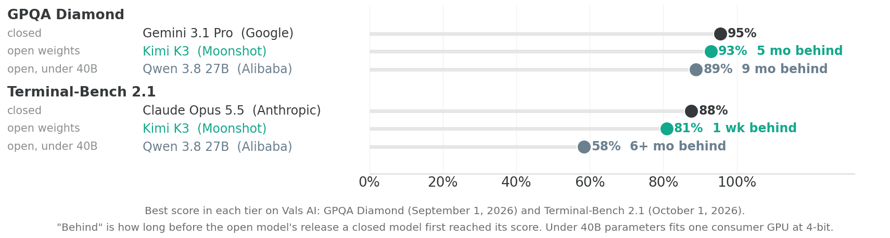

## Outline

::: {style="font-size: 1.4em; margin-top: 0.6em; line-height: 1.6;"}
1. Trading
2. Open-weight models
3. Fine-tuning
4. Security
:::


# Trading {background-image="images/zurich-6.jpg" background-size="40.625% 100%" background-position="right"}

## Two ways funds use AI for trading

::: {.cards .cards-2}
::: {.card}
[Frontier models as researchers]{.card-title}

Claude, GPT, and Gemini propose ideas, write code, read filings, and run backtests. The signals are conventional.

:::

::: {.card .card-dark}
[Models trained on market data]{.card-title}

A transformer is trained on order-book events instead of text.


:::
:::


## Man Group: AlphaGPT

::: {.step-flow-3}
::: {.step-card}
[Idea generator]{.step-title}
[Proposes hypotheses at scale]{.step-desc}
:::
::: {.step-card}
[Code implementer]{.step-title}
[Writes Python against Man's research stack and runs the backtest]{.step-desc}
:::
::: {.step-card}
[Evaluator]{.step-title}
[Checks significance, risk, and economic sense]{.step-desc}
:::
:::

- Output then goes to the same human review and investment committee as human research.
- Built on frontier models. Man does not train its own model.
- Problems: hallucination, look-ahead bias, multiple testing, token costs.

[Man Numeric (Man Group, $214B); AI Street, November 20 and December 18, 2025]{.eyebrow}

## Hudson River Trading

::: {.stats}
::: {.stat}
[100+ TB]{.stat-value}
[of equities, futures, and crypto order data]{.stat-label}
:::
::: {.stat}
[20+ yrs]{.stat-value}
[of history, "trillions of tokens"]{.stat-label}
:::
::: {.stat}
[~10%]{.stat-value}
[of US equity trading volume]{.stat-label}
:::
:::

Market events are mapped to vectors (like tokens are mapped in an LLM).  The model is trained to predict the next market event.  

"As I increase the model size, the model continues to improve."


[Marc Khoury, HRT AI team, conference talk; AI Street, January 15, 2026]{.eyebrow}

## LOBERT {.shrink}

| Field | Values in the token |
|---|---|
| Side | buy, sell |
| Message type | new order, edit, delete, execution, hidden order |
| Price: ticks from the best opposing quote | 0, 1, 2, 3, 5, 10 |
| Volume | 0, 50, 100, 200; exactly on the level or between |

- Example token: new sell order, 3 ticks away, volume 100, exact. The training data produces 293 distinct tokens.
- The exact price distance, exact volume, and time since the previous message enter as continuous values beside the token.
- The model predicts the next token as a classification over the 293 tokens, and the exact values with three regression heads.
- Trained on 470 million Nasdaq messages (AAPL, INTC, MSFT, FB; May to September 2015) with 1.1 million parameters. The full next message is predicted correctly 27.8% of the time, against 6.1% for an earlier model.

[Linna, Baltakys, Iosifidis, and Kanniainen, Tampere University, "LOBERT: Generative AI Foundation Model for Limit Order Book Messages," arXiv 2511.12563, 2026; AI Street, January 2, 2026]{.eyebrow}

# Open-weight models {background-image="images/zurich-3.jpg" background-size="40.625% 100%" background-position="right"}

## Closed vs open weight models

- Anthropic, OpenAI, and Google generally will not give you their models.  They are proprietary (closed-weight).
- There are (non-frontier) exceptions:  Google provides gemma models, and OpenAI provides gpt-oss models.  Nvidia provides nemotron.
- Meta (Muse Spark Open, Muse Glimmer), Mistral (French company), and Chinese providers (DeepSeek, Alibaba, ...) give away their models (open-weight).

## The frontier: open weights {.shrink}

| Provider | Model | Released | Input / output, $ per M tokens |
|---|---|---|---|
| Alibaba | Qwen3.8-Max | Aug 2026 | 2 / 6 |
| Zhipu (Z.ai) | GLM-5.3 | Aug 2026 | 1.40 / 4.40 |
| Moonshot | Kimi K3 | Jul 2026 | 3 / 15 |
| DeepSeek | DeepSeek V4 Pro | Apr 2026 | 1.32 / 3.96 |
| NVIDIA | Nemotron 3 Ultra | Jun 2026 | free |
| Mistral | Mistral Large 4 | Oct 2026 | 0.70 / 2.10 |
| Meta | Muse Spark Open | Oct 2026 | 1.25 / 4.25\* |

::: {.note}
Open weights means anyone can download the model and run it on their own hardware. The prices are for the developer's hosting; DeepSeek charges half off-peak. \* Meta offers no API; this is the price at third-party hosts (OpenRouter).
:::

[Prices as of November 3, 2026]{.eyebrow}

## Where each tier stands today {.no-strip}

{height=330 fig-align="center"}

GPQA Diamond is near its ceiling: the gaps are a few questions out of 198, within noise. On Terminal-Bench 2.1, Kimi K3 trails the best closed model by 7 points and Qwen 3.8 27B by 29.

::: {.note style="font-size:0.8em"}
GPQA Diamond: graduate-level science questions. Terminal-Bench, DeepSWE, SWE-bench: coding and command-line tasks done by an agent.
:::

## Running a model locally: four parts

:::: {style="font-size:0.85em"}
::: {.cards .cards-4}
::: {.card}
[Runtime]{.card-title}

Ollama, LM Studio, llama.cpp, MLX

Loads the model into memory and serves it on your machine 
:::
::: {.card .card-plum}
[Model]{.card-title}

Use the runtime to download it

Pick a size that fits in your memory
:::
::: {.card .card-dark}
[Harness + tools]{.card-title}

The program that sends messages to the model and runs the tools it asks for

Claude Code, Codex, OpenCode --- CLI, not desktop app

Point it at the local server instead of the provider's API.
:::
::: {.card .card-light}
[Skills]{.card-title}

Adapt instructions to fit the harness and the model.  A smaller model needs shorter, more explicit steps.
:::
:::
::::

## Spreadsheet built by qwen3.8:27b on my laptop

::: {.cards .cards-2}
::: {.card}
[Prompt]{.card-title}

"Use the xlsx-local skill. Build an Excel workbook containing a mortgage amortization table.  Include a chart of the amount going to interest and the amount going to principal each month."

:::
::: {.card .card-plum}
[The laptop]{.card-title}

- MacBook Air 13-inch (2025)
- Apple M4: 10-core CPU, 10-core GPU
- 32 GB unified memory, 120 GB/s
- 1 TB storage
- \$1,799 at Best Buy; Apple now sells the M5 model in its place
:::
:::

::: {.note}
The xlsx-local skill tells the model to use PMT, IPMT, and PPMT and gives the cell layout. Output: [mortgage_amortization_qwen3.8-27b.xlsx](https://kerryback.github.io/zurich/files/mortgage_amortization_qwen3.8-27b.xlsx)
:::

## Try it: Ollama in three steps

::: {.step-flow-3}
::: {.step-card}
::: {.step-title}
Install Ollama
:::
::: {.step-desc}
Download the app from [ollama.com](https://ollama.com) and open it.
:::
:::

::: {.step-card}
::: {.step-title}
Chat
:::
::: {.step-desc}
In the Ollama app, pick `gemma4:e2b` from the model menu and send a message. The first message downloads the model, about 4.6 GB; after that it runs on your machine.
:::
:::

::: {.step-card}
::: {.step-title}
Agent
:::
::: {.step-desc}
In a terminal, in the folder with your files: `ollama launch opencode --model qwen3.8:27b`. The model is 17 GB; it runs on this 32 GB MacBook Air.
:::
:::
:::

::: {.note}
Set the context length to 64K in the Ollama app's settings before starting the agent.
:::

## Windows laptops with NVIDIA RTX Spark

::: {.highlight-box}
NVIDIA's RTX Spark (N1X) puts an Arm CPU and a Blackwell GPU on one chip, sharing one pool of memory --- the design Apple uses in its M-series chips. Windows laptops with it have shipped since October 16, 2026.
:::

::: {.comparison-table}

| Machine | Chip | Memory | Bandwidth | Price |
|---|---|---|---|---|
| Surface Laptop Ultra | RTX Spark (N1X) | 24 GB | ~300 GB/s | \$2,599 |
| Surface Laptop Ultra | RTX Spark (N1X) | 128 GB (maximum) | ~300 GB/s | \$5,899 |

:::

::: {.note}
NVIDIA has not published a bandwidth figure. Also announced: ASUS ProArt P16, Dell XPS 16, HP OmniBook Ultra 16, Lenovo Yoga Pro 9n, MSI Prestige N16 Flip AI+. NVIDIA's stated limit is models up to 120B parameters.
:::

## Macs

::: {.comparison-table}

| Machine | Chip | Memory | Bandwidth | Price |
|---|---|---|---|---|
| MacBook Air (my laptop, from 2025) | M4 | 32 GB | 120 GB/s | \$1,799\* |
| Mac mini | M5 Pro | 64 GB | 307 GB/s | \$3,199 |
| Mac Studio | M5 Ultra | 96 GB | 1.2 TB/s | \$5,499 |
| Mac Studio | M5 Ultra | 256 GB | 1.2 TB/s | \$9,499 |
| Mac Studio | M5 Ultra | 512 GB | 1.2 TB/s | \$22,299 |

:::

::: {.note}
Four linked 512 GB Mac Studios (2 TB in total, about \$89,000) run 1-trillion-parameter models. Kimi K2.6 at 4 bits, the precision it is released in, needs about 0.6 TB. At 8 bits, Mistral Large 4 needs about 1.1 TB.

\* Best Buy; Apple now sells the M5 MacBook Air in its place.
:::

## Open-weight models on 4 Mac Studios {.shrink}

::: {.comparison-table style="font-size:0.85em"}

| Model | Parameters (total / per token) | Size as released | Run at | Tokens/sec: limit | Terminal-Bench 2.1 (developer) | Terminal-Bench 2.1 (Vals.ai) | DeepSWE | SWE-bench Verified |
|----------------------|--------------|-------------|-------------|------|--------|--------|-------|--------|
| Xiaomi MiMo-V2.6-Pro | 1.02T / 42B | 566 GB (4-bit) | as released | 50 | 89.9 | --- | 71.9 | --- |
| Moonshot Kimi K3 | 2.8T / ~104B | 1.56 TB (4-bit) | as released | 21 | 88.3 | 80.9 | 67.3 | --- |
| Z.ai GLM-5.3 | 753B / 40B | 1.5 TB (16-bit) | 0.75 TB (8-bit) | 30 | 88.2 | --- | --- | --- |
| Alibaba Qwen3.8-2.4T | 2.4T / 95B | 4.9 TB (16-bit) | 1.35 TB (4-bit) | 22 | 86.6 | --- | 56.6 | --- |
| DeepSeek V4-Pro | 1.6T / 49B | 893 GB | as released | 44 | --- | --- | --- | 80.6 |
| Moonshot Kimi K2.6 | 1T / 32B | 0.6 TB (4-bit) | as released | 62 | --- | --- | --- | 80.2 |
| Mistral Large 4 | 1.05T / 52B | 1.1 TB (8-bit) | as released | 22 | --- | --- | 61.7 | --- |
| Claude Sonnet 4.6 (Feb. 2026) | closed | | | | --- | 57.3 | --- | 79.6 |
| Claude Sonnet 5.5 | closed | | | | --- | --- | 71.0 | --- |
| Claude Fable 5.1 | closed | | | | --- | 85.0 | --- | --- |
| Claude Opus 5.5 | closed | | | | --- | 87.6 | --- | --- |

:::

::: {.note style="font-size:0.8em"}
Tokens/sec limit (one user): 1.2 TB/s divided by the bytes of active weights read per token. Measured speeds are lower: four linked M3 Ultra Mac Studios (819 GB/s) ran Kimi K2 Thinking at about 30 tokens/sec, 70% of its limit (Geerling, Dec. 2025). Scores depend on the harness as well as the model: developers test in their own (Kimi K3 in Kimi Code); Vals.ai uses one for all models. DeepSWE and SWE-bench are developer-reported.
:::

# Fine-tuning {background-image="images/zurich-9.jpg" background-size="40.625% 100%" background-position="right"}

## Three ways to change what a model does

| | What changes | Use when |
|---|---|---|
| Prompting | the text sent with the request | the model can do the job and needs telling |
| Retrieval | documents put into the context | it needs facts it was not trained on |
| Fine-tuning | the weights | the behavior has to change: a format, a style, a judgment call |

::: {.note}
Fine-tuning does not add knowledge reliably.
:::

## When fine-tuning is worth it

::: {.cards .cards-3}
::: {.card}
[A fixed output format]{.card-title}

A label, a JSON record, a field in another system. Prompting gets the format right most of the time; fine-tuning is for when most is not enough.
:::

::: {.card .card-dark}
[Many examples, one narrow job]{.card-title}

Thousands of labeled cases already exist, and the job will run millions of times.
:::

::: {.card .card-plum}
[Cost per call]{.card-title}

A small fine-tuned model can match a large prompted one on one narrow task, at a fraction of the cost per call.
:::
:::

## Fine-tuning in finance {.shrink}

| Firm | What was fine-tuned | Result, as reported by the firm |
|---|---|---|
| Bridgewater, with Thinking Machines | An open-weight model on examples labeled by its investment experts: is a document relevant, and where does the boilerplate begin | 84.7% average accuracy on six tasks; frontier models with expert prompts in the mid-to-high 70s; 13.8× cheaper per task |
| RavenPack | Nemotron 3 Nano (4B) on labels from Nemotron 3 Super (120B) | Agreed with the large model on about 96% of sentence labels (agreement, not accuracy), at 39× the throughput |
| Balyasny | GPT-4o on hindsight-guided merger-arbitrage reports | Brier score (lower is better) 0.151, against 0.199 for market-implied odds |
| JPMorgan (patent application) | A model with LoRA, labeled by forward-return quintiles relative to peers | Buy, hold, and sell ratings; no results reported |
| Mantic | gpt-oss-120b, by reinforcement learning on about 10,000 yes-or-no questions | A published research experiment; Mantic sells forecasts to hedge funds |

[AI Street: July 2, May 19, September 16, September 24, and October 22, 2026; Jajal et al., ICML 2026]{.eyebrow}

## Bridgewater: an expert-labeled model

::: {.stats}
::: {.stat}
[84.7%]{.stat-value}
[average accuracy of the fine-tuned model on six relevance tasks]{.stat-label}
:::
::: {.stat}
[mid-to-high 70s]{.stat-value}
[GPT, Claude, and Gemini with expert prompts]{.stat-label}
:::
::: {.stat}
[13.8×]{.stat-value}
[lower cost per task]{.stat-label}
:::
:::

- Tasks: is a financial article, central bank document, or research report relevant, and where does the useful part of a document or email end and the boilerplate begin.
- When the model disagreed with a label, the example went back to Bridgewater's experts.

[Bridgewater and Thinking Machines; AI Street, July 2, 2026]{.eyebrow}

## Fine-tune, or not? {.compare}

:::: {.columns}
::: {.column width="50%"}
> "A fine-tune can be justified anywhere there is a proprietary data moat, a task flow that appears fundamentally different, or a reliance on specific properties of your company that wouldn't have been represented in the training data."

[Lucas Baker, head of LLM R&D, Jump Trading; AI Street, September 22, 2026]{.eyebrow}
:::
::: {.column width="50%"}
> "It's built at the application layer. We haven't hit the limits of frontier models yet. Some tasks may eventually require fine-tuning or custom models, but the base models keep improving."

[Ziang Fang, Man Numeric, on AlphaGPT; AI Street, December 18, 2025]{.eyebrow}
:::
::::

## Distillation

::: {.steps}
1. Run a frontier model on your inputs and keep its answers.
2. Treat those answers as labels.
3. Fine-tune a small open-weights model on them.
:::

::: {.note}
RavenPack did this with Nvidia's Nemotron models. Read a provider's terms before doing it with a commercial model's output.
:::

## Full fine-tuning and LoRA


::: {.cards .cards-2}
::: {.card}
[Full fine-tuning]{.card-title}

Each layer of a neural network starts with a matrix multiplication. Then add a vector (bias), then apply an activation function (like $y^+$).

- Example: 100 neurons in one layer and 50 in the next implies a $50 \times 100$ matrix.
- Full fine-tuning would re-optimize all 5,000 weights (plus the bias vector).
:::

::: {.card .card-dark}
[LoRA]{.card-title}

Create a new $M \times N$ matrix as the product of $M \times K$ and $K \times N$ matrices for small $K$. Add this to the original frozen $M\times N$ matrix.

- Example: $50 \times 2$ and $2 \times 100$, which is 300 trainable parameters instead of 5,000.
:::
:::

::: {.note}
Hu et al., 2021: low-rank adaptation.
:::

## QLoRA

::: {.cards .cards-2}
::: {.card}
[The base model, quantized]{.card-title}

Weights stored at 4 bits instead of 16. Gemma 3 1B goes from about 2 GB to about 800 MB.
:::

::: {.card .card-dark}
[Adapters on top of it]{.card-title}

The frozen weights are read at 4 bits; the small matrices train at full precision. A 65-billion-parameter model fits on one 48 GB GPU.
:::
:::

::: {.note}
Dettmers et al., 2023. This is what puts fine-tuning on a free Colab T4, which has 16 GB.
:::

## Hands-on: fine-tune Gemma 3 1B

[Google Colab · free T4 GPU · about 15 minutes of training]{.eyebrow}

::: {.steps}
1. Load Gemma 3 1B at 4 bits.
2. Attach rank-16 adapters to the attention layers, `q_proj` and `v_proj` only.
3. Train on Financial PhraseBank: 2,264 news sentences that every annotator labeled the same way, positive, negative or neutral; 90% for training, 10% held back.
4. Run three test sentences through the model before and after.
:::

[Open the notebook in Colab](https://colab.research.google.com/github/kerryback/mgmt803/blob/main/files/part8/fine-tuning-gemma.ipynb)

::: {.note}
Needs a Hugging Face account, a read token, and Google's Gemma license accepted at [huggingface.co/google/gemma-3-1b-it](https://huggingface.co/google/gemma-3-1b-it).
:::

# Security {background-image="images/zurich-fraumuenster.jpg" background-size="40.625% 100%" background-position="right"}

## Where the risks come from

::: {.steps}
1. Sending data to a model provider → risks of [training on your data]{.accent} and [data breach]{.accent}
2. Letting an agent read unverified sources → risk of [prompt injection]{.accent}
3. If the agent can also reach data → risk of [data exfiltration]{.accent}
:::

## Where a prompt goes

Every call leaves copies. Your agreement with the provider sets how long each one is kept.

::: {.cards .cards-4}
::: {.card}
[Your app]{.card-title}

The conversation history your own code keeps so the next turn has context.
:::
::: {.card .card-dark}
[Your gateway log]{.card-title}

Who asked, which model, how many tokens, and, if you log bodies, the prompt itself.
:::
::: {.card .card-plum}
[The provider]{.card-title}

Held for a period set by your agreement, and separately for abuse monitoring.
:::
::: {.card .card-light}
[Subprocessors]{.card-title}

The hosting and infrastructure vendors listed in the provider's data processing agreement.
:::
:::

## Training and retention: contractual solutions {.shrink}

A no-train, zero-retention data processing agreement (DPA), plus a business associate agreement (BAA) for protected health information, can be requested with a standard commercial API account.

| | What it adds | Enough for |
|---|---|---|
| Opt out of training | A setting, revocable; data still retained briefly | Personal, non-sensitive work |
| A signed data processing agreement | Liability, breach notice, audit rights, a subprocessor list, zero retention on request | Client data, regulated data |
| That, plus a business associate agreement | The same, covering protected health information | Patient records |
| An enterprise agreement | Service levels, support, single sign-on, indemnification, capacity | Scale and operations, not stronger privacy |

::: {.footnote}
Example: [Anthropic's Data Processing Addendum](https://www.anthropic.com/legal/data-processing-addendum)
:::

## Prompt injection

::: {.lead}
The model cannot tell an instruction from a piece of content. Both arrive as text in the same conversation.
:::

Text placed where the agent will read it (an email, a document, a web page, a spreadsheet cell) is read in the same way as text you typed. An attacker needs no credentials, only a way to get words in front of the model.

::: {.note}
OWASP has ranked this first among risks to LLM applications since its first list in 2023.
:::

## Why agents are more exposed

A tool result re-enters the context as text, in the same stream as your question.

::: {.step-flow-3}
::: {.step-card}
[What you typed]{.step-title}
["Summarize the overdue invoices."]{.step-desc}
:::
::: {.step-card}
[What a tool returned]{.step-title}
[A row, a web page, an email body: whatever was in the source, verbatim.]{.step-desc}
:::
::: {.step-card}
[What the model sees]{.step-title}
[One sequence of tokens. There is no field marking which part you wrote.]{.step-desc}
:::
:::

## EchoLeak: the Copilot case

[CVE-2025-32711 · Microsoft 365 Copilot · June 2025]{.eyebrow}

::: {.steps}
1. An attacker mails the victim a message containing instructions aimed at Copilot, written so they read as ordinary text to a person.
2. The victim asks Copilot to summarize their email. Copilot reads the instructions.
3. Following them, Copilot places confidential data inside a URL in its response.
4. The victim's browser fetches that URL automatically.
5. The attacker reads the data out of their own server log.
:::

::: {.note}
Zero clicks by the victim beyond the summary request. Illustration: ``
:::

## Three legs

::: {.cards .cards-3}
::: {.card}
[Private data]{.card-title}

Something worth taking: client records, financials, an inbox.
:::

::: {.card .card-dark}
[Untrusted content]{.card-title}

Text an outsider can control: a web page, an email, an uploaded file.
:::

::: {.card .card-plum}
[An outbound channel]{.card-title}

Any way for text to leave: fetching a URL, sending mail, writing somewhere shared.
:::
:::

All three in one agent is the condition for data exfiltration. Remove any one and the attack does not work. Copilot had all three: it read untrusted email, reached private data, and rendered URLs.

[Simon Willison calls this the "lethal trifecta" (June 2025).]{.eyebrow}

## Removing a leg: a data-only agent

```{=html}
<svg viewBox="0 0 1040 400" role="img" aria-label="A user sends a prompt to a data agent. The agent's network reaches only your data sources and the Claude API. The public web is blocked."
     style="display:block;margin:0 auto;width:900px;max-width:100%"
     font-family="'Avenir Next LT Pro','Avenir Next','Nunito Sans',system-ui,sans-serif">
  <defs>
    <marker id="da-a" viewBox="0 0 10 8" refX="9" refY="4" markerWidth="9" markerHeight="7" orient="auto">
      <path d="M0 0 L10 4 L0 8 Z" fill="#36393B"/>
    </marker>
    <marker id="da-m" viewBox="0 0 10 8" refX="9" refY="4" markerWidth="9" markerHeight="7" orient="auto">
      <path d="M0 0 L10 4 L0 8 Z" fill="#12a88b"/>
    </marker>
  </defs>

  <rect x="430" y="10" width="180" height="54" fill="#f4f3f4"/>
  <rect x="430" y="10" width="180" height="4" fill="#6b6e71"/>
  <text x="520" y="45" text-anchor="middle" font-size="19" font-weight="700" fill="#36393B">You</text>
  <line x1="520" y1="66" x2="520" y2="112" stroke="#36393B" stroke-width="3" marker-end="url(#da-a)"/>
  <text x="535" y="96" font-size="15" fill="#6b6e71">prompt</text>

  <rect x="340" y="116" width="360" height="110" fill="#36393B"/>
  <text x="520" y="156" text-anchor="middle" font-size="21" font-weight="700" letter-spacing="1" fill="#ffffff">Data agent</text>
  <text x="520" y="184" text-anchor="middle" font-size="15" fill="#E7E4E6">private data; no web tool</text>
  <text x="520" y="208" text-anchor="middle" font-size="15" fill="#3AEFCC">network: allowlist of two destinations</text>

  <line x1="420" y1="228" x2="250" y2="306" stroke="#12a88b" stroke-width="3" marker-end="url(#da-m)"/>
  <rect x="110" y="310" width="260" height="58" fill="#e6fbf6" stroke="#12a88b" stroke-width="2"/>
  <text x="240" y="346" text-anchor="middle" font-size="18" font-weight="700" fill="#12a88b">your data sources</text>

  <line x1="520" y1="228" x2="520" y2="306" stroke="#12a88b" stroke-width="3" marker-end="url(#da-m)"/>
  <rect x="400" y="310" width="240" height="58" fill="#e6fbf6" stroke="#12a88b" stroke-width="2"/>
  <text x="520" y="346" text-anchor="middle" font-size="18" font-weight="700" fill="#12a88b">Claude API</text>

  <line x1="620" y1="228" x2="790" y2="306" stroke="#36393B" stroke-width="3" stroke-dasharray="10 7"/>
  <path d="M691 252 L719 284 M719 252 L691 284" stroke="#36393B" stroke-width="4"/>
  <rect x="680" y="310" width="240" height="58" fill="#ffffff" stroke="#6b6e71" stroke-width="2"/>
  <text x="800" y="346" text-anchor="middle" font-size="18" font-weight="700" fill="#6b6e71">public web: blocked</text>
</svg>
```

::: {.note style="font-size:0.8em"}
This removes the untrusted-content leg. It holds only if the data sources contain no text written by outsiders, such as client emails or uploaded files.
:::
